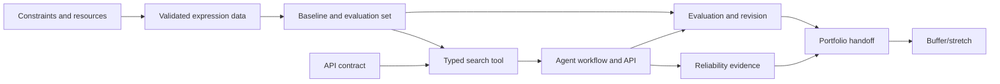
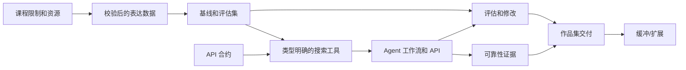
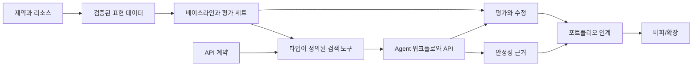

# Three-Week Project Roadmap — AI English Speaking Phrase Agent

> **Status:** Proposed schedule. English version first; Chinese and Korean versions follow. This file is the execution plan only. `design.md` is the source of truth for product scope, system behavior, technical choices, acceptance criteria, and interview coverage.

## Planning assumptions

- Three calendar weeks, planned as 15 working days.
- One project owner, with an estimated 10–15 focused hours per week.
- The project owner will resolve course constraints and access questions in the judgment section at the end.
- If time is shorter, reduce dataset size and polish before reducing the evaluation and reliability work defined in `design.md`.

## Progress board

Update status as work proceeds: `Not started`, `In progress`, `Blocked`, or `Done`.

| ID | Sub-goal | Planned window | Depends on | Status |
|---|---|---:|---|---|
| S0 | Confirm course constraints and available resources | Week 1, Day 1 | — | Not started |
| S1 | Prepare and validate the expression data | Week 1, Days 2–3 | S0 | Not started |
| S2 | Produce the search baseline and labeled evaluation set | Week 1, Days 4–5 | S1 | Not started |
| S3 | Freeze the request/response contract | Week 2, Day 1 | S0, design decisions | Not started |
| S4 | Make the search tool callable and observable | Week 2, Days 2–3 | S2, S3 | Not started |
| S5 | Integrate the bounded Agent workflow | Week 2, Days 4–5 | S4 | Not started |
| S6 | Run evaluation and make evidence-based revisions | Week 3, Days 1–2 | S2, S5 | Not started |
| S7 | Finish reliability and trace evidence | Week 3, Day 3 | S5 | Not started |
| S8 | Prepare portfolio documentation and walkthrough | Week 3, Day 4 | S6, S7 | Not started |
| S9 | Buffer or one stretch goal | Week 3, Day 5 | P0 work complete | Not started |

## Week 1 — Prepare evidence and baseline

### S0 — Confirm constraints and resources (Day 1)

**Tasks**

1. Resolve course framework, database, model, and submission requirements.
2. Confirm weekly availability and whether the work is individual or shared.
3. Confirm which datasets, APIs, and credentials are available and permitted.
4. Record decisions in the appropriate sections of `design.md` and this roadmap.

**Deliverable:** a short constraints/resource record and an agreed schedule.

**Done when:** no known course or access constraint blocks the next sub-goals.

### S1 — Prepare and validate expression data (Days 2–3)

**Tasks**

1. Prepare a starter dataset that follows the fields and source rules in `design.md`.
2. Check required fields, duplicates, encoding, and provenance.
3. Save a repeatable import artifact and record its version.

**Deliverable:** validated, versioned expression data and an import record.

**Done when:** the data can be imported and each entry has the required source information.

### S2 — Produce retrieval baseline and evaluation set (Days 4–5)

**Tasks**

1. Implement the simplest permitted search baseline.
2. Build the labeled query set using the coverage and size proposed in `design.md`.
3. Calculate the initial retrieval metrics and preserve the run configuration.
4. Record baseline failures for later comparison.

**Deliverable:** baseline result file, evaluation set, and short measurement note.

**Done when:** the same versioned run can be repeated and produces comparable results.

## Week 2 — Make the Agent callable

### S3 — Freeze the API contract (Day 1)

**Tasks**

1. Finalize the request and response models described in `design.md`.
2. Agree on validation and error shapes.
3. Add representative request/response examples to the API notes.

**Deliverable:** a versioned API contract.

**Done when:** normal, ambiguous, no-match, and invalid requests have defined outcomes.

### S4 — Wrap retrieval as a typed tool (Days 2–3)

**Tasks**

1. Expose the search baseline through the narrow read-only tool in `design.md`.
2. Validate tool arguments and returned record identifiers.
3. Preserve enough inputs and outputs to explain a search result.

**Deliverable:** a callable search tool with a sample trace.

**Done when:** valid calls return traceable records and invalid calls fail clearly.

### S5 — Integrate the bounded Agent workflow (Days 4–5)

**Tasks**

1. Connect request interpretation, the search tool, and structured response handling.
2. Implement the answer, clarification, and no-match paths from `design.md`.
3. Enforce the step/retry limits selected for the project.
4. Expose the flow through the planned Python API.

**Deliverable:** a locally callable end-to-end API flow.

**Done when:** representative inputs can be submitted and each response can be traced to its retrieval evidence or explicit no-match/clarification outcome.

## Week 3 — Evaluate and package the work

### S6 — Evaluate and revise (Days 1–2)

**Tasks**

1. Run baseline and Agent evaluation on the same versioned query set.
2. Inspect low-ranked, ambiguous, and no-match examples.
3. Make only changes supported by observed failures.
4. Rerun the same evaluation and record results and limitations.

**Deliverable:** comparable results before and after revisions, plus a brief failure analysis.

**Done when:** a reviewer can reproduce the comparison and see what changed.

### S7 — Complete reliability and trace evidence (Day 3)

**Tasks**

1. Verify bounded retries, timeouts, and failure responses.
2. Capture enough trace fields to locate a failure in interpretation, retrieval, or response construction.
3. Review logs for secrets or unnecessary learner content.

**Deliverable:** representative success and failure traces with documented fallback behavior.

**Done when:** the project owner can explain how a failed result is diagnosed and contained.

### S8 — Prepare the portfolio handoff (Day 4)

**Tasks**

1. Ensure setup and API instructions match the current implementation.
2. Prepare a short walkthrough connecting design choices to measured behavior.
3. Include data provenance, evaluation results, known limits, and future work.

**Deliverable:** reviewer-ready project documentation and a demo script.

**Done when:** a reviewer can understand and invoke the core API without a full front end.

### S9 — Buffer or one stretch goal (Day 5)

First close any incomplete item that blocks the completion criteria in `design.md`. If all core items are complete, select at most one stretch goal: API deployment, save-expression persistence, or a minimal browser interface. A full front end stays last priority.

**Deliverable:** closed P0 gaps or one clearly bounded extension.

## Dependency flow

## Status update format

When work begins, update the progress board and record only the status plus a short note about the latest artifact, blocker, or decision. Keep product and technical definitions in `design.md` so this roadmap remains an execution tracker.

## Project Owner Judgment Questions

1. **Course constraints:** A) the course specifies tools/frameworks; B) choices are open; C) not sure yet.
2. **Available time:** A) under 10 hours per week; B) 10–15 hours per week; C) over 15 hours per week.
3. **Resources:** A) the course provides data and model access; B) public/licensed data and an API are available; C) a low-cost/offline option is needed.
4. **Team and deadline:** A) individual project, 15 working days; B) team project; C) a different schedule—please state it.

---

# 三周项目进度 — AI 英语口语表达 Agent

> **状态：**拟定进度计划。英文版在前，其后依次为中文版和韩文版。本文件只负责执行进度；产品范围、系统行为、技术选择、验收标准和面试能力映射以 `design.md` 为准。

## 计划假设

- 三个自然周，按 15 个工作日规划。
- 由一名项目负责人完成，每周预计投入 10–15 小时。
- 项目负责人将在文档末尾的判断题中确认课程限制和资源情况。
- 如果可投入时间少于计划，应先缩小数据集和打磨范围，再考虑减少 `design.md` 定义的评估和可靠性工作。

## 进度看板

推进过程中更新状态：`未开始`、`进行中`、`受阻`或`完成`。

| 编号 | 子目标 | 计划时间 | 依赖 | 状态 |
|---|---|---:|---|---|
| S0 | 确认课程限制和可用资源 | 第 1 周，第 1 天 | — | 未开始 |
| S1 | 准备并校验表达数据 | 第 1 周，第 2–3 天 | S0 | 未开始 |
| S2 | 产出搜索基线和标注评估集 | 第 1 周，第 4–5 天 | S1 | 未开始 |
| S3 | 确定请求/响应合约 | 第 2 周，第 1 天 | S0、设计决策 | 未开始 |
| S4 | 让搜索工具可调用、可观察 | 第 2 周，第 2–3 天 | S2、S3 | 未开始 |
| S5 | 集成有限定的 Agent 工作流 | 第 2 周，第 4–5 天 | S4 | 未开始 |
| S6 | 运行评估并根据证据修改 | 第 3 周，第 1–2 天 | S2、S5 | 未开始 |
| S7 | 完成可靠性和追踪证据 | 第 3 周，第 3 天 | S5 | 未开始 |
| S8 | 准备作品集文档和讲解 | 第 3 周，第 4 天 | S6、S7 | 未开始 |
| S9 | 缓冲时间或一项扩展任务 | 第 3 周，第 5 天 | P0 工作已完成 | 未开始 |

## 第一周 — 准备证据和基线

### S0 — 确认限制和资源（第 1 天）

**任务**

1. 确认课程对框架、数据库、模型和提交形式的要求。
2. 确认每周可投入时间，以及项目由个人完成还是团队协作。
3. 确认可用且允许使用的数据集、API 和凭证。
4. 在 `design.md` 和本进度计划相应部分记录决定。

**交付物：**简短的限制/资源记录和确认后的进度安排。

**完成条件：**没有已知的课程规则或权限问题会阻碍后续子目标。

### S1 — 准备并校验表达数据（第 2–3 天）

**任务**

1. 按照 `design.md` 中的字段和来源规则准备初始数据集。
2. 检查必填字段、重复项、编码和来源信息。
3. 保存可重复使用的导入材料，并记录版本。

**交付物：**校验通过、有版本记录的表达数据及导入记录。

**完成条件：**数据可以导入，每条记录都有所需的来源信息。

### S2 — 产出检索基线和评估集（第 4–5 天）

**任务**

1. 实现课程允许的最简单搜索基线。
2. 按 `design.md` 建议的覆盖范围和规模构建标注查询集。
3. 计算初始检索指标并保存运行配置。
4. 记录基线的失败案例，供后续比较。

**交付物：**基线结果文件、评估集和简短测量说明。

**完成条件：**可以重复运行同一版本并得到可比较的结果。

## 第二周 — 让 Agent 可调用

### S3 — 确定 API 合约（第 1 天）

**任务**

1. 定稿 `design.md` 描述的请求和响应模型。
2. 确定输入校验和错误结构。
3. 在 API 说明中添加有代表性的请求/响应示例。

**交付物：**有版本记录的 API 合约。

**完成条件：**普通、含糊、无匹配和无效请求都有明确处理结果。

### S4 — 将检索包装成类型明确的工具（第 2–3 天）

**任务**

1. 按 `design.md` 将搜索基线暴露为职责明确的只读工具。
2. 校验工具参数和返回记录的标识符。
3. 保留足够的输入/输出信息，以便解释搜索结果。

**交付物：**可调用的搜索工具及示例追踪记录。

**完成条件：**有效调用返回可追溯记录，无效调用会明确失败。

### S5 — 集成有限定的 Agent 工作流（第 4–5 天）

**任务**

1. 串联请求理解、搜索工具和结构化响应处理。
2. 实现 `design.md` 中定义的回答、澄清和无匹配路径。
3. 执行项目选定的步骤数/重试次数上限。
4. 通过计划中的 Python API 暴露完整流程。

**交付物：**可在本地调用的端到端 API 流程。

**完成条件：**可以提交有代表性的输入；每个响应都能追溯到检索证据，或明确标记为无匹配/澄清结果。

## 第三周 — 评估并整理交付

### S6 — 评估和修改（第 1–2 天）

**任务**

1. 使用同一版本的查询集运行基线和 Agent 评估。
2. 检查排名较低、含义模糊和无匹配的案例。
3. 只进行有观察结果支持的修改。
4. 用相同评估流程重跑，并记录结果和限制。

**交付物：**可比较的修改前后结果和简短失败分析。

**完成条件：**评审者能够重现对比并看出发生了哪些变化。

### S7 — 完成可靠性和追踪证据（第 3 天）

**任务**

1. 检查重试、超时和故障响应是否受控。
2. 记录足够的追踪字段，以便定位意图理解、检索或响应构建中的故障。
3. 检查日志中是否包含密钥或不必要的学习者内容。

**交付物：**有代表性的成功/失败追踪记录和已说明的降级处理。

**完成条件：**项目负责人能够解释如何发现并控制一次失败结果。

### S8 — 准备作品集交付（第 4 天）

**任务**

1. 确保配置和 API 说明与当前实现一致。
2. 准备简短讲解，把设计选择与测量结果联系起来。
3. 补充数据来源、评估结果、已知限制和后续工作。

**交付物：**供评审者阅读的项目文档和演示脚本。

**完成条件：**评审者无需完整前端，就能理解并调用核心 API。

### S9 — 缓冲或一项扩展任务（第 5 天）

先完成任何阻碍 `design.md` 验收标准的未完成事项。核心任务全部完成后，最多选择一项扩展：部署 API、持久化保存表达，或增加简易浏览器界面。完整前端始终排在最后。

**交付物：**关闭 P0 遗留项，或完成一项边界清楚的扩展。

## 依赖流程

## 进度更新格式

开始执行后更新进度看板，只记录状态和有关最新交付物、阻塞项或决策的简短说明。产品和技术定义统一放在 `design.md`，让本文件保持为执行进度表。

## 项目负责人判断题

1. **课程限制：**A) 课程指定工具/框架；B) 可自行选择；C) 目前不确定。
2. **可投入时间：**A) 每周少于 10 小时；B) 每周 10–15 小时；C) 每周超过 15 小时。
3. **资源情况：**A) 课程提供数据和模型访问；B) 可使用公开/许可数据及 API；C) 需要低成本/离线方案。
4. **团队与周期：**A) 个人项目、15 个工作日；B) 团队项目；C) 时间安排不同，请说明。

---

# 3주 프로젝트 로드맵 — AI 영어 말하기 표현 Agent

> **상태:** 제안된 일정. 영어 버전이 먼저, 중국어 버전과 한국어 버전이 차례로 이어집니다. 이 파일은 실행 계획만 다룹니다. 제품 범위, 시스템 동작, 기술 선택, 검수 기준, 면접 대응 범위는 `design.md`를 기준으로 합니다.

## 계획 전제

- 달력 기준 3주, 15 근무일로 계획합니다.
- 프로젝트 책임자 1명이 진행하며, 주당 집중 작업 시간은 약 10–15시간으로 예상합니다.
- 프로젝트 책임자는 문서 끝의 판단 질문 섹션에서 수업 제약과 접근 권한 문제를 확정합니다.
- 시간이 부족하면 `design.md`에 정의된 평가 및 안정성 작업을 줄이기 전에 데이터셋 규모와 마무리 작업부터 줄입니다.

## 진행 현황판

작업이 진행되면 상태를 업데이트합니다: `시작 전`, `진행 중`, `막힘`, `완료`.

| ID | 하위 목표 | 계획 기간 | 의존 항목 | 상태 |
|---|---|---:|---|---|
| S0 | 수업 제약과 사용 가능한 리소스 확인 | 1주 차, 1일 차 | — | 시작 전 |
| S1 | 표현 데이터 준비 및 검증 | 1주 차, 2–3일 차 | S0 | 시작 전 |
| S2 | 검색 베이스라인과 레이블된 평가 세트 산출 | 1주 차, 4–5일 차 | S1 | 시작 전 |
| S3 | 요청/응답 계약 확정 | 2주 차, 1일 차 | S0, 설계 결정 | 시작 전 |
| S4 | 검색 도구를 호출 가능하고 관찰 가능하게 만들기 | 2주 차, 2–3일 차 | S2, S3 | 시작 전 |
| S5 | 범위가 제한된 Agent 워크플로 통합 | 2주 차, 4–5일 차 | S4 | 시작 전 |
| S6 | 평가 실행 및 근거 기반 수정 | 3주 차, 1–2일 차 | S2, S5 | 시작 전 |
| S7 | 안정성 및 트레이스 근거 마무리 | 3주 차, 3일 차 | S5 | 시작 전 |
| S8 | 포트폴리오 문서와 시연 설명 준비 | 3주 차, 4일 차 | S6, S7 | 시작 전 |
| S9 | 버퍼 또는 확장 목표 하나 | 3주 차, 5일 차 | P0 작업 완료 | 시작 전 |

## 1주 차 — 근거와 베이스라인 준비

### S0 — 제약과 리소스 확인(1일 차)

**작업**

1. 수업에서 요구하는 프레임워크, 데이터베이스, 모델, 제출 요건을 확정합니다.
2. 주당 가능한 시간과 개인 작업인지 공동 작업인지 확인합니다.
3. 사용 가능하고 허용된 데이터셋, API, 자격 증명을 확인합니다.
4. 결정 사항을 `design.md`와 이 로드맵의 해당 섹션에 기록합니다.

**산출물:** 짧은 제약/리소스 기록과 합의된 일정.

**완료 조건:** 다음 하위 목표를 막는 알려진 수업 제약이나 접근 제약이 없습니다.

### S1 — 표현 데이터 준비 및 검증(2–3일 차)

**작업**

1. `design.md`의 필드와 출처 규칙을 따르는 초기 데이터셋을 준비합니다.
2. 필수 필드, 중복, 인코딩, 출처 정보를 확인합니다.
3. 반복 사용할 수 있는 가져오기 산출물을 저장하고 버전을 기록합니다.

**산출물:** 검증되고 버전이 관리되는 표현 데이터와 가져오기 기록.

**완료 조건:** 데이터를 가져올 수 있고, 모든 항목에 필요한 출처 정보가 있습니다.

### S2 — 검색 베이스라인과 평가 세트 산출(4–5일 차)

**작업**

1. 허용되는 가장 단순한 검색 베이스라인을 구현합니다.
2. `design.md`에서 제안한 범위와 규모로 레이블된 질의 세트를 만듭니다.
3. 초기 검색 지표를 계산하고 실행 설정을 보존합니다.
4. 이후 비교를 위해 베이스라인의 실패 사례를 기록합니다.

**산출물:** 베이스라인 결과 파일, 평가 세트, 짧은 측정 메모.

**완료 조건:** 같은 버전의 실행을 반복할 수 있고 비교 가능한 결과가 나옵니다.

## 2주 차 — Agent를 호출 가능하게 만들기

### S3 — API 계약 확정(1일 차)

**작업**

1. `design.md`에 설명된 요청 및 응답 모델을 확정합니다.
2. 입력 검증과 오류 형식에 합의합니다.
3. API 메모에 대표적인 요청/응답 예시를 추가합니다.

**산출물:** 버전이 관리되는 API 계약.

**완료 조건:** 일반, 모호, 일치 없음, 잘못된 요청 각각에 정의된 결과가 있습니다.

### S4 — 검색을 타입이 정의된 도구로 감싸기(2–3일 차)

**작업**

1. `design.md`에 정의된 좁은 범위의 읽기 전용 도구를 통해 검색 베이스라인을 노출합니다.
2. 도구 인자와 반환된 레코드 식별자를 검증합니다.
3. 검색 결과를 설명할 수 있을 만큼 입력과 출력을 보존합니다.

**산출물:** 호출 가능한 검색 도구와 샘플 트레이스.

**완료 조건:** 유효한 호출은 추적 가능한 레코드를 반환하고, 잘못된 호출은 명확하게 실패합니다.

### S5 — 범위가 제한된 Agent 워크플로 통합(4–5일 차)

**작업**

1. 요청 해석, 검색 도구, 구조화된 응답 처리를 연결합니다.
2. `design.md`에 정의된 답변, 확인 질문, 일치 없음 경로를 구현합니다.
3. 프로젝트에서 정한 단계 수/재시도 제한을 적용합니다.
4. 계획된 Python API로 전체 흐름을 노출합니다.

**산출물:** 로컬에서 호출 가능한 엔드투엔드 API 흐름.

**완료 조건:** 대표적인 입력을 제출할 수 있고, 각 응답을 검색 근거나 명시적인 일치 없음/확인 질문 결과로 추적할 수 있습니다.

## 3주 차 — 평가 및 결과물 정리

### S6 — 평가 및 수정(1–2일 차)

**작업**

1. 같은 버전의 질의 세트로 베이스라인과 Agent 평가를 실행합니다.
2. 순위가 낮은 사례, 모호한 사례, 일치 없음 사례를 살펴봅니다.
3. 관찰된 실패로 뒷받침되는 변경만 합니다.
4. 같은 평가를 다시 실행하고 결과와 한계를 기록합니다.

**산출물:** 수정 전후의 비교 가능한 결과와 간단한 실패 분석.

**완료 조건:** 리뷰어가 비교를 재현하고 무엇이 바뀌었는지 확인할 수 있습니다.

### S7 — 안정성 및 트레이스 근거 마무리(3일 차)

**작업**

1. 재시도 제한, 타임아웃, 장애 응답이 제대로 동작하는지 검증합니다.
2. 의도 해석, 검색, 응답 생성 중 어디에서 장애가 났는지 찾을 수 있을 만큼 트레이스 필드를 수집합니다.
3. 로그에 비밀 정보나 불필요한 학습자 콘텐츠가 있는지 검토합니다.

**산출물:** 대체 동작이 문서화된 대표적인 성공 및 실패 트레이스.

**완료 조건:** 프로젝트 책임자가 실패한 결과를 어떻게 진단하고 영향을 억제하는지 설명할 수 있습니다.

### S8 — 포트폴리오 인계 준비(4일 차)

**작업**

1. 설정 및 API 안내가 현재 구현과 일치하는지 확인합니다.
2. 설계 선택과 측정된 동작을 연결하는 짧은 시연 설명을 준비합니다.
3. 데이터 출처, 평가 결과, 알려진 한계, 향후 작업을 포함합니다.

**산출물:** 리뷰어가 바로 볼 수 있는 프로젝트 문서와 데모 스크립트.

**완료 조건:** 리뷰어가 완전한 프런트엔드 없이도 핵심 API를 이해하고 호출할 수 있습니다.

### S9 — 버퍼 또는 확장 목표 하나(5일 차)

먼저 `design.md`의 완료 기준을 막는 미완료 항목을 마무리합니다. 핵심 항목이 모두 끝났다면 확장 목표를 최대 하나만 고릅니다: API 배포, 표현 저장 영구화, 최소 브라우저 인터페이스. 완전한 프런트엔드는 계속 가장 낮은 우선순위입니다.

**산출물:** 해결된 P0 공백 또는 범위가 명확한 확장 하나.

## 의존 관계 흐름

## 상태 업데이트 형식

작업이 시작되면 진행 현황판을 업데이트하고, 상태와 함께 최신 산출물, 막힌 점, 결정에 대한 짧은 메모만 기록합니다. 제품 및 기술 정의는 `design.md`에 두어 이 로드맵이 실행 추적 문서로 유지되게 합니다.

## 프로젝트 책임자 판단 질문

1. **수업 제약:** A) 수업에서 도구/프레임워크를 지정함; B) 자유롭게 선택 가능; C) 아직 잘 모름.
2. **가능한 시간:** A) 주당 10시간 미만; B) 주당 10–15시간; C) 주당 15시간 초과.
3. **리소스:** A) 수업에서 데이터와 모델 접근을 제공함; B) 공개/라이선스 데이터와 API를 사용할 수 있음; C) 저비용/오프라인 방식이 필요함.
4. **팀과 마감:** A) 개인 프로젝트, 15 근무일; B) 팀 프로젝트; C) 다른 일정 — 직접 적어 주세요.
