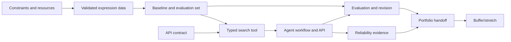
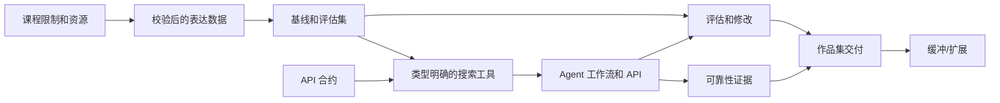
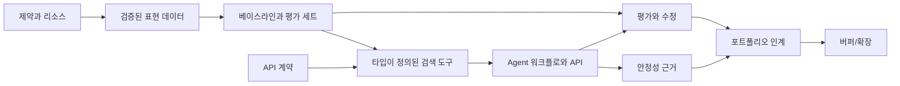

# Three-Week Project Roadmap — AI English Speaking Phrase Agent

> **Status:** Course submitted; the extension work is tracked below (updated 2026-11-22). English version first; Chinese and Korean versions follow. This file is the execution plan only. `design.md` is the source of truth for product scope, system behavior, technical choices, acceptance criteria, and interview coverage.

## Planning assumptions

- Three calendar weeks, planned as 15 working days.
- One project owner, with an estimated 10–15 focused hours per week.
- The project owner will resolve course constraints and access questions in the judgment section at the end.
- If time is shorter, reduce dataset size and polish before reducing the evaluation and reliability work defined in `design.md`.

## Progress board

Update status as work proceeds: `Not started`, `In progress`, `Blocked`, or `Done`.

| ID | Sub-goal | Planned window | Depends on | Status |
|---|---|---:|---|---|
| S0 | Confirm course constraints and available resources | Week 1, Day 1 | — | Not started |
| S1 | Prepare and validate the expression data | Week 1, Days 2–3 | S0 | Not started |
| S2 | Produce the search baseline and labeled evaluation set | Week 1, Days 4–5 | S1 | Not started |
| S3 | Freeze the request/response contract | Week 2, Day 1 | S0, design decisions | Not started |
| S4 | Make the search tool callable and observable | Week 2, Days 2–3 | S2, S3 | Not started |
| S5 | Integrate the bounded Agent workflow | Week 2, Days 4–5 | S4 | Not started |
| S6 | Run evaluation and make evidence-based revisions | Week 3, Days 1–2 | S2, S5 | Not started |
| S7 | Finish reliability and trace evidence | Week 3, Day 3 | S5 | Not started |
| S8 | Prepare portfolio documentation and walkthrough | Week 3, Day 4 | S6, S7 | Not started |
| S9 | Buffer or one stretch goal | Week 3, Day 5 | P0 work complete | Not started |

## Week 1 — Prepare evidence and baseline

### S0 — Confirm constraints and resources (Day 1)

**Tasks**

1. Resolve course framework, database, model, and submission requirements.
2. Confirm weekly availability and whether the work is individual or shared.
3. Confirm which datasets, APIs, and credentials are available and permitted.
4. Record decisions in the appropriate sections of `design.md` and this roadmap.

**Deliverable:** a short constraints/resource record and an agreed schedule.

**Done when:** no known course or access constraint blocks the next sub-goals.

### S1 — Prepare and validate expression data (Days 2–3)

**Tasks**

1. Prepare a starter dataset that follows the fields and source rules in `design.md`.
2. Check required fields, duplicates, encoding, and provenance.
3. Save a repeatable import artifact and record its version.

**Deliverable:** validated, versioned expression data and an import record.

**Done when:** the data can be imported and each entry has the required source information.

### S2 — Produce retrieval baseline and evaluation set (Days 4–5)

**Tasks**

1. Implement the simplest permitted search baseline.
2. Build the labeled query set using the coverage and size proposed in `design.md`.
3. Calculate the initial retrieval metrics and preserve the run configuration.
4. Record baseline failures for later comparison.

**Deliverable:** baseline result file, evaluation set, and short measurement note.

**Done when:** the same versioned run can be repeated and produces comparable results.

## Week 2 — Make the Agent callable

### S3 — Freeze the API contract (Day 1)

**Tasks**

1. Finalize the request and response models described in `design.md`.
2. Agree on validation and error shapes.
3. Add representative request/response examples to the API notes.

**Deliverable:** a versioned API contract.

**Done when:** normal, ambiguous, no-match, and invalid requests have defined outcomes.

### S4 — Wrap retrieval as a typed tool (Days 2–3)

**Tasks**

1. Expose the search baseline through the narrow read-only tool in `design.md`.
2. Validate tool arguments and returned record identifiers.
3. Preserve enough inputs and outputs to explain a search result.

**Deliverable:** a callable search tool with a sample trace.

**Done when:** valid calls return traceable records and invalid calls fail clearly.

### S5 — Integrate the bounded Agent workflow (Days 4–5)

**Tasks**

1. Connect request interpretation, the search tool, and structured response handling.
2. Implement the answer, clarification, and no-match paths from `design.md`.
3. Enforce the step/retry limits selected for the project.
4. Expose the flow through the planned Python API.

**Deliverable:** a locally callable end-to-end API flow.

**Done when:** representative inputs can be submitted and each response can be traced to its retrieval evidence or explicit no-match/clarification outcome.

## Week 3 — Evaluate and package the work

### S6 — Evaluate and revise (Days 1–2)

**Tasks**

1. Run baseline and Agent evaluation on the same versioned query set.
2. Inspect low-ranked, ambiguous, and no-match examples.
3. Make only changes supported by observed failures.
4. Rerun the same evaluation and record results and limitations.

**Deliverable:** comparable results before and after revisions, plus a brief failure analysis.

**Done when:** a reviewer can reproduce the comparison and see what changed.

### S7 — Complete reliability and trace evidence (Day 3)

**Tasks**

1. Verify bounded retries, timeouts, and failure responses.
2. Capture enough trace fields to locate a failure in interpretation, retrieval, or response construction.
3. Review logs for secrets or unnecessary learner content.

**Deliverable:** representative success and failure traces with documented fallback behavior.

**Done when:** the project owner can explain how a failed result is diagnosed and contained.

### S8 — Prepare the portfolio handoff (Day 4)

**Tasks**

1. Ensure setup and API instructions match the current implementation.
2. Prepare a short walkthrough connecting design choices to measured behavior.
3. Include data provenance, evaluation results, known limits, and future work.

**Deliverable:** reviewer-ready project documentation and a demo script.

**Done when:** a reviewer can understand and invoke the core API without a full front end.

### S9 — Buffer or one stretch goal (Day 5)

First close any incomplete item that blocks the completion criteria in `design.md`. If all core items are complete, select at most one stretch goal: API deployment, save-expression persistence, or a minimal browser interface. A full front end stays last priority.

**Deliverable:** closed P0 gaps or one clearly bounded extension.

## Dependency flow

## Status update format

When work begins, update the progress board and record only the status plus a short note about the latest artifact, blocker, or decision. Keep product and technical definitions in `design.md` so this roadmap remains an execution tracker.

### Web and mobile delivery

Done. The web study interface and installed Android app were tested with questions, transcript sources, persistent bookmarks, history and offline access. The local web client received a live ExpressionCoach answer. Build and installation instructions are in `frontend/README.md`.

The teammate's live Vercel deployment is described in `design.md` (Learner clients); our own Vercel project is tracked under P3–P4 below.

All suites passed on 2026-11-22: coach 142, evaluation 126 (5 skipped), frontend 116 (its database tests ran against the local Docker Postgres).

### Staged answers, verified-slot lock and admin page (D1–D6)

Scope, contracts and known gaps are in `design.md` (Learner clients). G6 made the only paid calls ($3.63); every other check used fake models.

| ID | Sub-goal | Depends on | Status | Latest check |
|---|---|---|---|---|
| G1 | Lock the first stage's verified slots in the agent; skip the continuation when every slot is verified | — | Done | Coach and evaluation unit tests pass |
| G2 | Server: `first`/`final` NDJSON on request, JSON by default, mode variables, 280 s deadline, one log line per request | G1 | Done | Server tests pass, including a real uvicorn stream and a client that leaves |
| G3 | Learner app: first results, notice, Podcast tab, return after leaving; the existing chat layout is kept | G2 | Done | Headless browser checks |
| G4 | Admin data generator, `/admin` on the local server and in the Vercel package | — | Done | Admin data, site and package tests pass, with a fake coach |
| G5 | Admin design on real data | G4 | Done | Design B in `frontend/admin/`: four tabs including Mode comparison, Korean, Chinese and English; drawn from sample data on the local server |
| G6 | D6 re-evaluation: baseline and the locked agent, 50 tasks × 3, then grading | G1 | Done | Run `lock-20261122` on 2026-11-22, $3.63; results in `design.md` |
| G7 | Three-language documentation | G1–G5 | Done | `design.md`, `frontend/README.md`, `README.md`, this file |
| G8 | Release: commit, package with the D6 data, rebuild the APK, deploy, then check streaming on Vercel and Android, `/admin`, the log lines, the saved rows, the daily count and the mode switch | G3, G5, G6, G9–G11, G13, L6, A1–A6, P1–P4 | Not started | Needs judgment question 1, G13 and P4 |

**D6 result (2026-11-22):** the lock held (0 requests lost a first-stage verified example; all 93 fully verified requests skipped the continuation), but the locked agent no longer beats the baseline: pass 85.3% for both, strict 54.0% vs 55.3% (−1.6 pp, 95% CI −6.2 to +2.3). Actual cost $3.63. The full figures are in `design.md` (Re-evaluation (D6)), and the open question on the deployed default is R1 there.

### Request log and mode switch (D5 update, 2026-11-22)

Contracts and known gaps are in `design.md` (Mode and request log, Admin API). The owner's Neon setup is in `frontend/README.md`. No paid calls.

| ID | Sub-goal | Depends on | Status | Latest check |
|---|---|---|---|---|
| G9 | Postgres request log: tables at start, one row per request, `GET /admin/requests.json` | G2 | Done | 2026-11-22: server tests pass against the local Docker Postgres (0 skipped) |
| G10 | Mode from the database (10 s cache, `COACH_SYSTEM` fallback), `GET`/`POST /admin/mode`, `COACH_ADMIN_TOKEN` (required on Vercel) | G9 | Done | 2026-11-22: server tests pass against the local Docker Postgres (0 skipped) |
| G11 | Admin page: live requests, the mode in effect and the switch, in Korean, Chinese and English | G5, G9, G10 | Done | Checked on the local server with the Docker Postgres; after the cleanup the page is 8 files and 120 before/after screens matched |
| G12 | Three-language documentation | G9–G11 | Done | `design.md`, `frontend/README.md`, this file |
| G13 | The owner attaches Neon (free plan) to the Vercel project | — | Not started | Owner only: the Hobby plan cannot invite members |

The S0–S9 board above still shows the original plan. It was not updated after the course submission.

### Faster first answer: parallel searches and a quick translation

Scope and contracts are in `design.md` (Learner clients → Faster first answer). The aim is something useful within 2 s, without changing D1.

| ID | Sub-goal | Depends on | Status | Latest check |
|---|---|---|---|---|
| L1 | Server: parallel first-stage searches, the `quick` line (3 s limit, `COACH_QUICK_MODEL` / `COACH_QUICK_PROVIDER`), `quick_ms` in the log line, `started_ms` in trace steps | G2 | Done | 2026-11-22: coach 113, evaluation 126 (5 skipped), frontend 71 tests pass |
| L2 | Learner app: show the `quick` line in Chinese and Korean, marked as a generated suggestion | L1 | Done | 2026-11-22: headless browser screenshots (Korean phone before `first`, Chinese desktop after) |
| L3 | Three-language documentation | L1 | Done | `design.md`, `frontend/README.md`, this file |
| L4 | Measure time to `quick` and to `first`, before and after | L1, L2 | Done | 2026-11-22, Claude Haiku 5.5, local: `quick` p50 0.98 s / p95 1.41 s (2 s target met); `first` p50 16.1 s; first stage 20.0 → 16.3 s at p50 with parallel searches |
| L5 | Fast first stage (PR ⑦): 3 candidates, compact prompts and spans, one embedding call, Claude Haiku 5.5 without thinking; `COACH_FIRST_*` settings, `full` to roll back | L1 | Done | 2026-11-22, 12 Korean questions, local: `first` p50 14.6 → 5.2 s (p95 6.0 s), `quick` p50 0.99 s; 1.5 verified examples at once instead of 2.4 (`design.md` R5). Tests then: coach 129, evaluation 126 (5 skipped), frontend 87 |
| L6 | Parallel fast path (the app default): streamed candidates, per-candidate search and selection, 0.4 s grace, trigram index (migration 014) | L5 | Done | 2026-11-22, 12 Korean questions, local: `first` p50 5.2 → 4.1 s (p95 4.5 s), `quick` p50 0.96 s; the 1–2 s goal is not met (`design.md` R5) |

### Podcast audio clips (PR ⑥)

Contract, positions and known gaps are in `design.md` (Podcast audio clips); setup commands are in `frontend/README.md`. No paid calls.

| ID | Sub-goal | Depends on | Status | Latest check |
|---|---|---|---|---|
| A1 | Audio data: migration 010, `podcast_audio backfill`, audio fields on hits and citations | — | Done | 1,460 of 1,460 transcript episodes have audio; unit tests pass |
| A2 | Time markers: migration 013, `podcast_audio anchors`, interpolated positions | A1 | Done | 1,157 of 1,167 searchable documents have markers; 10 of 11 spot checks within ±14 s |
| A3 | Alignment API and local ASR: `GET /api/audio/alignment`, migration 011 cache, faster-whisper, `frontend.audio_align` | A2 | Done | Unit tests pass; recognised clips played in headless Chrome |
| A4 | Clip player: loop, range, speed, captions, in Chinese and Korean | A3 | Done | Headless browser checks (Korean phone, Chinese desktop) |
| A5 | Three-language documentation | A1–A4 | Done | `design.md`, `frontend/README.md`, this file |
| A6 | Deployed audio: snapshot audio fields and bundled alignments | A1–A3 | In progress | Our package: marker positions for 36,050 chunks and 85 ASR alignments; the rest of the 313 cited chunks are still aligning. The teammate's package needs 010 and the backfill in WSL |

### Daily cap, security and our own Vercel deployment (2026-11-22)

Contracts and decisions D8–D9 are in `design.md`; owner steps are in `frontend/README.md` (Own Vercel deployment).

| ID | Sub-goal | Depends on | Status | Latest check |
|---|---|---|---|---|
| P1 | Daily cap: `COACH_DAILY_LIMIT` / `COACH_DAILY_TZ`, `coach_daily_usage`, 429 `daily_limit`, 503 `daily_limit_unavailable`, the two headers, the remaining count in the app | G9 | Done | Server tests pass (frontend 116) |
| P2 | Security: no mode switch on Vercel without the token, root `.gitignore`, admin data allowlist and leak check, request slot held until the work stops | G2, G4, G10 | Done | Server and admin data tests pass |
| P3 | Own Vercel package: `own_snapshot align` / `package`, `own_index.py`, all 36,397 approved chunks | A6 | Done | Built and checked locally: about 461 MB of the 500 MB limit; not deployed |
| P4 | Owner deploys our own project: login, project, Neon, secrets, `COACH_DAILY_LIMIT=10`, `--prod` | P1–P3, G13 | Not started | Owner only |
| P5 | Three-language documentation | P1–P3 | Done | `design.md`, `frontend/README.md`, `README.md`, `translation_agent_demo/README.md`, this file |

## Project Owner Judgment Questions

1. **Admin data in git (blocks G8):** commit `frontend/admin/data.json` built from the D6 run, so that any machine can package the same `/admin`? Our own package takes a prebuilt file with `--admin-data`. The detail and the recommendation are in `frontend/README.md`, judgment question 2.
2. **Neon and our own deployment (owner action, blocks G8 and P4):** attach Neon and deploy our own Vercel project (G13, P4; steps in `frontend/README.md`). The admin token and how long questions are kept are settled (`design.md`, decision log).

Open in `design.md`: R1 (submission wording and the deployed default after D6), R4 (narrowing the citation's audio fields to the quote) and R5 (how far the fast first stage should go).

The open question on a coach question during a background search is in `frontend/README.md` (judgment question 1).

The four original planning questions (course constraints, time, resources, team) belonged to the course schedule, which ended with the submission (`SUBMISSION.md`). They are no longer open.

---

# 三周项目进度 — AI 英语口语表达 Agent

> **状态：**课程已提交；扩展工作在下方跟踪（2026-11-22 更新）。英文版在前，其后依次为中文版和韩文版。本文件只负责执行进度；产品范围、系统行为、技术选择、验收标准和面试能力映射以 `design.md` 为准。

## 计划假设

- 三个自然周，按 15 个工作日规划。
- 由一名项目负责人完成，每周预计投入 10–15 小时。
- 项目负责人将在文档末尾的判断题中确认课程限制和资源情况。
- 如果可投入时间少于计划，应先缩小数据集和打磨范围，再考虑减少 `design.md` 定义的评估和可靠性工作。

## 进度看板

推进过程中更新状态：`未开始`、`进行中`、`受阻`或`完成`。

| 编号 | 子目标 | 计划时间 | 依赖 | 状态 |
|---|---|---:|---|---|
| S0 | 确认课程限制和可用资源 | 第 1 周，第 1 天 | — | 未开始 |
| S1 | 准备并校验表达数据 | 第 1 周，第 2–3 天 | S0 | 未开始 |
| S2 | 产出搜索基线和标注评估集 | 第 1 周，第 4–5 天 | S1 | 未开始 |
| S3 | 确定请求/响应合约 | 第 2 周，第 1 天 | S0、设计决策 | 未开始 |
| S4 | 让搜索工具可调用、可观察 | 第 2 周，第 2–3 天 | S2、S3 | 未开始 |
| S5 | 集成有限定的 Agent 工作流 | 第 2 周，第 4–5 天 | S4 | 未开始 |
| S6 | 运行评估并根据证据修改 | 第 3 周，第 1–2 天 | S2、S5 | 未开始 |
| S7 | 完成可靠性和追踪证据 | 第 3 周，第 3 天 | S5 | 未开始 |
| S8 | 准备作品集文档和讲解 | 第 3 周，第 4 天 | S6、S7 | 未开始 |
| S9 | 缓冲时间或一项扩展任务 | 第 3 周，第 5 天 | P0 工作已完成 | 未开始 |

## 第一周 — 准备证据和基线

### S0 — 确认限制和资源（第 1 天）

**任务**

1. 确认课程对框架、数据库、模型和提交形式的要求。
2. 确认每周可投入时间，以及项目由个人完成还是团队协作。
3. 确认可用且允许使用的数据集、API 和凭证。
4. 在 `design.md` 和本进度计划相应部分记录决定。

**交付物：**简短的限制/资源记录和确认后的进度安排。

**完成条件：**没有已知的课程规则或权限问题会阻碍后续子目标。

### S1 — 准备并校验表达数据（第 2–3 天）

**任务**

1. 按照 `design.md` 中的字段和来源规则准备初始数据集。
2. 检查必填字段、重复项、编码和来源信息。
3. 保存可重复使用的导入材料，并记录版本。

**交付物：**校验通过、有版本记录的表达数据及导入记录。

**完成条件：**数据可以导入，每条记录都有所需的来源信息。

### S2 — 产出检索基线和评估集（第 4–5 天）

**任务**

1. 实现课程允许的最简单搜索基线。
2. 按 `design.md` 建议的覆盖范围和规模构建标注查询集。
3. 计算初始检索指标并保存运行配置。
4. 记录基线的失败案例，供后续比较。

**交付物：**基线结果文件、评估集和简短测量说明。

**完成条件：**可以重复运行同一版本并得到可比较的结果。

## 第二周 — 让 Agent 可调用

### S3 — 确定 API 合约（第 1 天）

**任务**

1. 定稿 `design.md` 描述的请求和响应模型。
2. 确定输入校验和错误结构。
3. 在 API 说明中添加有代表性的请求/响应示例。

**交付物：**有版本记录的 API 合约。

**完成条件：**普通、含糊、无匹配和无效请求都有明确处理结果。

### S4 — 将检索包装成类型明确的工具（第 2–3 天）

**任务**

1. 按 `design.md` 将搜索基线暴露为职责明确的只读工具。
2. 校验工具参数和返回记录的标识符。
3. 保留足够的输入/输出信息，以便解释搜索结果。

**交付物：**可调用的搜索工具及示例追踪记录。

**完成条件：**有效调用返回可追溯记录，无效调用会明确失败。

### S5 — 集成有限定的 Agent 工作流（第 4–5 天）

**任务**

1. 串联请求理解、搜索工具和结构化响应处理。
2. 实现 `design.md` 中定义的回答、澄清和无匹配路径。
3. 执行项目选定的步骤数/重试次数上限。
4. 通过计划中的 Python API 暴露完整流程。

**交付物：**可在本地调用的端到端 API 流程。

**完成条件：**可以提交有代表性的输入；每个响应都能追溯到检索证据，或明确标记为无匹配/澄清结果。

## 第三周 — 评估并整理交付

### S6 — 评估和修改（第 1–2 天）

**任务**

1. 使用同一版本的查询集运行基线和 Agent 评估。
2. 检查排名较低、含义模糊和无匹配的案例。
3. 只进行有观察结果支持的修改。
4. 用相同评估流程重跑，并记录结果和限制。

**交付物：**可比较的修改前后结果和简短失败分析。

**完成条件：**评审者能够重现对比并看出发生了哪些变化。

### S7 — 完成可靠性和追踪证据（第 3 天）

**任务**

1. 检查重试、超时和故障响应是否受控。
2. 记录足够的追踪字段，以便定位意图理解、检索或响应构建中的故障。
3. 检查日志中是否包含密钥或不必要的学习者内容。

**交付物：**有代表性的成功/失败追踪记录和已说明的降级处理。

**完成条件：**项目负责人能够解释如何发现并控制一次失败结果。

### S8 — 准备作品集交付（第 4 天）

**任务**

1. 确保配置和 API 说明与当前实现一致。
2. 准备简短讲解，把设计选择与测量结果联系起来。
3. 补充数据来源、评估结果、已知限制和后续工作。

**交付物：**供评审者阅读的项目文档和演示脚本。

**完成条件：**评审者无需完整前端，就能理解并调用核心 API。

### S9 — 缓冲或一项扩展任务（第 5 天）

先完成任何阻碍 `design.md` 验收标准的未完成事项。核心任务全部完成后，最多选择一项扩展：部署 API、持久化保存表达，或增加简易浏览器界面。完整前端始终排在最后。

**交付物：**关闭 P0 遗留项，或完成一项边界清楚的扩展。

## 依赖流程

## 进度更新格式

开始执行后更新进度看板，只记录状态和有关最新交付物、阻塞项或决策的简短说明。产品和技术定义统一放在 `design.md`，让本文件保持为执行进度表。

### 网页和手机交付

已完成。网页与安装后的 Android 应用均通过提问、字幕出处、收藏持久化、历史和离线验收。本机网页已收到 ExpressionCoach 真实回答。构建和安装见 `frontend/README.md`。

队友的线上 Vercel 部署见 `design.md`（学习客户端）；我们自己的 Vercel 项目在下方 P3–P4 跟踪。

2026-11-22 全部测试通过：教练 142、评估 126（跳过 5）、前端 116（其中数据库测试在本地 Docker Postgres 上运行）。

### 分阶段回答、核对位置锁定与管理页（D1–D6）

范围、合约和已知差距见 `design.md`（学习客户端）。只有 G6 产生了付费调用（3.63 美元）；其他检查都使用假模型。

| 编号 | 子目标 | 依赖 | 状态 | 最近检查 |
|---|---|---|---|---|
| G1 | 在 agent 中锁定第一阶段核对通过的位置；所有位置都核对通过时跳过后续阶段 | — | 完成 | 教练和评估的单元测试通过 |
| G2 | 服务端：按请求提供 `first`/`final` NDJSON，默认 JSON，模式变量，280 秒截止，每个请求一行日志 | G1 | 完成 | 服务端测试通过，包括真实 uvicorn 流和客户端中途离开 |
| G3 | 学习端：先到的结果、提示条、播客页、离开后再回来；保留现有聊天布局 | G2 | 完成 | 无头浏览器检查 |
| G4 | 管理页数据生成器，本地服务和 Vercel 包中的 `/admin` | — | 完成 | 管理页数据、页面和打包测试通过，使用假教练 |
| G5 | 用真实数据完成管理页设计 | G4 | 完成 | 设计稿 B 放在 `frontend/admin/`：含「模式对比」在内的四个标签页，韩文、中文、英文；在本地服务上用样例数据绘制 |
| G6 | D6 重新评估：baseline 和加锁的 agent，50 题 × 3 次，再评分 | G1 | 完成 | 2026-11-22 运行 `lock-20261122`，3.63 美元；结果见 `design.md` |
| G7 | 三语文档 | G1–G5 | 完成 | `design.md`、`frontend/README.md`、`README.md` 和本文件 |
| G8 | 发布：提交，用 D6 数据打包，重新构建 APK，部署，然后检查 Vercel 和 Android 上的流式传输、`/admin`、日志行、保存的行、每日计数和模式切换 | G3、G5、G6、G9–G11、G13、L6、A1–A6、P1–P4 | 未开始 | 需要判断题 1、G13 和 P4 |

**D6 结果（2026-11-22）：** 锁定生效（丢失第一阶段核对通过例句的请求为 0；93 个全部核对通过的请求都跳过了后续阶段），但加锁的 agent 不再优于 baseline：通过率都是 85.3%，严格通过率 54.0% 对 55.3%（−1.6 个百分点，95% 置信区间 −6.2 至 +2.3）。实际费用 3.63 美元。完整数据见 `design.md`（重新评估（D6）），关于部署默认值的待决问题是其中的 R1。

### 请求日志与模式切换（D5 更新，2026-11-22）

契约和已知差距见 `design.md`（模式与请求日志、管理页 API）。项目负责人的 Neon 设置见 `frontend/README.md`。没有付费调用。

| 编号 | 子目标 | 依赖 | 状态 | 最近检查 |
|---|---|---|---|---|
| G9 | Postgres 请求日志：启动时建表，每个请求一行，`GET /admin/requests.json` | G2 | 完成 | 2026-11-22：服务端测试在本地 Docker Postgres 上通过（跳过 0） |
| G10 | 从数据库读取模式（缓存 10 秒，退回 `COACH_SYSTEM`），`GET`/`POST /admin/mode`，`COACH_ADMIN_TOKEN`（Vercel 上必需） | G9 | 完成 | 2026-11-22：服务端测试在本地 Docker Postgres 上通过（跳过 0） |
| G11 | 管理页：线上请求、当前生效的模式和切换，韩文、中文、英文 | G5、G9、G10 | 完成 | 已在接入 Docker Postgres 的本地服务上检查；整理后页面为 8 个文件，整理前后 120 个画面一致 |
| G12 | 三语文档 | G9–G11 | 完成 | `design.md`、`frontend/README.md` 和本文件 |
| G13 | 项目负责人把 Neon（免费计划）接入 Vercel 项目 | — | 未开始 | 只能由项目负责人操作：Hobby 计划不能邀请成员 |

上方的 S0–S9 看板仍是原始计划，课程提交后没有更新。

### 更快看到第一个回答：并行检索与快速翻译

范围和合约见 `design.md`（学习客户端 → 更快看到第一个回答）。目标是在不改变 D1 的前提下，2 秒内显示有用的内容。

| 编号 | 子目标 | 依赖 | 状态 | 最近检查 |
|---|---|---|---|---|
| L1 | 服务端：第一阶段并行检索，`quick` 行（3 秒上限，`COACH_QUICK_MODEL` / `COACH_QUICK_PROVIDER`），日志行中的 `quick_ms`，trace 步骤中的 `started_ms` | G2 | 完成 | 2026-11-22：教练 113、评估 126（跳过 5）、前端 71 个测试通过 |
| L2 | 学习端：用中文和韩文显示 `quick` 行，并标明是生成的建议 | L1 | 完成 | 2026-11-22：无头浏览器截图（`first` 之前的韩文手机画面，之后的中文桌面画面） |
| L3 | 三语文档 | L1 | 完成 | `design.md`、`frontend/README.md` 和本文件 |
| L4 | 测量改动前后到 `quick` 和到 `first` 的时间 | L1、L2 | 完成 | 2026-11-22，Claude Haiku 5.5，本地：`quick` p50 0.98 秒 / p95 1.41 秒（达到 2 秒目标）；`first` p50 16.1 秒；并行检索使第一阶段 p50 从 20.0 秒降到 16.3 秒 |
| L5 | 快速第一阶段（PR ⑦）：3 个候选、精简提示词和片段、一次向量调用、Claude Haiku 5.5 不思考；`COACH_FIRST_*` 设置，`full` 可回退 | L1 | 完成 | 2026-11-22，12 个韩语问题，本地：`first` p50 14.6 → 5.2 秒（p95 6.0 秒），`quick` p50 0.99 秒；一次核对通过 1.5 个例句，而不是 2.4 个（`design.md` R5）。当时的测试：教练 129、评估 126（跳过 5）、前端 87 |
| L6 | 并行快速路径（应用默认）：流式候选、按候选检索和选择、0.4 秒等待、trigram 索引（迁移 014） | L5 | 完成 | 2026-11-22，12 个韩语问题，本地：`first` p50 5.2 → 4.1 秒（p95 4.5 秒），`quick` p50 0.96 秒；未达到 1–2 秒目标（`design.md` R5） |

### 播客音频片段（PR ⑥）

接口约定、位置和已知差距见 `design.md`（播客音频片段）；设置命令见 `frontend/README.md`。没有付费调用。

| 编号 | 子目标 | 依赖 | 状态 | 最近检查 |
|---|---|---|---|---|
| A1 | 音频数据：迁移 010、`podcast_audio backfill`、检索结果和出处上的音频字段 | — | 完成 | 有字幕的 1,460 集全部有音频；单元测试通过 |
| A2 | 时间标记：迁移 013、`podcast_audio anchors`、插值位置 | A1 | 完成 | 1,167 个可搜索文稿中 1,157 个有时间标记；11 处抽查中 10 处误差在 ±14 秒内 |
| A3 | 对齐 API 和本地语音识别：`GET /api/audio/alignment`、迁移 011 缓存、faster-whisper、`frontend.audio_align` | A2 | 完成 | 单元测试通过；语音识别片段在无头 Chrome 中能播放 |
| A4 | 片段播放器：循环、范围、速度、字幕，中文和韩文 | A3 | 完成 | 无头浏览器检查（韩文手机、中文桌面） |
| A5 | 三语文档 | A1–A4 | 完成 | `design.md`、`frontend/README.md` 和本文件 |
| A6 | 部署中的音频：快照音频字段和随包的对齐 | A1–A3 | 进行中 | 我们的包：36,050 个片段有时间标记位置，85 个语音识别对齐；313 个被引用片段中其余的仍在对齐。队友的包需要在 WSL 中应用 010 并运行回填 |

### 每日上限、安全和我们自己的 Vercel 部署（2026-11-22）

接口约定和决定 D8–D9 见 `design.md`；项目负责人的步骤见 `frontend/README.md`（自有 Vercel 部署）。

| 编号 | 子目标 | 依赖 | 状态 | 最近检查 |
|---|---|---|---|---|
| P1 | 每日上限：`COACH_DAILY_LIMIT` / `COACH_DAILY_TZ`、`coach_daily_usage`、429 `daily_limit`、503 `daily_limit_unavailable`、两个响应头、应用中的剩余次数 | G9 | 完成 | 服务端测试通过（前端 116） |
| P2 | 安全：Vercel 上没有令牌就不能切换模式、根目录 `.gitignore`、管理页数据的允许列表和泄露检查、请求名额保留到工作停止 | G2、G4、G10 | 完成 | 服务端和管理页数据测试通过 |
| P3 | 自有 Vercel 包：`own_snapshot align` / `package`、`own_index.py`、全部 36,397 个已核准片段 | A6 | 完成 | 已在本地构建并检查：约 461 MB，上限 500 MB；尚未部署 |
| P4 | 项目负责人部署我们自己的项目：登录、创建项目、Neon、密钥、`COACH_DAILY_LIMIT=10`、`--prod` | P1–P3、G13 | 未开始 | 只能由项目负责人操作 |
| P5 | 三语文档 | P1–P3 | 完成 | `design.md`、`frontend/README.md`、`README.md`、`translation_agent_demo/README.md` 和本文件 |

## 项目负责人判断题

1. **把管理页数据放进 git（阻塞 G8）：** 是否提交由 D6 运行生成的 `frontend/admin/data.json`，让任何机器都能打包出相同的 `/admin`？我们自己的包用 `--admin-data` 接收预先生成的文件。详情和建议见 `frontend/README.md` 判断题 2。
2. **Neon 和我们自己的部署（项目负责人操作，阻塞 G8 和 P4）：** 接入 Neon 并部署我们自己的 Vercel 项目（G13、P4；步骤见 `frontend/README.md`）。管理令牌和问题保留期限已经确定（`design.md` 的决定记录）。

`design.md` 中的待决问题：R1（D6 之后的提交说明和部署默认值）、R4（是否把出处的音频字段缩小到引用句）和 R5（快速第一阶段要做到什么程度）。

后台查找期间如何处理新的教练提问，这一待决问题见 `frontend/README.md`（判断题 1）。

原来的四个计划问题（课程限制、时间、资源、团队）属于课程进度，课程已随提交结束（`SUBMISSION.md`），不再需要决定。

---

# 3주 프로젝트 로드맵 — AI 영어 말하기 표현 Agent

> **상태:** 수업 제출 완료. 확장 작업은 아래에서 추적합니다(2026-11-22 갱신). 영어 버전이 먼저, 중국어 버전과 한국어 버전이 차례로 이어집니다. 이 파일은 실행 계획만 다룹니다. 제품 범위, 시스템 동작, 기술 선택, 검수 기준, 면접 대응 범위는 `design.md`를 기준으로 합니다.

## 계획 전제

- 달력 기준 3주, 15 근무일로 계획합니다.
- 프로젝트 책임자 1명이 진행하며, 주당 집중 작업 시간은 약 10–15시간으로 예상합니다.
- 프로젝트 책임자는 문서 끝의 판단 질문 섹션에서 수업 제약과 접근 권한 문제를 확정합니다.
- 시간이 부족하면 `design.md`에 정의된 평가 및 안정성 작업을 줄이기 전에 데이터셋 규모와 마무리 작업부터 줄입니다.

## 진행 현황판

작업이 진행되면 상태를 업데이트합니다: `시작 전`, `진행 중`, `막힘`, `완료`.

| ID | 하위 목표 | 계획 기간 | 의존 항목 | 상태 |
|---|---|---:|---|---|
| S0 | 수업 제약과 사용 가능한 리소스 확인 | 1주 차, 1일 차 | — | 시작 전 |
| S1 | 표현 데이터 준비 및 검증 | 1주 차, 2–3일 차 | S0 | 시작 전 |
| S2 | 검색 베이스라인과 레이블된 평가 세트 산출 | 1주 차, 4–5일 차 | S1 | 시작 전 |
| S3 | 요청/응답 계약 확정 | 2주 차, 1일 차 | S0, 설계 결정 | 시작 전 |
| S4 | 검색 도구를 호출 가능하고 관찰 가능하게 만들기 | 2주 차, 2–3일 차 | S2, S3 | 시작 전 |
| S5 | 범위가 제한된 Agent 워크플로 통합 | 2주 차, 4–5일 차 | S4 | 시작 전 |
| S6 | 평가 실행 및 근거 기반 수정 | 3주 차, 1–2일 차 | S2, S5 | 시작 전 |
| S7 | 안정성 및 트레이스 근거 마무리 | 3주 차, 3일 차 | S5 | 시작 전 |
| S8 | 포트폴리오 문서와 시연 설명 준비 | 3주 차, 4일 차 | S6, S7 | 시작 전 |
| S9 | 버퍼 또는 확장 목표 하나 | 3주 차, 5일 차 | P0 작업 완료 | 시작 전 |

## 1주 차 — 근거와 베이스라인 준비

### S0 — 제약과 리소스 확인(1일 차)

**작업**

1. 수업에서 요구하는 프레임워크, 데이터베이스, 모델, 제출 요건을 확정합니다.
2. 주당 가능한 시간과 개인 작업인지 공동 작업인지 확인합니다.
3. 사용 가능하고 허용된 데이터셋, API, 자격 증명을 확인합니다.
4. 결정 사항을 `design.md`와 이 로드맵의 해당 섹션에 기록합니다.

**산출물:** 짧은 제약/리소스 기록과 합의된 일정.

**완료 조건:** 다음 하위 목표를 막는 알려진 수업 제약이나 접근 제약이 없습니다.

### S1 — 표현 데이터 준비 및 검증(2–3일 차)

**작업**

1. `design.md`의 필드와 출처 규칙을 따르는 초기 데이터셋을 준비합니다.
2. 필수 필드, 중복, 인코딩, 출처 정보를 확인합니다.
3. 반복 사용할 수 있는 가져오기 산출물을 저장하고 버전을 기록합니다.

**산출물:** 검증되고 버전이 관리되는 표현 데이터와 가져오기 기록.

**완료 조건:** 데이터를 가져올 수 있고, 모든 항목에 필요한 출처 정보가 있습니다.

### S2 — 검색 베이스라인과 평가 세트 산출(4–5일 차)

**작업**

1. 허용되는 가장 단순한 검색 베이스라인을 구현합니다.
2. `design.md`에서 제안한 범위와 규모로 레이블된 질의 세트를 만듭니다.
3. 초기 검색 지표를 계산하고 실행 설정을 보존합니다.
4. 이후 비교를 위해 베이스라인의 실패 사례를 기록합니다.

**산출물:** 베이스라인 결과 파일, 평가 세트, 짧은 측정 메모.

**완료 조건:** 같은 버전의 실행을 반복할 수 있고 비교 가능한 결과가 나옵니다.

## 2주 차 — Agent를 호출 가능하게 만들기

### S3 — API 계약 확정(1일 차)

**작업**

1. `design.md`에 설명된 요청 및 응답 모델을 확정합니다.
2. 입력 검증과 오류 형식에 합의합니다.
3. API 메모에 대표적인 요청/응답 예시를 추가합니다.

**산출물:** 버전이 관리되는 API 계약.

**완료 조건:** 일반, 모호, 일치 없음, 잘못된 요청 각각에 정의된 결과가 있습니다.

### S4 — 검색을 타입이 정의된 도구로 감싸기(2–3일 차)

**작업**

1. `design.md`에 정의된 좁은 범위의 읽기 전용 도구를 통해 검색 베이스라인을 노출합니다.
2. 도구 인자와 반환된 레코드 식별자를 검증합니다.
3. 검색 결과를 설명할 수 있을 만큼 입력과 출력을 보존합니다.

**산출물:** 호출 가능한 검색 도구와 샘플 트레이스.

**완료 조건:** 유효한 호출은 추적 가능한 레코드를 반환하고, 잘못된 호출은 명확하게 실패합니다.

### S5 — 범위가 제한된 Agent 워크플로 통합(4–5일 차)

**작업**

1. 요청 해석, 검색 도구, 구조화된 응답 처리를 연결합니다.
2. `design.md`에 정의된 답변, 확인 질문, 일치 없음 경로를 구현합니다.
3. 프로젝트에서 정한 단계 수/재시도 제한을 적용합니다.
4. 계획된 Python API로 전체 흐름을 노출합니다.

**산출물:** 로컬에서 호출 가능한 엔드투엔드 API 흐름.

**완료 조건:** 대표적인 입력을 제출할 수 있고, 각 응답을 검색 근거나 명시적인 일치 없음/확인 질문 결과로 추적할 수 있습니다.

## 3주 차 — 평가 및 결과물 정리

### S6 — 평가 및 수정(1–2일 차)

**작업**

1. 같은 버전의 질의 세트로 베이스라인과 Agent 평가를 실행합니다.
2. 순위가 낮은 사례, 모호한 사례, 일치 없음 사례를 살펴봅니다.
3. 관찰된 실패로 뒷받침되는 변경만 합니다.
4. 같은 평가를 다시 실행하고 결과와 한계를 기록합니다.

**산출물:** 수정 전후의 비교 가능한 결과와 간단한 실패 분석.

**완료 조건:** 리뷰어가 비교를 재현하고 무엇이 바뀌었는지 확인할 수 있습니다.

### S7 — 안정성 및 트레이스 근거 마무리(3일 차)

**작업**

1. 재시도 제한, 타임아웃, 장애 응답이 제대로 동작하는지 검증합니다.
2. 의도 해석, 검색, 응답 생성 중 어디에서 장애가 났는지 찾을 수 있을 만큼 트레이스 필드를 수집합니다.
3. 로그에 비밀 정보나 불필요한 학습자 콘텐츠가 있는지 검토합니다.

**산출물:** 대체 동작이 문서화된 대표적인 성공 및 실패 트레이스.

**완료 조건:** 프로젝트 책임자가 실패한 결과를 어떻게 진단하고 영향을 억제하는지 설명할 수 있습니다.

### S8 — 포트폴리오 인계 준비(4일 차)

**작업**

1. 설정 및 API 안내가 현재 구현과 일치하는지 확인합니다.
2. 설계 선택과 측정된 동작을 연결하는 짧은 시연 설명을 준비합니다.
3. 데이터 출처, 평가 결과, 알려진 한계, 향후 작업을 포함합니다.

**산출물:** 리뷰어가 바로 볼 수 있는 프로젝트 문서와 데모 스크립트.

**완료 조건:** 리뷰어가 완전한 프런트엔드 없이도 핵심 API를 이해하고 호출할 수 있습니다.

### S9 — 버퍼 또는 확장 목표 하나(5일 차)

먼저 `design.md`의 완료 기준을 막는 미완료 항목을 마무리합니다. 핵심 항목이 모두 끝났다면 확장 목표를 최대 하나만 고릅니다: API 배포, 표현 저장 영구화, 최소 브라우저 인터페이스. 완전한 프런트엔드는 계속 가장 낮은 우선순위입니다.

**산출물:** 해결된 P0 공백 또는 범위가 명확한 확장 하나.

## 의존 관계 흐름

## 상태 업데이트 형식

작업이 시작되면 진행 현황판을 업데이트하고, 상태와 함께 최신 산출물, 막힌 점, 결정에 대한 짧은 메모만 기록합니다. 제품 및 기술 정의는 `design.md`에 두어 이 로드맵이 실행 추적 문서로 유지되게 합니다.

### 웹 및 모바일 제공

완료. 웹 화면과 설치한 Android 앱에서 질문, 자막 출처, 북마크 보존, 기록 및 오프라인 사용을 확인했다. 로컬 웹에서 실제 ExpressionCoach 답변을 받았다. 빌드 및 설치 방법은 `frontend/README.md`에 있다.

팀원의 라이브 Vercel 배포는 `design.md`(학습 클라이언트)에 있다. 우리 Vercel 프로젝트는 아래 P3–P4에서 추적한다.

2026-11-22에 모든 테스트가 통과했다: 코치 142, 평가 126(건너뜀 5), 프런트엔드 116(데이터베이스 테스트는 로컬 Docker Postgres에서 실행).

### 단계별 응답, 검증 슬롯 잠금, 어드민 화면(D1–D6)

범위, 계약, 알려진 차이는 `design.md`(학습 클라이언트)에 있다. 유료 호출은 G6에서만 했다($3.63). 다른 확인은 모두 가짜 모델로 했다.

| ID | 하위 목표 | 의존 항목 | 상태 | 최근 확인 |
|---|---|---|---|---|
| G1 | agent에서 첫 단계 검증 슬롯 잠금, 모든 슬롯이 검증되면 후속 단계 생략 | — | 완료 | 코치와 평가 단위 테스트 통과 |
| G2 | 서버: 요청 시 `first`/`final` NDJSON, 기본 JSON, 모드 변수, 280초 마감, 요청당 로그 한 줄 | G1 | 완료 | 실제 uvicorn 스트림과 클라이언트 이탈을 포함한 서버 테스트 통과 |
| G3 | 학습자 앱: 먼저 보이는 결과, 공지, 팟캐스트 탭, 떠났다 돌아왔을 때. 기존 채팅 배치는 유지 | G2 | 완료 | 헤드리스 브라우저 확인 |
| G4 | 어드민 데이터 생성기, 로컬 서버와 Vercel 패키지의 `/admin` | — | 완료 | 어드민 데이터·화면·패키지 테스트 통과, 가짜 코치 사용 |
| G5 | 실제 데이터로 어드민 디자인 완성 | G4 | 완료 | 시안 B를 `frontend/admin/`에 넣음: '모드 비교'를 포함한 탭 네 개, 한국어·중국어·영어. 로컬 서버에서 샘플 데이터로 그려짐 |
| G6 | D6 재평가: baseline과 잠금 agent, 50과제 × 3회, 이어서 심사 | G1 | 완료 | 2026-11-22 실행 `lock-20261122`, $3.63, 결과는 `design.md` |
| G7 | 3개 언어 문서 | G1–G5 | 완료 | `design.md`, `frontend/README.md`, `README.md`, 이 파일 |
| G8 | 출시: 커밋, D6 데이터로 패키징, APK 재빌드, 배포, 이어서 Vercel과 Android의 스트리밍·`/admin`·로그 줄·저장된 행·일일 카운트·모드 전환 확인 | G3, G5, G6, G9–G11, G13, L6, A1–A6, P1–P4 | 시작 전 | 판단 질문 1, G13, P4가 필요 |

**D6 결과(2026-11-22):** 잠금은 동작했다(첫 단계 검증 예문을 잃은 요청 0건, 모두 검증된 요청 93건 전부 후속 생략). 그러나 잠금 agent는 더 이상 baseline보다 낫지 않다. 통과율은 둘 다 85.3%, strict는 54.0% 대 55.3%다(−1.6%p, 95% CI −6.2 ~ +2.3). 실제 비용은 $3.63이다. 전체 수치는 `design.md`의 재평가(D6)에 있고, 배포 기본값에 대한 질문은 그곳의 R1이다.

### 요청 로그와 모드 전환(D5 갱신, 2026-11-22)

계약과 알려진 차이는 `design.md`(모드와 요청 로그, 어드민 API)에 있다. 책임자의 Neon 설정은 `frontend/README.md`에 있다. 유료 호출은 없다.

| ID | 하위 목표 | 의존 항목 | 상태 | 최근 확인 |
|---|---|---|---|---|
| G9 | Postgres 요청 로그: 시작할 때 테이블 생성, 요청당 한 행, `GET /admin/requests.json` | G2 | 완료 | 2026-11-22: 로컬 Docker Postgres에서 서버 테스트 통과(건너뜀 0) |
| G10 | 데이터베이스에서 모드 읽기(10초 캐시, `COACH_SYSTEM`으로 대체), `GET`/`POST /admin/mode`, `COACH_ADMIN_TOKEN`(Vercel에서는 필수) | G9 | 완료 | 2026-11-22: 로컬 Docker Postgres에서 서버 테스트 통과(건너뜀 0) |
| G11 | 어드민 화면: 실제 요청, 지금 적용 중인 모드와 전환, 한국어·중국어·영어 | G5, G9, G10 | 완료 | Docker Postgres에 연결한 로컬 서버에서 확인. 정리 후 화면 파일 8개, 정리 전후 화면 120개 일치 |
| G12 | 3개 언어 문서 | G9–G11 | 완료 | `design.md`, `frontend/README.md`, 이 파일 |
| G13 | 책임자가 Neon(무료 플랜)을 Vercel 프로젝트에 연결 | — | 시작 전 | 책임자만 가능: Hobby 플랜은 멤버를 초대할 수 없음 |

위 S0–S9 현황판은 원래 계획 그대로다. 수업 제출 뒤에는 갱신하지 않았다.

### 첫 답 더 빨리 보기: 병렬 검색과 빠른 번역

범위와 계약은 `design.md`(학습 클라이언트 → 첫 답 더 빨리 보기)에 있다. D1을 바꾸지 않고 2초 안에 쓸 만한 것을 보여 주는 것이 목표다.

| ID | 하위 목표 | 의존 항목 | 상태 | 최근 확인 |
|---|---|---|---|---|
| L1 | 서버: 첫 단계 병렬 검색, `quick` 줄(3초 제한, `COACH_QUICK_MODEL` / `COACH_QUICK_PROVIDER`), 로그 줄의 `quick_ms`, trace 단계의 `started_ms` | G2 | 완료 | 2026-11-22: 코치 113, 평가 126(건너뜀 5), 프런트엔드 71개 테스트 통과 |
| L2 | 학습자 앱: `quick` 줄을 중국어와 한국어로 보여 주고 생성된 제안이라고 표시 | L1 | 완료 | 2026-11-22: 헤드리스 브라우저 스크린샷(`first` 전 한국어 휴대폰 화면, 이후 중국어 데스크톱 화면) |
| L3 | 3개 언어 문서 | L1 | 완료 | `design.md`, `frontend/README.md`, 이 파일 |
| L4 | 변경 전후로 `quick`과 `first`까지의 시간 측정 | L1, L2 | 완료 | 2026-11-22, Claude Haiku 5.5, 로컬: `quick` p50 0.98초 / p95 1.41초(2초 목표 달성); `first` p50 16.1초; 병렬 검색으로 첫 단계 p50 20.0 → 16.3초 |
| L5 | 빠른 첫 단계(PR ⑦): 후보 3개, 간결한 프롬프트와 스팬, 임베딩 호출 한 번, Claude Haiku 5.5 사고 없음; `COACH_FIRST_*` 설정, `full`로 되돌리기 | L1 | 완료 | 2026-11-22, 한국어 질문 12개, 로컬: `first` p50 14.6 → 5.2초(p95 6.0초), `quick` p50 0.99초; 한 번에 검증 예문 2.4개 대신 1.5개(`design.md` R5). 당시 테스트: 코치 129, 평가 126(건너뜀 5), 프런트엔드 87 |
| L6 | 병렬 빠른 경로(앱 기본값): 스트리밍 후보, 후보별 검색과 선택, 0.4초 대기, trigram 인덱스(마이그레이션 014) | L5 | 완료 | 2026-11-22, 한국어 질문 12개, 로컬: `first` p50 5.2 → 4.1초(p95 4.5초), `quick` p50 0.96초. 1–2초 목표는 달성하지 못함(`design.md` R5) |

### 팟캐스트 음성 구간(PR ⑥)

계약, 위치, 알려진 차이는 `design.md`(팟캐스트 음성 구간)에, 설정 명령은 `frontend/README.md`에 있다. 유료 호출은 없다.

| ID | 하위 목표 | 의존 항목 | 상태 | 최근 확인 |
|---|---|---|---|---|
| A1 | 음성 데이터: 마이그레이션 010, `podcast_audio backfill`, 검색 결과와 citation의 음성 필드 | — | 완료 | 대본이 있는 에피소드 1,460개 모두 음성 있음, 단위 테스트 통과 |
| A2 | 시간 표시: 마이그레이션 013, `podcast_audio anchors`, 보간 위치 | A1 | 완료 | 검색 가능한 문서 1,167개 중 1,157개에 시간 표시, 11곳 중 10곳이 ±14초 안 |
| A3 | 정렬 API와 로컬 ASR: `GET /api/audio/alignment`, 마이그레이션 011 캐시, faster-whisper, `frontend.audio_align` | A2 | 완료 | 단위 테스트 통과, 헤드리스 Chrome에서 음성 인식 구간 재생 |
| A4 | 구간 플레이어: 반복, 범위, 속도, 자막, 중국어와 한국어 | A3 | 완료 | 헤드리스 브라우저 확인(한국어 휴대폰, 중국어 데스크톱) |
| A5 | 3개 언어 문서 | A1–A4 | 완료 | `design.md`, `frontend/README.md`, 이 파일 |
| A6 | 배포의 음성: 스냅샷 음성 필드와 번들 정렬 | A1–A3 | 진행 중 | 우리 패키지: 청크 36,050개는 시간 표시 위치, ASR 정렬 85개. 인용 청크 313개의 나머지는 정렬 중. 팀원 패키지는 WSL에서 010 적용과 백필이 필요 |

### 일일 상한, 보안, 우리 Vercel 배포(2026-11-22)

계약과 결정 D8–D9는 `design.md`에, 책임자 절차는 `frontend/README.md`(우리 Vercel 배포)에 있다.

| ID | 하위 목표 | 의존 항목 | 상태 | 최근 확인 |
|---|---|---|---|---|
| P1 | 일일 상한: `COACH_DAILY_LIMIT` / `COACH_DAILY_TZ`, `coach_daily_usage`, 429 `daily_limit`, 503 `daily_limit_unavailable`, 헤더 두 개, 앱의 남은 횟수 | G9 | 완료 | 서버 테스트 통과(프런트엔드 116) |
| P2 | 보안: Vercel에서 토큰 없이 모드 전환 불가, 루트 `.gitignore`, 어드민 데이터 허용 목록과 유출 검사, 작업이 멈출 때까지 요청 자리 유지 | G2, G4, G10 | 완료 | 서버와 어드민 데이터 테스트 통과 |
| P3 | 우리 Vercel 패키지: `own_snapshot align` / `package`, `own_index.py`, 승인된 청크 36,397개 전부 | A6 | 완료 | 로컬에서 빌드하고 확인: 한도 500 MB 중 약 461 MB, 배포 안 함 |
| P4 | 책임자가 우리 프로젝트 배포: 로그인, 프로젝트 생성, Neon, 비밀값, `COACH_DAILY_LIMIT=10`, `--prod` | P1–P3, G13 | 시작 전 | 책임자만 가능 |
| P5 | 3개 언어 문서 | P1–P3 | 완료 | `design.md`, `frontend/README.md`, `README.md`, `translation_agent_demo/README.md`, 이 파일 |

## 프로젝트 책임자 판단 질문

1. **어드민 데이터를 git에 넣을지(G8을 막음):** D6 실행으로 만든 `frontend/admin/data.json`을 커밋해 어느 기기에서나 같은 `/admin`을 패키징할 수 있게 할까요? 우리 패키지는 미리 만든 파일을 `--admin-data`로 받습니다. 자세한 내용과 추천은 `frontend/README.md` 판단 질문 2에 있습니다.
2. **Neon과 우리 배포(책임자 작업, G8과 P4를 막음):** Neon을 연결하고 우리 Vercel 프로젝트를 배포합니다(G13, P4, 절차는 `frontend/README.md`). 어드민 토큰과 질문 보관 기간은 정해졌습니다(`design.md`의 결정 기록).

`design.md`에 남은 질문: R1(D6 이후 제출 서술과 배포 기본값), R4(citation 음성 필드를 인용으로 좁힐지), R5(빠른 첫 단계를 어디까지 줄일지).

백그라운드 검색 중 새 코치 질문을 어떻게 할지는 `frontend/README.md`의 판단 질문 1에 있습니다.

원래의 계획 질문 네 개(수업 제약, 시간, 리소스, 팀)는 수업 일정에 속한 것으로, 제출(`SUBMISSION.md`)과 함께 끝났습니다. 더 이상 결정할 사항이 아닙니다.
