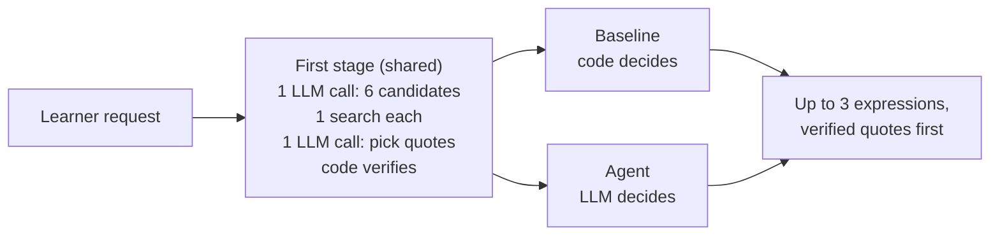

# Expression Coach: Baseline vs Agent

### Team

| Name | NetID |
|---|---|
| Taehyun Lee | taehyun2 |
| Xyu Chern | xyuchern |

### Context

The coach is for people whose second language is English, such as Korean and Chinese speakers.
A learner asks in their own language how to say something in English (a message, a situation, or a constraint like "please include *keep up*").
The coach returns up to 3 natural English expressions. Each expression comes with one real quote from a fixed podcast corpus (Go Time, JS Party, The Changelog), and code checks that the quote really exists there.
If the coach cannot serve a request (a source outside the corpus, not about English wording, prompt injection), it declines and shows nothing.

### Submission

| Item | Where |
|---|---|
| `tasks.jsonl` | `evaluation/data/tasks.jsonl`: 50 tasks (37 regular, 6 edge, 7 unanswerable). This set is written in Korean; each task has `type` (`rubric` or `unanswerable`), `question`, `question_en` and `rubric`. |
| Eval script | `evaluation/eval.py`: `python -m evaluation.eval all` runs both systems on every task 3 times, grades them and writes the report. |
| Results table with pass@3 and pass^3 | [Results](#results) below |
| One paragraph on the failure | [Failure](#failure) below |

### Baseline vs Agent

Both systems start from the same first stage and use the same tools and budgets. They differ only in who decides the next step.

| | Baseline (workflow) | Agent |
|---|---|---|
| Next step | Fixed rule: while a slot has no verified quote, propose replacements, search, select (max 3 rounds) | Each turn the LLM reviews the whole draft and chooses `search`, `repick`, `replace` or `finish` (max 3 turns) |
| Verified quotes | Never touched | Re-checked; a wrong one can be replaced (a guard keeps it unless the new pick also verifies) |
| Stops when | No empty slot, rounds spent, or nothing new | The LLM finishes, or turns/budget spent |
| Budget after the first stage | 6 LLM calls, 9 searches | same |

Models: Claude Haiku 5.5 for both systems; judge `gpt-5.4-mini` (3 votes, majority).

### Results

50 tasks × 3 runs, 150 attempts per system. Accuracy = pass rate; turns = LLM calls per request.

| | Baseline | Agent |
|---|---|---|
| Accuracy | 88.7% (133/150) | **92.0%** (138/150) |
| Strict pass (all 3 items good) | 61.3% | **69.3%** |
| pass@3 | 96% (48/50) | 96% (48/50) |
| pass^3 | 78% (39/50) | **86%** (43/50) |
| Avg turns | 3.25 | 3.42 |
| Avg / p95 latency | 26.1 s / 51.7 s | 33.4 s / 60.5 s |
| Avg tokens | 40,332 | 58,608 |
| Cost per request | $0.0055 | $0.0080 |

Pass = the answer meets the request's explicit constraints and at least 2 of 3 items are good (the expression fits and is natural, and its verified quote shows that use); decline tasks pass when nothing is shown.
On the 43 answerable tasks, agent − baseline: pass +3.9 pp (95% CI [−0.8, +9.3]), strict pass +9.3 pp (95% CI [+3.1, +16.3]). So the agent is not worse on pass and better on strict pass, at about 1.5× the cost.

**Tasks that flip across the 3 runs** (P = pass, F = fail):

| System | Tasks |
|---|---|
| Baseline (9) | ko-spec-idiom-ctx-2 `FPP`, ko-spec-idiom-ctx-3 `PPF`, ko-func-con-2 `PFF`, ko-draft-con-2 `PFP`, ko-usage-ctx-3 `FPP`, ko-cmp-con-1 `PPF`, ko-edge-typo_keys `FPP`, ko-edge-code_switching `FPF`, ko-edge-english_only `PPF` |
| Agent (5) | ko-spec-ctx-1 `PPF`, ko-spec-idiom-ctx-3 `FPP`, ko-cmp-con-1 `PFF`, ko-edge-code_switching `FPP`, ko-edge-english_only `PPF` |

### Failure

**Task** `ko-spec-ctx-1`: "In an incident meeting, I want to say the cause is not confirmed yet, so let's not state guesses as facts." The agent passed it in runs 1 and 2 and failed in run 3.

| Step | What happened in run 3 |
|---|---|
| First stage (shared) | Slot 1 got a quote that contains the key phrase "not to treat" but is about something else (not treating your employer like a playground). The verifier passed it, because it checks wording only. Slots 2 and 3 had no quote. |
| Agent, turn 1 | The agent's own review said slot 1's quote has a different meaning, but it kept the quote. It filled slot 2 with a good quote ("jump to conclusions"). |
| Agent, turn 2 | It filled slot 3 with another quote that has a different meaning, then finished with one turn left. |
| Judge | Only 1 of 3 items was good (2 are needed), so the attempt failed. |

The step that went wrong was the agent's review and its decision to finish: it saw that a quote did not match the meaning but kept it, and it stopped early while it still had budget. From the same start, the baseline kept searching while a slot was empty, found a good third quote in round 3, and passed. The root cause is that the verifier checks only wording, so the meaning check depends on the model, and the model's judgment changes between runs.

### Notes

- The judge is an LLM (3 votes, majority), not a human.
