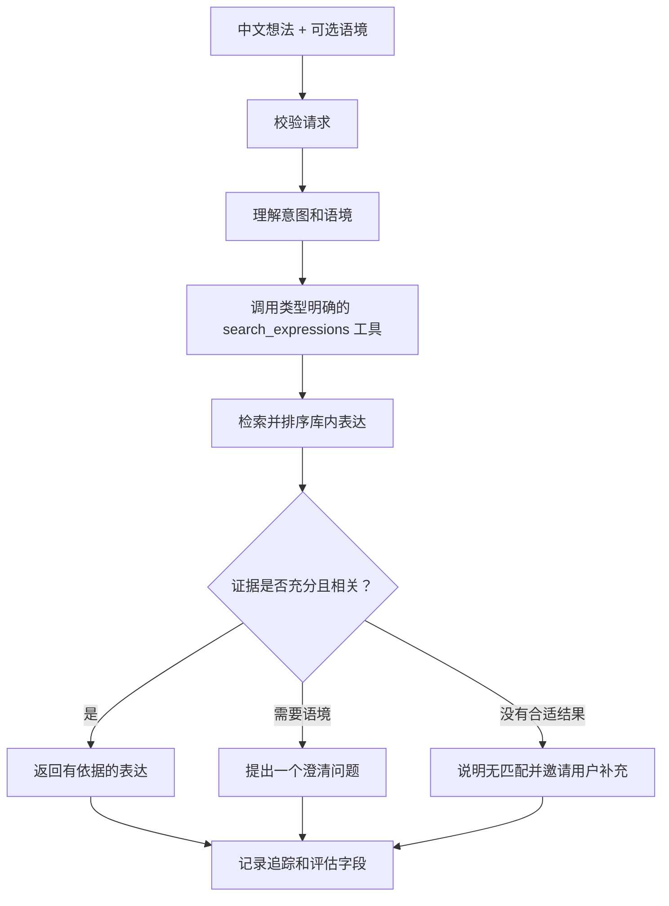
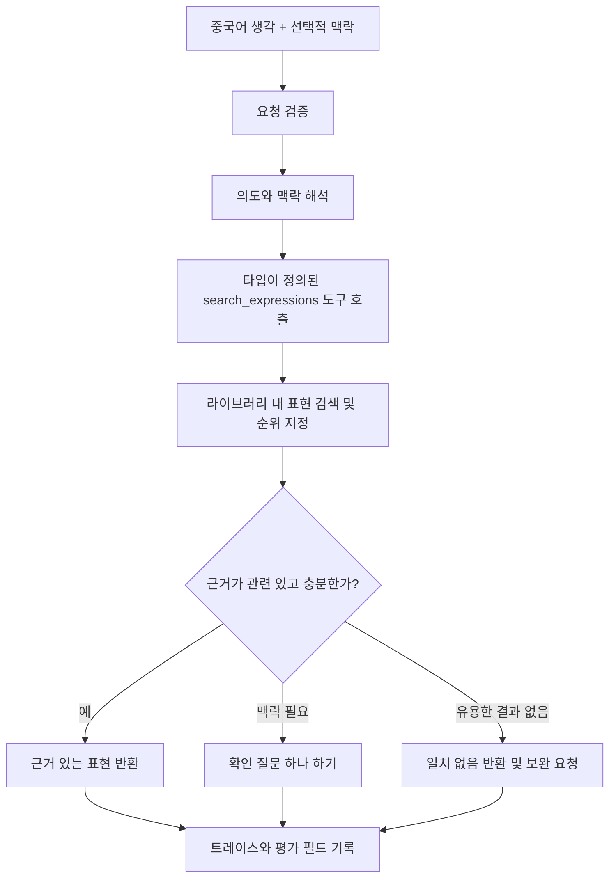

# AI English Speaking Phrase Agent — Design

> **Status:** Updated draft. English version first; Chinese and Korean versions follow. This design prioritizes Agent development. The learner-client extension now delivers a web interface and an Android app; the original three-week scope is recorded below. Owner decisions D1–D3, D5 and D6 (verified examples first, the verified-slot lock, the request log and a re-evaluation) are recorded under Learner clients.

### Current minimal demo slice

The approved first code demo is isolated in `translation_agent_demo/`. It accepts user text and returns an English translation using an LLM, with no retrieval, external tools, or Agent framework. Its purpose is to demonstrate strict task boundaries and modular provider design. It is a prototype slice and does not replace the expression-retrieval MVP defined below.

## 1. Project goal

Build a Python Agent/API that helps learners around IELTS 7 recall natural spoken English expressions. A learner submits an idea in Chinese, the Agent interprets the intended meaning and context, searches a curated expression library through a typed tool, checks whether the results are relevant, and returns grounded English expressions or asks a clarifying question.

The portfolio should make the Agent behavior reviewable: tool inputs and outputs, retrieval evidence, workflow decisions, failure handling, and evaluation results should be visible and reproducible.

## 2. Target user and core scenario

- **User:** an English learner with approximately IELTS 7 proficiency who sometimes cannot recall an appropriate spoken expression quickly.
- **Core request:** “I know what I mean in Chinese, but what is a natural way to say it in English in this situation?”
- **Input:** a Chinese idea and optional situation/topic, such as everyday conversation or IELTS speaking.
- **Output:** the best matching stored English expression, its Chinese meaning and usage context; optionally up to two useful alternatives. When context or evidence is insufficient, the Agent asks a short question or reports that no close match was found.

## 3. MVP boundary

### P0 — required

- Python API for phrase search
- A bounded Agent workflow that interprets the query, calls a typed expression-search tool, checks evidence, and returns a structured result
- A curated, attributable expression dataset with metadata
- A search evaluation set with expected relevant results and no-match cases
- A comparison between a simple retrieval baseline and the Agent workflow
- Defined behavior for ambiguity, low-confidence matches, malformed input, and search-service failures
- Clear setup and architecture documentation

### P1 — if time allows after P0

- Persistent learner records or a `save_expression` tool/API
- Authentication and per-user data isolation
- Agent tracing for model calls, tool calls, retrieved records, latency, and token/cost usage
- Deployment of the API for a reviewer

### P2 — optional after the three-week core is complete

- Minimal browser interface for trying the API
- Full responsive web app or native mobile application
- Speech input, pronunciation scoring, broad tutoring chat, multi-agent orchestration, or spaced repetition

The project does not need a Next.js front end to demonstrate Agent development. Use an API client, command-line demo, or API documentation as the initial interface. The later learner-client delivery is documented under Learner clients.

## 4. Agent workflow

```mermaid
flowchart TD
  A[Chinese idea + optional context] --> B[Validate request]
  B --> C[Interpret intent and context]
  C --> D[Call typed search_expressions tool]
  D --> E[Retrieve and rank stored expressions]
  E --> F{Evidence relevant and sufficient?}
  F -->|Yes| G[Return grounded expression(s)]
  F -->|Need context| H[Ask one clarifying question]
  F -->|No useful match| I[Return no-match and invite refinement]
  G --> J[Record trace and evaluation fields]
  H --> J
  I --> J
```

Keep the model's autonomy bounded. The Agent may interpret intent, choose search filters, and decide whether to answer or clarify. It must not invent a database result, change user data without an explicit tool call, or retry indefinitely. Under the verified-slot lock, it must not change an example the first stage verified (see Learner clients). A deterministic workflow should enforce schemas, permissions, step limits, and failure behavior.

## 5. Search tool and expression data

### `search_expressions`

The tool accepts a normalized intent, optional situation/topic, and bounded result count. It returns stored expression IDs, English text, Chinese meaning, usage notes, metadata, and relevance scores. It has a narrow read-only responsibility.

### Expression record

- `id`
- `english_text`
- `chinese_meaning`
- `usage_note`
- `example_text` (optional)
- `topic`, `situation`, and `register`
- `difficulty` or learner level
- `source` and reuse/license information
- searchable text and optional embedding
- timestamps and dataset version

Start with a small reviewed dataset; a proposed planning target is 100–300 expressions. The actual size and source depend on the course rules and available materials. Do not import content without checking reuse rights.

### Retrieval approach

1. Validate and normalize the Chinese query and optional context.
2. Retrieve candidates using lexical search and multilingual semantic search where available.
3. Apply relevant metadata filters and rank candidates.
4. Apply a confidence threshold selected by reviewing evaluation results.
5. Return only stored records. If retrieval is weak, clarify or report no match.

Begin with the simplest measurable baseline. Add query rewriting, reranking, or a vector database only if the evaluation set shows a meaningful need.

## 6. Proposed technical shape

| Area | Proposed starting point | Notes |
|---|---|---|
| Language/API | Python + FastAPI | Typed HTTP API and convenient integration with Agent and retrieval libraries |
| Agent | One bounded workflow; framework choice remains open | Use the course-required framework if there is one; otherwise compare a small LangGraph workflow with a simple custom workflow before choosing |
| Data | Start with the simplest database permitted by the course; PostgreSQL/pgvector is a deployment-ready option | Keep the retrieval interface independent of the storage choice |
| Model | Select an available model/provider after checking course access, cost, and language quality | Keep model calls behind a small adapter |
| Demo | OpenAPI/Swagger UI, a small CLI, or a minimal API client | A full front end is optional and last priority |
| Evaluation | A versioned query set plus a repeatable evaluation script or documented procedure | Compare the same queries and dataset across retrieval variants |

These are proposals, not decisions about vendors. Prefer tools required or already supported by the course.

## 7. API outline

- `POST /api/search` — accept a Chinese idea, optional context, and bounded result count; return structured results, a clarification request, or a no-match response.
- Optional later: `POST /api/saved-expressions` and `GET /api/saved-expressions` — persist and retrieve a learner's saved expressions.
- Optional later: authentication endpoints or integration with a managed identity provider.

The search response should distinguish `matched`, `needs_clarification`, and `no_match` outcomes. Do not use a client-supplied user ID as proof of identity.

The delivered learner API differs from this outline: it takes `{question, context}` and returns expressions with sources and a note, as one JSON reply or as staged NDJSON lines (see Learner clients → API).

## 8. Evaluation and acceptance

Build a fixed set of Chinese queries covering paraphrases, ambiguous meaning, context-sensitive expressions, several topic areas, and cases with no suitable stored result. A proposed starting size is 30–50 queries, adjusted to the time and data available.

Measure:

- Recall@k and Precision@k for retrieved expressions
- Whether the Agent preserves the user's intended meaning
- Whether retrieved expressions preserve intent and fit the requested situation and register
- Whether it asks for clarification or abstains on ambiguous/no-match cases
- Tool selection/argument validity, step count, latency, and model/tool failure behavior

Compare the Agent with a simple retrieval baseline on the same dataset. Review weak cases manually and record the prompt, model, dataset, and search version. Do not treat an LLM judge as ground truth.

The three-week core is complete when the API can perform the intended flow, results are grounded in stored records, no-match and failure paths are defined, and the evaluation comparison is reproducible.

## 9. Reliability and safety

- Validate request size, required fields, result limits, and tool arguments.
- Bound Agent steps, retries, latency, and model/tool usage per request.
- Retry only transient failures; do not endlessly retry invalid tool arguments.
- Return a useful error or fallback when the model or search service is unavailable.
- Treat user input and imported learning materials as untrusted data.
- Keep credentials outside source control and avoid logging secrets or unnecessary learner content.
- If persistence is added, enforce ownership on every read/write and define deletion behavior.

## 10. Interview readiness and relationship to `idea.md`

The original idea document describes a broader English coach. This MVP deliberately narrows the product to Chinese-to-English expression retrieval so the Agent, its search tool, and its evaluation can be built and explained well within the course project.

| Interview area from `idea.md` | Evidence this project should produce | Boundary to explain honestly |
|---|---|---|
| Product and architecture (Q1–7) | Target user, request-to-response flow, typed tool boundary, bounded Agent decisions, and reason for using one workflow | Voice input and mid-session activity switching are future work; the API should keep input handling separable from learning logic |
| Feedback and model behavior (Q8–14) | Preserve intended meaning, return only retrieved expressions, ask when ambiguous, and use a structured response | The MVP finds expressions; it does not claim to diagnose grammar mistakes or grade writing |
| RAG and learning materials (Q15–23) | Source/rights notes, expression metadata, lexical vs semantic baseline, retrieval metrics, threshold selection, and evidence grounding | A phrase library uses records rather than long-document chunks; reranking and query rewriting need evidence before adoption |
| Tools and reliability (Q24–32) | Typed `search_expressions` schema, bounded steps/retries, malformed-input handling, no-match fallback, and traces that help replay a failure | Write-tool idempotency matters only if persistence/save tools are added |
| Memory and personalization (Q33–39) | A clear boundary between per-request context and future learner memory; a documented path for save/history and user controls | Long-term profile, cross-session personalization, authentication, and deletion are not P0 unless the course requires them |
| Evaluation (Q40–46) | Fixed labeled queries, baseline comparison, Recall@k/Precision@k, human review, versioned regression cases, and latency/cost records | Report actual measurements and limitations; do not claim quality improvements without evidence |
| Backend, scale, and security (Q47–54) | API validation, identity/data isolation design if persistence is enabled, secret handling, timeouts, bounded work, and graceful degradation | High-concurrency load testing and production operations are outside the three-week core; explain what would be added and why |
| Ownership and trade-offs (Q55–60) | Keep a short decision/failure log and prepare a walkthrough connecting a design choice, the failure it prevents, and measured evidence | Only describe implementation and results that were actually completed by the project owner |

This project is interview-ready when each in-scope claim can be supported by a design artifact, a trace, or an evaluation result, and deferred features are described as deliberate scope decisions rather than completed capabilities.

### Learner clients

The web client and installable Android client share a bilingual interface and an offline phrase collection. A saved card and search history belong to the current device. POST /api/search accepts a question and optional context and returns learner-facing expressions with verified source details from ExpressionCoach. Credentials stay on the Python server.

The live Vercel app serves the chat UI, Android download and coach at the same HTTPS origin. A deployment includes 185 reviewed passages, their vectors and the MiniLM encoder. Vercel computes the query vector and calls the Responses gateway. Anyone can ask a question directly. The computer can be off. Publish a new snapshot when transcripts or rights change.

#### Owner decisions D1–D3, D5 and D6

Agreed on 2026-11-21. The sections below implement D1–D3 and D5, and prepare D6.

| ID | Decision |
|---|---|
| D1 | When the first stage verifies at least one example, send only the verified expressions and examples at once. They never change. The continuation (baseline or agent) fills only the empty slots. With all three verified, neither system runs a continuation. With none verified, send the finished answer once. |
| D2 | A school project: questions may be shown and kept as written. |
| D3 | No user identity. Data is per request. |
| D5 | No production store. The mode is an environment variable and a redeploy. Live requests are not stored; each prints one log line. A learner who leaves cannot fetch the rest later. |
| D6 | After the lock, re-run the baseline and the locked agent locally with the real API (50 tasks × 3, then grading, about $6). |

#### Verified examples first (D1)

- An empty slot has no verified example. The first result holds only verified expressions with their examples. Unverified candidates are never sent early.
- What was sent is final. The final answer starts with the sent items unchanged. If that ever broke, the server would put the sent items first and log `invariant_ok: false`.
- The learner sees the first examples at once. While the continuation runs, a notice above the chat says more podcast examples are being looked for, and that keeping the screen open shows when it ends. Examples found later go to a new **Podcast** tab with a badge. The chat answer does not change.
- If the learner leaves, the first examples stay in the device history, and the app offers **Look again** on return (D5).
- The chat page keeps its brand; the notice, the empty slot, the waiting time and the Podcast tab are new. The tabs show on the chat page too, so the Podcast tab's badge can be seen and tapped at once; the notice and the slot also link to it.
- Reversible default: a new coach question waits while a background search runs, because the server answers one request per process. The full state table is in `frontend/README.md`.

#### API: POST /api/search

The request is `{question, context}`. The default reply is one JSON object, `{expressions, note}`, as before, so installed APKs keep working. A client that sends `Accept: application/x-ndjson` gets one JSON object per line:

| Line | When | Fields |
|---|---|---|
| `first` | The first stage verified 1–3 examples | `expressions` (verified only), `pending` (`false`: nothing follows), `note` |
| `final` | After the continuation. The only line when nothing was verified or the request was declined | `expressions` (the whole answer, sent items first), `added` (indexes of later examples), `note` |
| `error` | In place of `final` | `code`: `timeout`, `coach_unavailable` or a coach code |

- Each item keeps `expression`, `key_phrase`, `note` and `citation`.
- Refusals (401, 403, 422 `invalid_input`, 429 `coach_busy`) are plain HTTP errors before any line.
- The JSON reply is the last answer the stream would show. If the continuation fails after verified examples were found, the reply returns them with 200 (before this change: 503).
- Work stops 280 s after the request starts (Vercel's `maxDuration` is 300 s), with the error code `timeout`. One request runs per process. If the client leaves, the work stops at its next model call or search.

#### Mode and request log (D5)

- `COACH_SYSTEM` is `agent` (the default, the locked agent) or `baseline`. `COACH_CONTINUATION` is `on` (the default) or `off` (first stage only, not evaluated). The server reads both once at start and refuses to start on any other value, so a change needs a new deployment.
- Each request that passes the access checks prints one JSON line to stdout: `event` (`coach_request`), `ts`, `request_id`, `mode`, `continuation_setting`, `transport`, `status`, `error_code`, `verified_first`, `added_final`, `verified_final`, `continuation`, `invariant_ok`, `first_ms`, `total_ms`, `llm_calls`, `searches`, `input_tokens`, `output_tokens`, `cached_input_tokens`, `disconnected`, `question_head`.
- `question_head` is the first 40 characters of the question (D2). The context and the answer are not logged. Time to the first answer is `first_ms`, or `total_ms` when it is `null`.
- Retention is Vercel's runtime-log retention: 1 hour on Hobby, 1 day on Pro. Nothing else about a request is stored. Field meanings are in `frontend/README.md`.

#### Verified-slot lock and evaluation reproducibility

In the submission run's 129 normal answers, the first stage verified all three slots in 82 (63.6%), one or two in 44 (34.1%) and none in 3 (2.3%). The LLM judge (three votes, not human truth) rated 277 of the 319 first-stage verified examples (86.8%) grounded-good. The submission agent later removed 45 of these examples from 43 answers. The lock keeps all of them, 8 of which were rated poor (2.5% of the 319).

- The agent locks the slots that are verified when it starts. A repick or replace that names a locked slot is recorded as a noop (`locked`) and spends no budget. A search that names a locked slot still runs and spends a search, but cannot change that slot. The decision input marks each slot `locked`. The prompt `AGENT_LOCKED_PROMPT` is the submission prompt plus one paragraph. Slots the agent fills later are not locked; the existing G1 guard protects them. The baseline never changed a verified slot.
- When the first stage verified every slot, neither system runs a continuation: no model call, no search.
- Both registered systems keep the lock. The submission agent stays in the code as `AgentPipeline(locked=False)`. It is not registered and has no command-line switch.
- The submitted results (`evaluation/results/submission`, `SUBMISSION.md`) came from the pre-lock code at commit `173cbed`. They stay unchanged. Check out that commit to reproduce them.
- `python -m evaluation.eval` now runs the locked agent under the same name, `agent`. Put `locked` in a new run's name. The run manifest now hashes the `agents/` subpackages too, so a run folder made before this change refuses to resume.

#### Re-evaluation (D6)

- **What:** the baseline and the locked agent on the 50 tasks × 3 runs, then the three-vote judge, with the submission's models, judge, repeats, seed and task file. About $6, estimated from the submission's usage at list prices.
- **Where:** locally, against the PostgreSQL copy of the evaluation snapshot (`evaluation_snapshot_v2`), with the API keys in the demo settings.
- **Steps:** `python -m evaluation.snapshot_store verify`. Then `python -m evaluation.eval run --run d6-locked-<date> --prepare-only`, and compare its manifest with the submission's. Run a trial with `--max-new 6` and stop if the extrapolated total exceeds $7. Then `python -m evaluation.eval all --run d6-locked-<date>`. Always pass `--run`: the default is `submission`.
- **Checks:** no first-stage verified example changes, no continuation call when every slot is verified, the count of infrastructure errors and the actual cost.
- **Record here:** pass, strict pass, pass@3 and pass^3, the first-stage distribution, total time, tokens, locked noops and the actual cost, next to the figures above.
- **Status:** done locally on 2026-11-22 (run `lock-20261122`, actual cost $3.63 at list prices). The submitted results are unchanged.

**Result.** The lock held: all 323 first-stage verified examples stayed in the final answers (0 requests lost one; 43 in the submission), all 93 requests with three verified slots skipped the continuation, and there were 0 locked noops because none of the agent's 147 continuation actions named a locked slot. The first stage verified 3 / 1–2 / 0 slots in 93 / 30 / 5 of 128 normal answers. The agent's advantage disappeared: pass is 85.3% (128/150) for both systems (submission: baseline 88.7%, agent 92.0%), and strict is 55.3% for the baseline and 54.0% for the agent (submission: 61.3% and 69.3%), a difference of −1.6 pp (95% CI −6.2 to +2.3). Pass non-inferiority holds; strict superiority does not. pass@3 is 0.96 and pass^3 0.72 for both. Mean / p95 time over all requests is 23.9 / 54.3 s for the baseline and 24.4 / 55.4 s for the agent; tokens per attempt 33,488 and 37,215; cost per attempt $0.0047 and $0.0052. With the lock, the two systems can differ only on the 35 units that ran a continuation. Both systems also scored below the submission on the same first-stage code, so a single run varies a lot. One error came from the shared first stage (`invalid_model_output`); there were no infrastructure errors.

#### Known gaps

- Not yet checked on a real deployment or device: line-by-line streaming through Vercel and the Android WebView, and idle timeouts during a quiet continuation (there is no ping line).
- Installed APKs keep the JSON flow, so they show no early results until the APK is rebuilt.
- The deadline stops work between calls. A model call already running is not cut.
- The app's default agent is the locked agent that D6 measured: equal to the baseline on pass, not better as the pre-lock submission agent was (judgment question R1).

## 11. Project Owner Judgment Questions

**R1. Submission wording and deployed default after D6:** keep the locked agent as the default and write "same accuracy as the baseline, plus kept examples and skipped continuations"? Recommended: yes, because the lock keeps the D1 promise and the strict gap is not significant. Alternatives: switch the default to the baseline (cheaper, same results), or cite only the submission results and attach the D6 run as an appendix.

Nothing else is pending in this document. The open question on a coach question during a background search is in `frontend/README.md` (judgment question 1).

The five earlier scope questions are settled by the delivered clients: a question takes an optional context; an answer shows up to three expressions with a key phrase, note and podcast source; saving and history stay on the device; topics follow the podcast corpus.

---

# AI 英语口语表达 Agent — 设计文档

> **状态：**更新后的草案。英文版在前，其后依次为中文版和韩文版。本设计优先展示 Agent 开发；后续学习端已交付网页和 Android 应用，下文保留原三周范围。项目负责人决定 D1–D3、D5 和 D6（先发送已核对的例句、核对位置锁定、请求日志和重新评估）记录在「学习客户端」中。

### 当前最小 Demo 切片

已确认的首个代码 Demo 独立放在 `translation_agent_demo/` 中。它接收用户文本，只使用 LLM 返回英文翻译，不接检索、外部工具或 Agent 框架。这个 Demo 用于展示严格的任务边界和可替换的模型供应商设计。它是一个原型切片，不会替代下文定义的表达检索 MVP。

## 1. 项目目标

构建一个 Python Agent/API，帮助雅思水平约为 7 分的学习者快速想起自然的英语口语表达。学习者用中文描述想法后，Agent 理解意图和语境，通过有明确类型定义的工具搜索整理好的表达库，判断结果是否相关，然后返回有依据的英语表达，或提出澄清问题。

作品集需要让评审者看清 Agent 的行为：工具输入与输出、检索证据、工作流决策、故障处理和评估结果都应可查看、可重现。

## 2. 目标用户与核心场景

- **用户：**英语水平约为雅思 7 分、有时无法快速想起合适口语表达的学习者。
- **核心需求：**“我知道自己想用中文表达什么，但在这个情境下，用英语怎么说才自然？”
- **输入：**中文想法，可选场景/话题，例如日常交流或雅思口语。
- **输出：**最匹配的库内英语表达、中文含义和使用语境；也可以给出最多两个有用的替代说法。语境或证据不足时，Agent 应简短追问，或者说明没有找到足够接近的表达。

## 3. MVP 范围边界

### P0 — 必须完成

- 用于表达搜索的 Python API
- 有明确边界的 Agent 工作流：理解查询、调用类型明确的表达搜索工具、检查证据并返回结构化结果
- 经过整理且来源可追溯、带有元数据的表达数据集
- 包含预期相关结果和无匹配案例的搜索评估集
- 对比简单检索基线和 Agent 工作流
- 为歧义、低置信度匹配、无效输入和搜索服务故障定义处理方式
- 清晰的配置和架构文档

### P1 — P0 完成后有时间再做

- 持久化学习记录，或 `save_expression` 工具/API
- 身份验证和逐用户数据隔离
- Agent 调用追踪：模型调用、工具调用、检索记录、延迟及令牌/成本使用情况
- 部署 API，方便评审者体验

### P2 — 三周核心目标完成后的可选项

- 用于试用 API 的简易浏览器界面
- 完整的响应式网页应用或原生移动应用
- 语音输入、发音评分、泛化辅导聊天、多智能体编排或间隔重复系统

展示 Agent 开发不要求使用 Next.js 前端。初期可通过 API 客户端、命令行演示或 API 文档来试用。后续界面交付见「学习客户端」。

## 4. Agent 工作流



限制模型的自主范围。Agent 可以理解意图、选择搜索筛选条件，并决定回答还是澄清；不得编造数据库结果、未经明确工具调用就修改用户数据，也不得无限重试。在核对位置锁定下，也不得修改第一阶段核对通过的例句（见「学习客户端」）。工作流应通过确定性逻辑执行结构校验、权限、步骤上限和故障处理。

## 5. 搜索工具与表达数据

### `search_expressions`

工具接收规范化后的意图、可选场景/话题和有上限的结果数量。它返回库内表达 ID、英文文本、中文含义、用法说明、元数据和相关度分数。该工具只负责只读搜索。

### 表达记录

- `id`
- `english_text`：英文表达
- `chinese_meaning`：中文含义
- `usage_note`：用法说明
- `example_text`：例句，可选
- `topic`、`situation` 和 `register`：话题、场景和语域
- `difficulty` 或学习者水平
- `source` 和重用/许可信息
- 可搜索文本及可选向量嵌入
- 时间戳和数据集版本

从小型人工审核数据集开始；建议先按 100–300 条表达做计划。实际规模和来源取决于课程要求及可用材料。导入内容前要检查重用权利。

### 检索方案

1. 校验并规范化中文查询和可选语境。
2. 在条件允许时，结合词法搜索和多语言语义搜索检索候选项。
3. 应用相关元数据筛选并为候选结果排序。
4. 根据评估结果选择置信度阈值。
5. 只返回库内记录。检索结果较弱时，应澄清或说明无匹配。

先从最简单且可衡量的基线开始。只有评估集显示确有明显需求时，才增加查询改写、重排或向量数据库。

## 6. 建议的技术形态

| 领域 | 初步建议 | 说明 |
|---|---|---|
| 语言/API | Python + FastAPI | 提供类型明确的 HTTP API，便于集成 Agent 和检索库 |
| Agent | 一个边界明确的工作流；框架待定 | 如果课程指定框架，优先使用；否则先比较小型 LangGraph 工作流和简单自定义工作流 |
| 数据 | 先用课程允许的最简单数据库；PostgreSQL/pgvector 可作为可部署方案 | 检索接口不依赖特定存储方案 |
| 模型 | 确认课程访问权限、成本和中文效果后再选模型/API | 将模型调用封装在小型适配层后 |
| 演示方式 | OpenAPI/Swagger UI、小型命令行程序或简易 API 客户端 | 完整前端是可选项，优先级最低 |
| 评估 | 有版本记录的查询集，以及可重复运行的评估脚本或流程 | 使用同一组查询和数据集比较不同检索方案 |

这些都是建议，不代表已经选定供应商。优先使用课程要求或已经提供的工具。

## 7. API 草案

- `POST /api/search`：接收中文想法、可选语境和有上限的结果数量；返回结构化结果、澄清请求或无匹配状态。
- 后续可选：`POST /api/saved-expressions` 和 `GET /api/saved-expressions`，用于持久化并读取学习者保存的表达。
- 后续可选：身份验证接口或托管身份服务集成。

搜索响应应区分 `matched`、`needs_clarification` 和 `no_match` 三种结果。不能把客户端提供的用户 ID 当作身份凭证。

已交付的学习端 API 与这份草案不同：它接收 `{question, context}`，返回带出处的表达和说明，形式为一个 JSON 回复或分阶段的 NDJSON 行（见「学习客户端」中的 API）。

## 8. 评估与验收

建立固定的中文查询集，覆盖不同说法、含义模糊、依赖语境的表达、多个话题，以及表达库中没有合适结果的情况。初步建议为 30–50 条查询，再根据时间和数据调整。

至少衡量：

- 检索表达的 Recall@k 和 Precision@k
- Agent 是否保留用户本来的意思
- 检索表达是否保留原意，并符合用户要求的场景和语域
- 在歧义或无匹配情况下，Agent 是否会澄清或明确拒答
- 工具选择与参数是否合法、步骤数、延迟，以及模型/工具故障时的表现

在相同数据集上对比 Agent 和简单检索基线。人工复核效果较差的案例，并记录提示词、模型、数据集和搜索版本。不要把 LLM 评审分数当成绝对真值。

三周核心目标的完成标准是：API 能完成预期流程；返回内容有库内记录作为依据；无匹配和故障路径有明确处理；评估对比可以重复进行。

## 9. 可靠性与安全

- 校验请求大小、必填字段、结果数量限制和工具参数。
- 限制每次请求的 Agent 步骤、重试次数、延迟和模型/工具使用量。
- 只对暂时性故障重试；无效工具参数不得无限重试。
- 模型或搜索服务不可用时，返回有用的错误说明或降级结果。
- 将用户输入和导入的学习材料视为不可信数据。
- 不把凭证提交到源码管理，并避免记录密钥和不必要的学习者内容。
- 如果添加持久化存储，对每次读写执行所有权校验，并明确数据删除方式。

## 10. 面试准备及与 `idea.md` 的对应关系

原始 idea 文档描述的是更完整的英语教练。本 MVP 有意缩小为“中文想法检索英语表达”，以便在课程项目时间内把 Agent、搜索工具和评估做扎实，并能清楚讲解。

| `idea.md` 中的面试主题 | 本项目应产出的证据 | 需要诚实说明的范围边界 |
|---|---|---|
| 产品与架构（Q1–7） | 目标用户、请求到响应的流程、类型明确的工具边界、受限的 Agent 决策，以及采用单一工作流的原因 | 语音输入和会话中途切换活动属于后续工作；API 应让输入处理与学习逻辑保持可分离 |
| 反馈与模型行为（Q8–14） | 保留原意、只返回检索表达、遇到歧义时追问、使用结构化响应 | MVP 负责查找表达，不宣称能诊断语法错误或给写作评分 |
| RAG 与学习材料（Q15–23） | 来源/许可记录、表达元数据、词法与语义基线对比、检索指标、阈值选择和证据依据 | 表达库使用记录，而不是长文档分块；只有评估证明必要时才加入重排和查询改写 |
| 工具与可靠性（Q24–32） | `search_expressions` 类型定义、有限步骤/重试、错误参数处理、无匹配降级，以及便于重现故障的追踪信息 | 只有添加保存等写入工具后，幂等写入才成为必要事项 |
| 记忆与个性化（Q33–39） | 明确区分单次请求语境与未来学习者记忆；记录保存/历史功能和用户控制的后续方案 | 长期学习者档案、跨会话个性化、身份验证和数据删除不属于 P0，除非课程要求 |
| 评估（Q40–46） | 固定标注查询集、基线对比、Recall@k/Precision@k、人工复核、带版本的回归案例，以及延迟/成本记录 | 只报告实际测量和限制；没有证据就不声称质量提升 |
| 后端、规模与安全（Q47–54） | API 校验；启用持久化时的身份/数据隔离设计；密钥处理、超时、工作量限制和降级行为 | 高并发压力测试和生产运维不属于三周核心；要说明扩展时会增加什么以及原因 |
| 项目归属与权衡（Q55–60） | 简短记录设计决策和失败案例，并准备演示，说明某个设计选择预防了什么问题及其测量证据 | 只描述项目负责人实际完成的实现和结果 |

当项目范围内的每项主张都有设计材料、追踪记录或评估结果支撑，并且后续功能被明确描述为范围选择而非已实现能力时，本项目就具备面试展示基础。

### 学习客户端

网页和可安装的 Android 客户端共用中韩双语界面和离线表达集。收藏与学习历史保存在当前设备。POST /api/search 接收问题和可选场景，返回 ExpressionCoach 给出的表达及经过核对的字幕出处。密钥保存在 Python 服务端。

Vercel 独立网址同时提供聊天首页、Android 安装包和教练接口。云端随部署携带 185 个字幕片段、对应向量与 MiniLM 编码器，在云端计算问题向量并调用 Responses 接口。手机打开即可提问，电脑可以关机。字幕或使用许可发生变化时需重新发布快照。

#### 项目负责人决定 D1–D3、D5 和 D6

2026-11-21 确定。下文实现 D1–D3 和 D5，并为 D6 做好准备。

| 编号 | 决定 |
|---|---|
| D1 | 第一阶段至少核对通过一个例句时，立即只发送核对通过的表达和例句，之后不再改变。后续阶段（baseline 或 agent）只填补空位。三个都核对通过时，两个系统都不运行后续阶段。一个都没有时，完成后一次发送最终答案。 |
| D2 | 这是学校项目：问题可以原样显示和保存。 |
| D3 | 不区分用户，数据只按请求计。 |
| D5 | 不增加运行时存储。模式通过环境变量加重新部署切换。线上请求不保存，每个请求只打印一行日志。学习者离开后，无法再从服务端取回剩余结果。 |
| D6 | 加锁后，在本地用真实 API 重新评估 baseline 和加锁的 agent（50 题 × 3 次，再评分，约 6 美元）。 |

#### 先发送已核对的结果（D1）

- 空位是没有核对通过例句的位置。先发送的结果只包含核对通过的表达及其例句，未核对的候选不会提前发送。
- 已发送的内容就是最终内容。最终答案以未改动的已发送条目开头。万一不成立，服务端会把已发送条目放在最前面，并在日志中记录 `invariant_ok: false`。
- 学习者立即看到先到的例句。后续阶段运行期间，聊天上方的提示条说明正在查找更多播客例句，并说明保持此页面打开就会在结束时得到提示。后来找到的例句放进新的带徽标的 **播客** 页，聊天中的回答不变。
- 学习者离开后，先到的例句仍保存在设备历史中，再次打开时应用提供 **重新查找**（D5）。
- 聊天页保持现有品牌，新增的是提示条、空位、等待时间和播客页。聊天页也显示标签栏，播客页的徽标一眼可见，可以直接点开；提示条和空位也链接到那里。
- 可逆的默认做法：后台查找进行时，新的教练提问需要等待，因为服务端每个进程只处理一个请求。完整的状态表见 `frontend/README.md`。

#### API：POST /api/search

请求为 `{question, context}`。默认回复仍是一个 JSON 对象 `{expressions, note}`，所以已安装的 APK 可以照常使用。客户端发送 `Accept: application/x-ndjson` 时，改为每行返回一个 JSON 对象：

| 行 | 何时 | 字段 |
|---|---|---|
| `first` | 第一阶段核对了 1–3 个例句 | `expressions`（只有核对通过的条目）、`pending`（`false` 表示后面没有内容）、`note` |
| `final` | 后续阶段结束后。没有核对通过的例句或请求被拒绝时，只有这一行 | `expressions`（完整答案，已发送条目在前）、`added`（后来找到的例句序号）、`note` |
| `error` | 代替 `final` | `code`：`timeout`、`coach_unavailable` 或教练错误码 |

- 每个条目保留 `expression`、`key_phrase`、`note` 和 `citation`。
- 拒绝（401、403、422 `invalid_input`、429 `coach_busy`）是普通 HTTP 错误，在任何行之前返回。
- JSON 回复就是流最终会显示的答案。已找到核对通过的例句后，即使后续阶段失败，回复也会以 200 返回这些例句（此前为 503）。
- 请求开始 280 秒后停止工作（Vercel 的 `maxDuration` 为 300 秒），错误码为 `timeout`。每个进程同时只处理一个请求。客户端离开后，工作会在下一次模型调用或检索前停止。

#### 模式与请求日志（D5）

- `COACH_SYSTEM` 为 `agent`（默认，加锁的 agent）或 `baseline`。`COACH_CONTINUATION` 为 `on`（默认）或 `off`（只运行第一阶段，未经评估）。服务启动时读取一次，遇到其他值会拒绝启动，因此修改后需要重新部署。
- 每个通过访问检查的请求都向 stdout 打印一行 JSON：`event`（`coach_request`）、`ts`、`request_id`、`mode`、`continuation_setting`、`transport`、`status`、`error_code`、`verified_first`、`added_final`、`verified_final`、`continuation`、`invariant_ok`、`first_ms`、`total_ms`、`llm_calls`、`searches`、`input_tokens`、`output_tokens`、`cached_input_tokens`、`disconnected`、`question_head`。
- `question_head` 是问题的前 40 个字符（D2）。不记录场景和答案。首次看到答案的时间是 `first_ms`，为 `null` 时是 `total_ms`。
- 保留期限就是 Vercel 运行日志的保留期限：Hobby 计划 1 小时，Pro 计划 1 天。请求的其他内容都不保存。字段含义见 `frontend/README.md`。

#### 核对位置锁定与评估可重现性

在提交运行的 129 个正常回答中，第一阶段三个位置全部核对通过的有 82 个（63.6%），一到两个的有 44 个（34.1%），一个都没有的有 3 个（2.3%）。LLM 评审（三票多数，不是人工标准答案）认为第一阶段核对通过的 319 个例句中有 277 个（86.8%）为 grounded-good。提交时的 agent 后来从 43 个回答中删掉了其中 45 个例句。加锁后这些例句全部保留，其中 8 个被评为较差（占 319 个的 2.5%）。

- agent 在开始时锁定已经核对通过的位置。指向锁定位置的 repick 或 replace 会记录为 noop（`locked`），不消耗预算。指向锁定位置的 search 仍会执行并消耗一次检索，但不能改变该位置。判断输入为每个位置标注 `locked`。提示词 `AGENT_LOCKED_PROMPT` 是提交时的提示词再加一段。agent 之后填入的位置不锁定，由原有的 G1 保护规则保护。baseline 本来就不修改已核对的位置。
- 第一阶段所有位置都核对通过时，两个系统都不运行后续阶段：没有模型调用，也没有检索。
- 两个已注册的系统都遵守锁定。提交时的 agent 以 `AgentPipeline(locked=False)` 保留在代码中，未注册，也没有命令行开关。
- 已提交的结果（`evaluation/results/submission`、`SUBMISSION.md`）由加锁前提交 `173cbed` 的代码产生，保持不变。要重现这些结果，请检出该提交。
- `python -m evaluation.eval` 现在以同一名称 `agent` 运行加锁的 agent。新运行的名称中请加入 `locked`。运行清单现在也对 `agents/` 子包计算哈希，因此在本次修改前创建的运行文件夹会拒绝续跑。

#### 重新评估（D6）

- **内容：** 用 50 题 × 3 次运行 baseline 和加锁的 agent，再用三票评审评分；模型、评审、重复次数、随机种子和题目文件与提交时相同。按提交运行的用量和公开价格估算，约 6 美元。
- **地点：** 在本地运行，使用评估快照的 PostgreSQL 副本（`evaluation_snapshot_v2`）和 Demo 配置中的 API 密钥。
- **步骤：** 先运行 `python -m evaluation.snapshot_store verify`。再运行 `python -m evaluation.eval run --run d6-locked-<日期> --prepare-only`，把生成的清单与提交时的清单对比。用 `--max-new 6` 试跑，外推总额超过 7 美元就停止。然后运行 `python -m evaluation.eval all --run d6-locked-<日期>`。始终指定 `--run`：默认值是 `submission`。
- **检查：** 第一阶段核对通过的例句改动为 0，所有位置都核对通过时后续调用为 0，基础设施错误数，以及实际费用。
- **在此记录：** 通过率、严格通过率、pass@3 和 pass^3、第一阶段分布、完成时间、token、锁定 noop 数和实际费用，与上方数据并列。
- **状态：** 已于 2026-11-22 在本地完成（运行 `lock-20261122`，按公开价格估算的实际费用为 3.63 美元）。提交结果保持不变。

**结果。** 锁定按设计生效：第一阶段核对通过的 323 个例句全部留在最终回答中（丢失例句的请求为 0；提交时为 43），三个位置都核对通过的 93 个请求全部跳过后续阶段；锁定 noop 为 0，因为 agent 后续阶段的 147 个动作没有一个指向已锁定的位置。在 128 个正常回答中，第一阶段核对通过 3 个 / 1–2 个 / 0 个位置的分别有 93 / 30 / 5 个。agent 的优势消失了：两个系统的通过率都是 85.3%（128/150）（提交时 baseline 88.7%，agent 92.0%）；严格通过率 baseline 为 55.3%，agent 为 54.0%（提交时为 61.3% 和 69.3%），差值为 −1.6 个百分点（95% 置信区间 −6.2 至 +2.3）。通过率非劣效条件成立，严格通过率优势条件不成立。pass@3 都是 0.96，pass^3 都是 0.72。全部请求的平均 / p95 用时：baseline 23.9 / 54.3 秒，agent 24.4 / 55.4 秒；每次尝试的 token 为 33,488 和 37,215；每次尝试的费用为 0.0047 和 0.0052 美元。加锁后，两个系统只可能在运行了后续阶段的 35 个单元上出现差异。第一阶段代码与提交时相同，两个系统的分数却一起低于提交时，说明单次运行的波动很大。共享的第一阶段出现 1 次错误（`invalid_model_output`），没有基础设施错误。

#### 已知差距

- 尚未在真实部署或设备上检查：经过 Vercel 和 Android WebView 时是否逐行传输，以及后续阶段长时间无输出时的空闲超时（没有 ping 行）。
- 已安装的 APK 仍使用 JSON 流程，重新构建 APK 之前不会提前显示结果。
- 截止时间只在两次调用之间停止工作，已经开始的模型调用不会被中断。
- 应用默认的 agent 是 D6 评估过的加锁 agent：通过率与 baseline 相同，不像加锁前的提交 agent 那样更好（判断题 R1）。

## 11. 项目负责人判断题

**R1. D6 之后的提交说明和部署默认值：** 是否保留加锁的 agent 作为默认，并写明“准确率与 baseline 相同，另外能保留已发送的例句并跳过后续阶段”？建议：是，因为锁定兑现了 D1 的承诺，严格通过率的差距不显著。其他选项：把默认改为 baseline（更便宜，结果相同），或只引用提交结果，把 D6 运行作为附录。

本文件没有其他待决定的事项。后台查找期间如何处理新的教练提问，这一待决问题见 `frontend/README.md`（判断题 1）。

早先的五个范围问题已由已交付的客户端回答：提问可附带可选场景；每个回答最多显示三个表达，附关键短语、说明和播客出处；收藏和历史保存在设备上；话题范围取决于播客语料。

---

# AI 영어 말하기 표현 Agent — 설계 문서

> **상태:** 업데이트된 초안. 영어 버전이 먼저, 중국어 버전과 한국어 버전이 차례로 이어집니다. 이 설계는 Agent 개발을 우선합니다. 추가 학습 클라이언트로 웹과 Android 앱을 제공하며 아래에 기존 3주 범위를 기록합니다. 책임자 결정 D1–D3, D5, D6(검증된 예문 먼저 보내기, 검증 슬롯 잠금, 요청 로그, 재평가)은 학습 클라이언트 절에 기록합니다.

### 현재 최소 Demo 슬라이스

승인된 첫 코드 Demo는 `translation_agent_demo/`에 따로 있습니다. 사용자 텍스트를 받아 LLM으로 영어 번역을 반환하며, 검색, 외부 도구, Agent 프레임워크는 사용하지 않습니다. 목적은 엄격한 작업 경계와 교체 가능한 모델 제공자 설계를 보여 주는 것입니다. 이는 프로토타입 슬라이스이며, 아래에 정의된 표현 검색 MVP를 대체하지 않습니다.

## 1. 프로젝트 목표

IELTS 7점 안팎의 학습자가 자연스러운 영어 구어 표현을 떠올리도록 돕는 Python Agent/API를 만듭니다. 학습자가 중국어로 생각을 입력하면 Agent가 의도한 의미와 맥락을 해석하고, 타입이 정의된 도구로 선별된 표현 라이브러리를 검색하고, 결과가 관련 있는지 확인한 뒤, 근거가 있는 영어 표현을 반환하거나 확인 질문을 합니다.

포트폴리오는 Agent의 동작을 검토할 수 있게 해야 합니다. 도구 입력과 출력, 검색 근거, 워크플로 결정, 장애 처리, 평가 결과를 확인하고 재현할 수 있어야 합니다.

## 2. 대상 사용자와 핵심 시나리오

- **사용자:** 영어 실력이 IELTS 7점 정도이며, 적절한 구어 표현을 바로 떠올리지 못할 때가 있는 학습자.
- **핵심 요청:** "중국어로는 무슨 말을 하고 싶은지 아는데, 이 상황에서 영어로 자연스럽게 말하려면 어떻게 해야 하지?"
- **입력:** 중국어로 쓴 생각과 선택적인 상황/주제(예: 일상 대화, IELTS 말하기).
- **출력:** 가장 잘 맞는 라이브러리 내 영어 표현, 그 중국어 의미와 사용 맥락. 선택적으로 유용한 대안 표현을 최대 두 개까지 제공합니다. 맥락이나 근거가 부족하면 Agent는 짧게 질문하거나, 충분히 가까운 표현을 찾지 못했다고 알립니다.

## 3. MVP 범위

### P0 — 필수

- 표현 검색용 Python API
- 질의를 해석하고, 타입이 정의된 표현 검색 도구를 호출하고, 근거를 확인한 뒤 구조화된 결과를 반환하는, 범위가 제한된 Agent 워크플로
- 출처를 추적할 수 있고 메타데이터를 갖춘 선별된 표현 데이터셋
- 기대되는 관련 결과와 일치 없음 사례를 포함한 검색 평가 세트
- 단순 검색 베이스라인과 Agent 워크플로의 비교
- 모호성, 낮은 신뢰도의 매칭, 잘못된 입력, 검색 서비스 장애에 대한 정의된 동작
- 명확한 설정 및 아키텍처 문서

### P1 — P0 완료 후 시간이 있으면

- 영구 학습 기록 또는 `save_expression` 도구/API
- 인증과 사용자별 데이터 격리
- 모델 호출, 도구 호출, 검색된 레코드, 지연 시간, 토큰/비용 사용량에 대한 Agent 트레이싱
- 리뷰어가 사용해 볼 수 있도록 API 배포

### P2 — 3주 핵심 목표 완료 후 선택 사항

- API를 시험해 볼 수 있는 최소한의 브라우저 인터페이스
- 완전한 반응형 웹 앱 또는 네이티브 모바일 앱
- 음성 입력, 발음 채점, 범용 튜터링 채팅, 멀티 에이전트 오케스트레이션, 간격 반복 학습

Agent 개발을 보여 주는 데 Next.js 프런트엔드는 필요하지 않습니다. 초기 인터페이스로는 API 클라이언트, 명령줄 데모, API 문서를 사용합니다. 이후 화면 제공 내용은 학습 클라이언트 절에 기록합니다.

## 4. Agent 워크플로



모델의 자율성은 제한합니다. Agent는 의도를 해석하고, 검색 필터를 고르고, 답할지 확인 질문을 할지 결정할 수 있습니다. 데이터베이스 결과를 지어내거나, 명시적인 도구 호출 없이 사용자 데이터를 변경하거나, 무한히 재시도해서는 안 됩니다. 검증 슬롯 잠금 아래에서는 첫 단계에서 검증된 예문도 바꿀 수 없습니다(학습 클라이언트 절 참고). 스키마, 권한, 단계 제한, 장애 처리 동작은 결정론적 워크플로가 강제해야 합니다.

## 5. 검색 도구와 표현 데이터

### `search_expressions`

이 도구는 정규화된 의도, 선택적 상황/주제, 상한이 있는 결과 개수를 입력받습니다. 라이브러리 내 표현 ID, 영어 텍스트, 중국어 의미, 사용 메모, 메타데이터, 관련도 점수를 반환합니다. 읽기 전용 검색이라는 좁은 책임만 가집니다.

### 표현 레코드

- `id`
- `english_text`: 영어 표현
- `chinese_meaning`: 중국어 의미
- `usage_note`: 사용 메모
- `example_text`: 예문(선택)
- `topic`, `situation`, `register`: 주제, 상황, 격식 수준
- `difficulty` 또는 학습자 수준
- `source`와 재사용/라이선스 정보
- 검색 가능한 텍스트와 선택적 임베딩
- 타임스탬프와 데이터셋 버전

사람이 검토한 작은 데이터셋으로 시작합니다. 계획상 제안 목표는 표현 100–300개입니다. 실제 규모와 출처는 수업 규칙과 사용 가능한 자료에 따라 달라집니다. 재사용 권리를 확인하지 않은 콘텐츠는 가져오지 않습니다.

### 검색 방식

1. 중국어 질의와 선택적 맥락을 검증하고 정규화합니다.
2. 가능하면 어휘 기반 검색과 다국어 의미 검색을 함께 사용해 후보를 찾습니다.
3. 관련 메타데이터 필터를 적용하고 후보의 순위를 매깁니다.
4. 평가 결과를 검토해 정한 신뢰도 임계값을 적용합니다.
5. 라이브러리 내 레코드만 반환합니다. 검색 결과가 약하면 확인 질문을 하거나 일치 없음을 알립니다.

측정 가능한 가장 단순한 베이스라인부터 시작합니다. 질의 재작성, 재순위화, 벡터 데이터베이스는 평가 세트에서 의미 있는 필요가 확인될 때만 추가합니다.

## 6. 제안 기술 구성

| 영역 | 초기 제안 | 비고 |
|---|---|---|
| 언어/API | Python + FastAPI | 타입이 정의된 HTTP API를 제공하고 Agent 및 검색 라이브러리와 쉽게 통합 |
| Agent | 범위가 제한된 워크플로 하나, 프레임워크는 미정 | 수업에서 지정한 프레임워크가 있으면 사용하고, 없으면 작은 LangGraph 워크플로와 단순한 자체 워크플로를 비교한 뒤 선택 |
| 데이터 | 수업에서 허용하는 가장 단순한 데이터베이스로 시작, PostgreSQL/pgvector는 배포 가능한 선택지 | 검색 인터페이스가 특정 저장소에 의존하지 않도록 유지 |
| 모델 | 수업 접근 권한, 비용, 언어 품질을 확인한 뒤 사용 가능한 모델/제공자 선택 | 모델 호출은 작은 어댑터 뒤에 둠 |
| 데모 | OpenAPI/Swagger UI, 작은 CLI, 최소 API 클라이언트 | 완전한 프런트엔드는 선택 사항이며 우선순위가 가장 낮음 |
| 평가 | 버전이 관리되는 질의 세트와 반복 실행 가능한 평가 스크립트 또는 문서화된 절차 | 같은 질의와 데이터셋으로 검색 방식별 결과 비교 |

이는 제안일 뿐 공급업체를 결정한 것이 아닙니다. 수업에서 요구하거나 이미 지원하는 도구를 우선합니다.

## 7. API 개요

- `POST /api/search` — 중국어 생각, 선택적 맥락, 상한이 있는 결과 개수를 받아 구조화된 결과, 확인 요청, 일치 없음 응답 중 하나를 반환합니다.
- 이후 선택 사항: `POST /api/saved-expressions`와 `GET /api/saved-expressions` — 학습자가 저장한 표현을 영구 저장하고 조회합니다.
- 이후 선택 사항: 인증 엔드포인트 또는 관리형 ID 공급자 연동.

검색 응답은 `matched`, `needs_clarification`, `no_match` 결과를 구분해야 합니다. 클라이언트가 보낸 사용자 ID를 신원 증명으로 사용하지 않습니다.

실제로 제공한 학습자 API는 이 개요와 다릅니다. `{question, context}`를 받아 출처가 붙은 표현과 안내 문구를 JSON 응답 하나 또는 단계별 NDJSON 줄로 돌려줍니다(학습 클라이언트 절의 API 참고).

## 8. 평가와 검수 기준

다르게 바꿔 말한 표현, 의미가 모호한 경우, 맥락에 따라 달라지는 표현, 여러 주제 영역, 라이브러리에 적합한 결과가 없는 경우를 포함하는 고정된 중국어 질의 세트를 만듭니다. 초기 제안 규모는 질의 30–50개이며, 시간과 데이터에 맞춰 조정합니다.

측정 항목:

- 검색된 표현의 Recall@k와 Precision@k
- Agent가 사용자가 의도한 의미를 보존하는지
- 검색된 표현이 의도를 보존하고, 요청된 상황과 격식 수준에 맞는지
- 모호하거나 일치하는 결과가 없을 때 확인 질문을 하거나 답변을 보류하는지
- 도구 선택/인자 유효성, 단계 수, 지연 시간, 모델/도구 장애 시 동작

같은 데이터셋에서 Agent와 단순 검색 베이스라인을 비교합니다. 결과가 약한 사례는 직접 검토하고 프롬프트, 모델, 데이터셋, 검색 버전을 기록합니다. LLM 평가자의 점수를 정답 기준으로 취급하지 않습니다.

3주 핵심 목표는 API가 의도한 흐름을 수행하고, 결과가 라이브러리 내 레코드에 근거하며, 일치 없음 및 장애 경로가 정의되어 있고, 평가 비교를 재현할 수 있을 때 완료됩니다.

## 9. 안정성과 안전

- 요청 크기, 필수 필드, 결과 개수 제한, 도구 인자를 검증합니다.
- 요청당 Agent 단계, 재시도, 지연 시간, 모델/도구 사용량을 제한합니다.
- 일시적인 장애만 재시도하고, 잘못된 도구 인자는 끝없이 재시도하지 않습니다.
- 모델이나 검색 서비스를 사용할 수 없으면 유용한 오류 또는 대체 응답을 반환합니다.
- 사용자 입력과 가져온 학습 자료를 신뢰할 수 없는 데이터로 취급합니다.
- 자격 증명은 소스 관리 밖에 두고, 비밀 정보나 불필요한 학습자 콘텐츠를 로그에 남기지 않습니다.
- 영구 저장을 추가하면 모든 읽기/쓰기에서 소유권을 확인하고 삭제 동작을 정의합니다.

## 10. 면접 준비와 `idea.md`와의 관계

원래 아이디어 문서는 더 넓은 범위의 영어 코치를 설명합니다. 이 MVP는 수업 프로젝트 기간 안에 Agent, 검색 도구, 평가를 제대로 만들고 설명할 수 있도록 제품을 중국어→영어 표현 검색으로 의도적으로 좁혔습니다.

| `idea.md`의 면접 영역 | 이 프로젝트가 만들어야 할 근거 | 솔직하게 설명할 범위 경계 |
|---|---|---|
| 제품과 아키텍처(Q1–7) | 대상 사용자, 요청에서 응답까지의 흐름, 타입이 정의된 도구 경계, 제한된 Agent 결정, 단일 워크플로를 쓰는 이유 | 음성 입력과 세션 중 활동 전환은 향후 작업이며, API는 입력 처리와 학습 로직을 분리할 수 있게 유지해야 함 |
| 피드백과 모델 동작(Q8–14) | 의도한 의미 보존, 검색된 표현만 반환, 모호할 때 질문, 구조화된 응답 사용 | MVP는 표현을 찾아 줄 뿐, 문법 오류 진단이나 작문 채점을 한다고 주장하지 않음 |
| RAG와 학습 자료(Q15–23) | 출처/권리 메모, 표현 메타데이터, 어휘 기반 대 의미 기반 베이스라인, 검색 지표, 임계값 선택, 근거 연결 | 표현 라이브러리는 긴 문서 청크가 아닌 레코드를 사용하며, 재순위화와 질의 재작성은 근거가 있어야 도입 |
| 도구와 안정성(Q24–32) | 타입이 정의된 `search_expressions` 스키마, 제한된 단계/재시도, 잘못된 입력 처리, 일치 없음 대체 응답, 장애 재현에 도움이 되는 트레이스 | 쓰기 도구의 멱등성은 영구 저장/저장 도구를 추가할 때만 중요함 |
| 메모리와 개인화(Q33–39) | 요청별 맥락과 향후 학습자 메모리 사이의 명확한 경계, 저장/기록 기능과 사용자 제어에 대한 문서화된 방향 | 장기 프로필, 세션 간 개인화, 인증, 삭제는 수업에서 요구하지 않는 한 P0가 아님 |
| 평가(Q40–46) | 고정된 레이블 질의, 베이스라인 비교, Recall@k/Precision@k, 사람의 검토, 버전이 관리되는 회귀 사례, 지연 시간/비용 기록 | 실제 측정값과 한계를 보고하고, 근거 없이 품질 향상을 주장하지 않음 |
| 백엔드, 확장성, 보안(Q47–54) | API 검증, 영구 저장 활성화 시 신원/데이터 격리 설계, 비밀 정보 처리, 타임아웃, 작업량 제한, 우아한 성능 저하 | 고동시성 부하 테스트와 운영 환경 관리는 3주 핵심 범위 밖이며, 무엇을 왜 추가할지 설명 |
| 주도성과 트레이드오프(Q55–60) | 짧은 결정/실패 로그를 유지하고, 설계 선택·그것이 막는 장애·측정 근거를 연결하는 시연 설명 준비 | 프로젝트 책임자가 실제로 완료한 구현과 결과만 설명 |

범위 안의 모든 주장이 설계 산출물, 트레이스, 평가 결과로 뒷받침되고, 보류된 기능이 완성된 기능이 아니라 의도적인 범위 결정으로 설명될 때 이 프로젝트는 면접에서 보여 줄 준비가 된 것입니다.

### 학습 클라이언트

웹과 설치형 Android 앱은 중·한 이중 언어 화면과 오프라인 표현 모음을 공유한다. 저장한 표현과 학습 기록은 현재 기기에 보관한다. POST /api/search는 질문과 선택한 맥락을 받아 ExpressionCoach의 표현과 검증된 자막 출처를 반환한다. 키는 Python 서버에 보관한다.

Vercel의 같은 HTTPS 주소에서 대화 화면, Android 설치 파일과 코치 API를 제공한다. 배포본은 검토된 자막 185개, 벡터, MiniLM 인코더를 포함한다. 서버가 질문 벡터를 계산하고 Responses API를 호출한다. 휴대폰에서 바로 질문할 수 있으며 컴퓨터는 꺼도 된다. 자막이나 이용 허가가 바뀌면 스냅샷을 다시 배포한다.

#### 책임자 결정 D1–D3, D5, D6

2026-11-21에 확정했다. 아래 절들은 D1–D3과 D5를 구현하고 D6을 준비한다.

| ID | 결정 |
|---|---|
| D1 | 첫 단계에서 검증된 예문이 1개 이상이면 검증된 표현과 예문만 즉시 보낸다. 보낸 것은 이후 바뀌지 않는다. 후속 단계(baseline 또는 agent)는 빈 슬롯만 채운다. 3개 모두 검증되면 두 시스템 모두 후속 단계를 실행하지 않는다. 하나도 검증되지 않으면 끝난 답을 한 번에 보낸다. |
| D2 | 학교 프로젝트이므로 질문을 원문 그대로 보여 주고 보관해도 된다. |
| D3 | 사용자를 구분하지 않는다. 데이터는 요청 단위다. |
| D5 | 운영 저장소를 두지 않는다. 모드는 환경변수와 재배포로 바꾼다. 실제 요청은 저장하지 않고 요청마다 로그 한 줄만 남긴다. 학습자가 화면을 떠나면 남은 결과를 서버에서 다시 받을 수 없다. |
| D6 | 잠금을 구현한 뒤 로컬에서 실제 API로 baseline과 잠금 agent를 다시 평가한다(50과제 × 3회, 이어서 심사, 약 $6). |

#### 검증된 결과 먼저 보내기(D1)

- 빈 슬롯은 검증된 예문이 없는 슬롯이다. 먼저 보내는 결과에는 검증된 표현과 그 예문만 담고, 검증되지 않은 후보는 미리 보내지 않는다.
- 보낸 것이 최종이다. 최종 답은 보낸 항목을 바꾸지 않은 채 그 항목으로 시작한다. 만약 이 규칙이 깨지면 서버는 보낸 항목을 앞에 두고 로그에 `invariant_ok: false`를 남긴다.
- 학습자는 처음 예문을 바로 본다. 후속 단계가 도는 동안 채팅 위 공지가 팟캐스트 예문을 더 찾는 중이며, 이 화면을 열어 두면 끝날 때 알려 준다고 안내한다. 나중에 찾은 예문은 배지가 붙는 새 **팟캐스트** 탭으로 가고, 채팅의 답은 바뀌지 않는다.
- 학습자가 화면을 떠나도 처음 예문은 기기 기록에 남고, 다시 열면 앱이 **다시 찾기**를 제안한다(D5).
- 채팅 화면은 지금의 브랜드를 유지한다. 새로 생기는 것은 공지, 빈 자리, 기다린 시간, 팟캐스트 탭이다. 채팅 화면에도 탭을 보여 주므로 팟캐스트 탭의 배지를 바로 보고 누를 수 있다. 공지와 빈 자리도 그곳으로 연결한다.
- 되돌릴 수 있는 기본값: 서버가 프로세스당 요청 하나만 처리하므로, 백그라운드 검색 중에는 새 코치 질문이 기다린다. 전체 상태 표는 `frontend/README.md`에 있다.

#### API: POST /api/search

요청은 `{question, context}`다. 기본 응답은 지금처럼 JSON 객체 하나(`{expressions, note}`)이므로 설치된 APK도 그대로 동작한다. 클라이언트가 `Accept: application/x-ndjson`을 보내면 줄마다 JSON 객체 하나를 받는다.

| 줄 | 언제 | 필드 |
|---|---|---|
| `first` | 첫 단계에서 예문 1~3개가 검증됨 | `expressions`(검증된 항목만), `pending`(`false`면 뒤에 오는 것이 없음), `note` |
| `final` | 후속 단계가 끝난 뒤. 검증된 예문이 없거나 요청이 거절되면 이 줄만 온다 | `expressions`(전체 답, 보낸 항목이 앞), `added`(나중에 찾은 예문의 번호), `note` |
| `error` | `final` 대신 | `code`: `timeout`, `coach_unavailable` 또는 코치 오류 코드 |

- 각 항목의 키는 `expression`, `key_phrase`, `note`, `citation`으로 기존과 같다.
- 거절(401, 403, 422 `invalid_input`, 429 `coach_busy`)은 일반 HTTP 오류이며 어떤 줄보다 먼저 온다.
- JSON 응답은 스트림이 마지막에 보여 줄 답과 같다. 검증된 예문을 찾은 뒤 후속 단계가 실패하면 그 예문을 200으로 돌려준다(이번 변경 전에는 503).
- 작업은 요청 시작 280초 뒤에 오류 코드 `timeout`으로 멈춘다(Vercel의 `maxDuration`은 300초). 프로세스당 요청 하나만 처리한다. 클라이언트가 떠나면 작업은 다음 모델 호출이나 검색 전에 멈춘다.

#### 모드와 요청 로그(D5)

- `COACH_SYSTEM`은 `agent`(기본값, 잠금 agent) 또는 `baseline`이다. `COACH_CONTINUATION`은 `on`(기본값) 또는 `off`(첫 단계만 실행, 평가되지 않음)다. 서버는 시작할 때 두 값을 한 번 읽고, 다른 값이면 시작하지 않는다. 그래서 바꾸려면 다시 배포해야 한다.
- 접근 검사를 통과한 요청마다 stdout에 JSON 한 줄을 출력한다: `event`(`coach_request`), `ts`, `request_id`, `mode`, `continuation_setting`, `transport`, `status`, `error_code`, `verified_first`, `added_final`, `verified_final`, `continuation`, `invariant_ok`, `first_ms`, `total_ms`, `llm_calls`, `searches`, `input_tokens`, `output_tokens`, `cached_input_tokens`, `disconnected`, `question_head`.
- `question_head`는 질문의 앞 40자다(D2). 맥락과 답은 남기지 않는다. 첫 답을 보는 시간은 `first_ms`이고, `null`이면 `total_ms`다.
- 보존 기간은 Vercel 런타임 로그의 보존 기간(Hobby 1시간, Pro 1일)이다. 그 밖의 요청 내용은 저장하지 않는다. 필드의 뜻은 `frontend/README.md`에 있다.

#### 검증 슬롯 잠금과 평가 재현성

제출 실행의 정상 답 129건 중 첫 단계에서 3개 슬롯이 모두 검증된 답은 82건(63.6%), 1~2개는 44건(34.1%), 0개는 3건(2.3%)이었다. LLM 심사(3표 다수결, 사람 정답이 아님)는 첫 단계에서 검증된 예문 319개 중 277개(86.8%)를 grounded-good으로 판정했다. 제출 때 agent는 그중 45개를 43건의 답에서 나중에 지웠다. 잠금은 이 예문을 모두 남기며, 그중 8개는 나쁘게 판정된 것이다(319개의 2.5%).

- agent는 시작할 때 이미 검증된 슬롯을 잠근다. 잠긴 슬롯을 지정한 repick이나 replace는 noop(`locked`)으로 기록되고 예산을 쓰지 않는다. 잠긴 슬롯을 지정한 search는 그대로 실행되어 검색 한 번을 쓰지만, 그 슬롯을 바꾸지는 못한다. 판단 입력에는 슬롯마다 `locked`가 붙는다. 프롬프트 `AGENT_LOCKED_PROMPT`는 제출 때 프롬프트에 한 문단을 더한 것이다. agent가 나중에 채운 슬롯은 잠그지 않으며, 기존 G1 가드가 보호한다. baseline은 원래 검증된 슬롯을 바꾸지 않았다.
- 첫 단계에서 모든 슬롯이 검증되면 두 시스템 모두 후속 단계를 실행하지 않는다. 모델 호출도 검색도 없다.
- 등록된 두 시스템 모두 잠금을 지킨다. 제출 때 agent는 `AgentPipeline(locked=False)`로 코드에 남아 있다. 등록되지 않았고 명령줄 옵션도 없다.
- 제출 결과(`evaluation/results/submission`, `SUBMISSION.md`)는 잠금 전 코드(커밋 `173cbed`)로 만들었고 그대로 둔다. 그 결과를 재현하려면 그 커밋을 체크아웃한다.
- 이제 `python -m evaluation.eval`은 같은 이름 `agent`로 잠금 agent를 실행한다. 새 실행의 이름에는 `locked`를 넣는다. 실행 manifest가 이제 `agents/` 하위 패키지까지 해시하므로, 이번 변경 전에 만든 실행 폴더는 이어 하기가 거부된다.

#### 재평가(D6)

- **대상:** baseline과 잠금 agent를 50과제 × 3회로 실행한 뒤 3표 심사를 한다. 모델, 심사, 반복 수, 시드, 과제 파일은 제출 때와 같다. 제출 실행의 사용량을 공시 가격으로 계산하면 약 $6이다.
- **위치:** 로컬에서 평가 스냅샷의 PostgreSQL 사본(`evaluation_snapshot_v2`)과 데모 설정의 API 키로 실행한다.
- **순서:** `python -m evaluation.snapshot_store verify`를 먼저 실행한다. 이어서 `python -m evaluation.eval run --run d6-locked-<날짜> --prepare-only`로 만든 manifest를 제출 manifest와 비교한다. `--max-new 6`으로 시범 실행하고, 외삽한 합계가 $7를 넘으면 멈춘다. 그다음 `python -m evaluation.eval all --run d6-locked-<날짜>`를 실행한다. `--run`은 항상 지정한다. 기본값이 `submission`이기 때문이다.
- **확인:** 첫 단계에서 검증된 예문 변경 0건, 모든 슬롯이 검증된 요청의 후속 호출 0건, 인프라 오류 수, 실제 비용.
- **여기에 기록:** 통과, strict 통과, pass@3과 pass^3, 첫 단계 분포, 완료 시간, 토큰, 잠금 noop 수, 실제 비용을 위 수치 옆에 적는다.
- **상태:** 2026-11-22에 로컬에서 완료했다(실행 `lock-20261122`, 공시 가격 기준 실제 비용 $3.63). 제출 결과는 바뀌지 않았다.

**결과.** 잠금은 설계대로 동작했다. 첫 단계에서 검증된 예문 323개가 모두 최종 답에 남았고(예문을 잃은 요청 0건, 제출 때 43건), 세 슬롯이 모두 검증된 요청 93건은 모두 후속 단계를 생략했다. 잠금 noop은 0건인데, agent의 후속 행동 147개 중 잠긴 슬롯을 지목한 것이 하나도 없었기 때문이다. 정상 답 128개 중 첫 단계가 슬롯 3개 / 1~2개 / 0개를 검증한 답은 93 / 30 / 5개다. agent의 우위는 사라졌다. 통과율은 두 시스템 모두 85.3%(128/150)이고(제출 때 baseline 88.7%, agent 92.0%), strict는 baseline 55.3%, agent 54.0%다(제출 때 61.3%와 69.3%). 차이는 −1.6%p(95% CI −6.2 ~ +2.3)다. 통과율 비열등 조건은 통과했고 strict 우위 조건은 통과하지 못했다. pass@3은 둘 다 0.96, pass^3은 둘 다 0.72다. 전체 요청의 평균 / p95 시간은 baseline 23.9 / 54.3초, agent 24.4 / 55.4초다. 시도당 토큰은 33,488과 37,215, 시도당 비용은 $0.0047과 $0.0052다. 잠금이 걸리면 두 시스템은 후속 단계를 실행한 35개 단위에서만 달라질 수 있다. 첫 단계 코드가 제출 때와 같은데도 두 시스템이 함께 제출 때보다 낮게 나왔으므로, 실행 1회의 변동이 크다. 오류 1건은 공유 첫 단계에서 났고(`invalid_model_output`), 인프라 오류는 없었다.

#### 알려진 차이

- 실제 배포나 기기에서 아직 확인하지 않은 것: Vercel과 Android WebView를 거칠 때 줄 단위로 바로 전달되는지, 후속 단계가 오래 조용할 때의 유휴 타임아웃(ping 줄 없음).
- 설치된 APK는 JSON 흐름을 그대로 쓰므로, APK를 다시 빌드하기 전에는 결과를 먼저 보여 주지 않는다.
- 마감은 호출과 호출 사이에서만 작업을 멈춘다. 이미 진행 중인 모델 호출은 끊지 않는다.
- 앱의 기본 agent는 D6에서 측정한 잠금 agent다. 통과율은 baseline과 같고, 잠금 전 제출 agent처럼 더 낫지는 않다(판단 질문 R1).

## 11. 프로젝트 책임자 판단 질문

**R1. D6 이후 제출 서술과 배포 기본값:** 잠금 agent를 기본으로 두고 "정확도는 baseline과 같고, 보낸 예문 유지와 후속 생략을 얻는다"고 적을까요? 추천: 예. 잠금이 D1의 약속을 지키고 strict 차이는 유의하지 않기 때문입니다. 다른 선택지: 기본값을 baseline으로 바꾸기(더 싸고 결과가 같음), 또는 제출 결과만 근거로 쓰고 D6 실행은 부록으로 두기.

이 문서에는 이 밖에 지금 결정할 사항이 없습니다. 백그라운드 검색 중 새 코치 질문을 어떻게 할지는 `frontend/README.md`의 판단 질문 1에 있습니다.

예전의 범위 질문 다섯 개는 제공한 클라이언트로 정해졌습니다. 질문에는 선택적 맥락을 붙일 수 있고, 답은 표현을 최대 세 개까지 핵심 구절·설명·팟캐스트 출처와 함께 보여 주며, 저장과 기록은 기기에 남고, 주제는 팟캐스트 코퍼스를 따릅니다.
