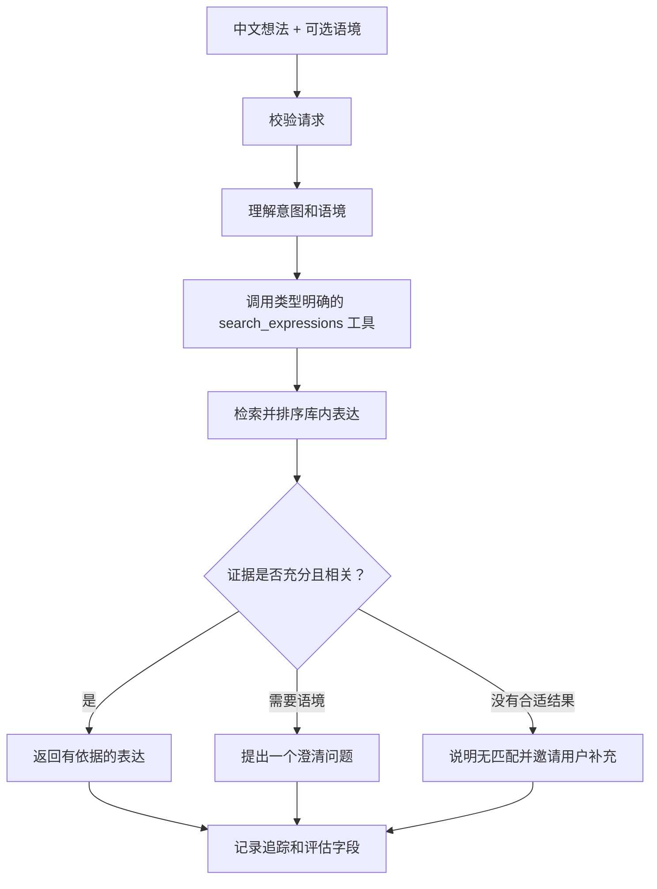
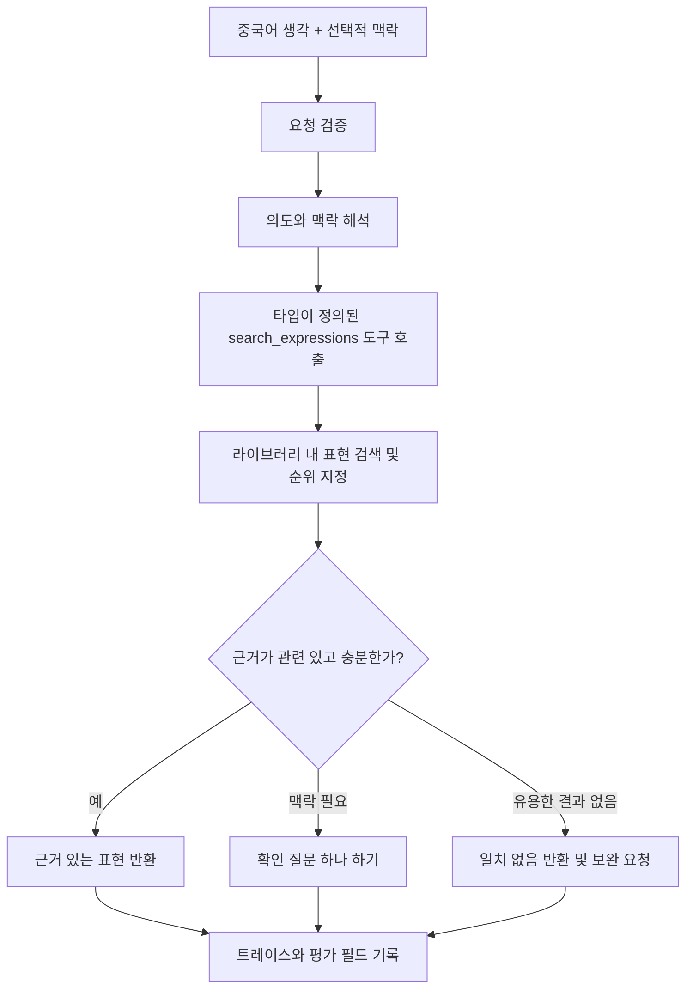

# AI English Speaking Phrase Agent — Design

> **Status:** Updated 2026-11-22. English version first; Chinese and Korean versions follow. This design prioritizes Agent development. The learner-client extension delivers a web interface and an Android app; the original three-week scope is recorded below. Learner clients holds the owner's decision log (D1–D9), the staged answers, the latency work (parallel searches, a quick translation and the fast first stage), podcast audio clips, the daily cap, the security changes and our own Vercel deployment.

### Historical note: the first demo slice

The first code demo was an LLM-only translation prototype in `translation_agent_demo/`, with no retrieval, tools or Agent framework. That folder now holds the coach itself (agents, the search tool, storage, jobs and migrations); the learner clients and the server are in `frontend/`, the evaluation in `evaluation/`. The translation CLI is still there (`translation_agent_demo/README.md`). `AGENTS.md` still describes the old slice; the owner chose to leave it unchanged, and the decision log below records the current scope.

## 1. Project goal

Build a Python Agent/API that helps learners around IELTS 7 recall natural spoken English expressions. A learner submits an idea in Chinese, the Agent interprets the intended meaning and context, searches a curated expression library through a typed tool, checks whether the results are relevant, and returns grounded English expressions or asks a clarifying question.

The portfolio should make the Agent behavior reviewable: tool inputs and outputs, retrieval evidence, workflow decisions, failure handling, and evaluation results should be visible and reproducible.

## 2. Target user and core scenario

- **User:** an English learner with approximately IELTS 7 proficiency who sometimes cannot recall an appropriate spoken expression quickly.
- **Core request:** “I know what I mean in Chinese, but what is a natural way to say it in English in this situation?”
- **Input:** a Chinese idea and optional situation/topic, such as everyday conversation or IELTS speaking.
- **Output:** the best matching stored English expression, its Chinese meaning and usage context; optionally up to two useful alternatives. When context or evidence is insufficient, the Agent asks a short question or reports that no close match was found.

## 3. MVP boundary

### P0 — required

- Python API for phrase search
- A bounded Agent workflow that interprets the query, calls a typed expression-search tool, checks evidence, and returns a structured result
- A curated, attributable expression dataset with metadata
- A search evaluation set with expected relevant results and no-match cases
- A comparison between a simple retrieval baseline and the Agent workflow
- Defined behavior for ambiguity, low-confidence matches, malformed input, and search-service failures
- Clear setup and architecture documentation

### P1 — if time allows after P0

- Persistent learner records or a `save_expression` tool/API
- Authentication and per-user data isolation
- Agent tracing for model calls, tool calls, retrieved records, latency, and token/cost usage
- Deployment of the API for a reviewer

### P2 — optional after the three-week core is complete

- Minimal browser interface for trying the API
- Full responsive web app or native mobile application
- Speech input, pronunciation scoring, broad tutoring chat, multi-agent orchestration, or spaced repetition

The project does not need a Next.js front end to demonstrate Agent development. Use an API client, command-line demo, or API documentation as the initial interface. The later learner-client delivery is documented under Learner clients.

## 4. Agent workflow

```mermaid
flowchart TD
  A[Chinese idea + optional context] --> B[Validate request]
  B --> C[Interpret intent and context]
  C --> D[Call typed search_expressions tool]
  D --> E[Retrieve and rank stored expressions]
  E --> F{Evidence relevant and sufficient?}
  F -->|Yes| G[Return grounded expression(s)]
  F -->|Need context| H[Ask one clarifying question]
  F -->|No useful match| I[Return no-match and invite refinement]
  G --> J[Record trace and evaluation fields]
  H --> J
  I --> J
```

Keep the model's autonomy bounded. The Agent may interpret intent, choose search filters, and decide whether to answer or clarify. It must not invent a database result, change user data without an explicit tool call, or retry indefinitely. Under the verified-slot lock, it must not change an example the first stage verified (see Learner clients). A deterministic workflow should enforce schemas, permissions, step limits, and failure behavior.

## 5. Search tool and expression data

### `search_expressions`

The tool accepts a normalized intent, optional situation/topic, and bounded result count. It returns stored expression IDs, English text, Chinese meaning, usage notes, metadata, and relevance scores. It has a narrow read-only responsibility.

### Expression record

- `id`
- `english_text`
- `chinese_meaning`
- `usage_note`
- `example_text` (optional)
- `topic`, `situation`, and `register`
- `difficulty` or learner level
- `source` and reuse/license information
- searchable text and optional embedding
- timestamps and dataset version

Start with a small reviewed dataset; a proposed planning target is 100–300 expressions. The actual size and source depend on the course rules and available materials. Do not import content without checking reuse rights.

### Retrieval approach

1. Validate and normalize the Chinese query and optional context.
2. Retrieve candidates using lexical search and multilingual semantic search where available.
3. Apply relevant metadata filters and rank candidates.
4. Apply a confidence threshold selected by reviewing evaluation results.
5. Return only stored records. If retrieval is weak, clarify or report no match.

Begin with the simplest measurable baseline. Add query rewriting, reranking, or a vector database only if the evaluation set shows a meaningful need.

## 6. Proposed technical shape

| Area | Proposed starting point | Notes |
|---|---|---|
| Language/API | Python + FastAPI | Typed HTTP API and convenient integration with Agent and retrieval libraries |
| Agent | One bounded workflow; framework choice remains open | Use the course-required framework if there is one; otherwise compare a small LangGraph workflow with a simple custom workflow before choosing |
| Data | Start with the simplest database permitted by the course; PostgreSQL/pgvector is a deployment-ready option | Keep the retrieval interface independent of the storage choice |
| Model | Select an available model/provider after checking course access, cost, and language quality | Keep model calls behind a small adapter |
| Demo | OpenAPI/Swagger UI, a small CLI, or a minimal API client | A full front end is optional and last priority |
| Evaluation | A versioned query set plus a repeatable evaluation script or documented procedure | Compare the same queries and dataset across retrieval variants |

These are proposals, not decisions about vendors. Prefer tools required or already supported by the course.

## 7. API outline

- `POST /api/search` — accept a Chinese idea, optional context, and bounded result count; return structured results, a clarification request, or a no-match response.
- Optional later: `POST /api/saved-expressions` and `GET /api/saved-expressions` — persist and retrieve a learner's saved expressions.
- Optional later: authentication endpoints or integration with a managed identity provider.

The search response should distinguish `matched`, `needs_clarification`, and `no_match` outcomes. Do not use a client-supplied user ID as proof of identity.

The delivered learner API differs from this outline: it takes `{question, context}` and returns expressions with sources and a note, as one JSON reply or as staged NDJSON lines (see Learner clients → API).

## 8. Evaluation and acceptance

Build a fixed set of Chinese queries covering paraphrases, ambiguous meaning, context-sensitive expressions, several topic areas, and cases with no suitable stored result. A proposed starting size is 30–50 queries, adjusted to the time and data available.

Measure:

- Recall@k and Precision@k for retrieved expressions
- Whether the Agent preserves the user's intended meaning
- Whether retrieved expressions preserve intent and fit the requested situation and register
- Whether it asks for clarification or abstains on ambiguous/no-match cases
- Tool selection/argument validity, step count, latency, and model/tool failure behavior

Compare the Agent with a simple retrieval baseline on the same dataset. Review weak cases manually and record the prompt, model, dataset, and search version. Do not treat an LLM judge as ground truth.

The three-week core is complete when the API can perform the intended flow, results are grounded in stored records, no-match and failure paths are defined, and the evaluation comparison is reproducible.

## 9. Reliability and safety

- Validate request size, required fields, result limits, and tool arguments.
- Bound Agent steps, retries, latency, and model/tool usage per request.
- Retry only transient failures; do not endlessly retry invalid tool arguments.
- Return a useful error or fallback when the model or search service is unavailable.
- Treat user input and imported learning materials as untrusted data.
- Keep credentials outside source control and avoid logging secrets or unnecessary learner content.
- If persistence is added, enforce ownership on every read/write and define deletion behavior.

## 10. Interview readiness and relationship to `idea.md`

The original idea document describes a broader English coach. This MVP deliberately narrows the product to Chinese-to-English expression retrieval so the Agent, its search tool, and its evaluation can be built and explained well within the course project.

| Interview area from `idea.md` | Evidence this project should produce | Boundary to explain honestly |
|---|---|---|
| Product and architecture (Q1–7) | Target user, request-to-response flow, typed tool boundary, bounded Agent decisions, and reason for using one workflow | Voice input and mid-session activity switching are future work; the API should keep input handling separable from learning logic |
| Feedback and model behavior (Q8–14) | Preserve intended meaning, return only retrieved expressions, ask when ambiguous, and use a structured response | The MVP finds expressions; it does not claim to diagnose grammar mistakes or grade writing |
| RAG and learning materials (Q15–23) | Source/rights notes, expression metadata, lexical vs semantic baseline, retrieval metrics, threshold selection, and evidence grounding | A phrase library uses records rather than long-document chunks; reranking and query rewriting need evidence before adoption |
| Tools and reliability (Q24–32) | Typed `search_expressions` schema, bounded steps/retries, malformed-input handling, no-match fallback, and traces that help replay a failure | Write-tool idempotency matters only if persistence/save tools are added |
| Memory and personalization (Q33–39) | A clear boundary between per-request context and future learner memory; a documented path for save/history and user controls | Long-term profile, cross-session personalization, authentication, and deletion are not P0 unless the course requires them |
| Evaluation (Q40–46) | Fixed labeled queries, baseline comparison, Recall@k/Precision@k, human review, versioned regression cases, and latency/cost records | Report actual measurements and limitations; do not claim quality improvements without evidence |
| Backend, scale, and security (Q47–54) | API validation, identity/data isolation design if persistence is enabled, secret handling, timeouts, bounded work, and graceful degradation | High-concurrency load testing and production operations are outside the three-week core; explain what would be added and why |
| Ownership and trade-offs (Q55–60) | Keep a short decision/failure log and prepare a walkthrough connecting a design choice, the failure it prevents, and measured evidence | Only describe implementation and results that were actually completed by the project owner |

This project is interview-ready when each in-scope claim can be supported by a design artifact, a trace, or an evaluation result, and deferred features are described as deliberate scope decisions rather than completed capabilities.

### Learner clients

The web client and installable Android client share a bilingual interface and an offline phrase collection. A saved card and search history belong to the current device. POST /api/search accepts a question and optional context and returns learner-facing expressions with verified source details from ExpressionCoach. Credentials stay on the Python server.

The live Vercel app (the teammate's project) serves the chat UI, Android download and coach at the same HTTPS origin. Its deployment includes 185 reviewed passages, their vectors and the MiniLM encoder; it computes the query vector and calls the Responses gateway. Anyone can ask a question directly, and the computer can be off. Publish a new snapshot when transcripts or rights change. Our own Vercel project (D9) carries the whole approved Changelog corpus; see **Own Vercel deployment**.

#### Decision log

D1–D6 were agreed on 2026-11-21. On 2026-11-22, D5 was revised, D6 was run, and D7–D9 were added. The sections below implement them.

| ID | Decision |
|---|---|
| D1 | **Verified-example lock.** When the first stage verifies at least one example, send only the verified expressions and examples at once. They never change: the agent locks those slots, and the continuation (baseline or agent) fills only the empty slots. With all three verified, neither system runs a continuation. With none verified, send the finished answer once. |
| D2 | **Raw questions stored.** A school project: questions are kept and may be shown as written. |
| D3 | **No user ID.** No accounts and no user identity; data is per request. Saved cards and history stay on the device. |
| D4 | **Admin public.** `/admin` ships in the same Vercel deployment and is open for viewing. |
| D2/D4 exception | Storing raw questions (D2) and a public `/admin` (D4) are a school-project exception to the `AGENTS.md` rules on logging learner content and per-user access. Retention: kept for the course period, then deleted by the owner. `AGENTS.md` itself stays unchanged (owner decision). |
| D5 | **Neon logs and the DB-backed mode switch** (revised 2026-11-22). A free Neon Postgres database, attached by the owner, holds the request log, the mode and the daily count. Each request is one row with the question as written (D2). `/admin` shows these requests and switches the mode without a redeploy; the database setting wins over `COACH_SYSTEM`. Without a database, the log and the switch are off and the mode is `COACH_SYSTEM`. The evaluation run stays bundled as comparison data. A learner who leaves still cannot fetch the rest later. (Before: no production store; the mode was an environment variable and a redeploy.) |
| D6 | **Re-evaluation after the lock** (done 2026-11-22, run `lock-20261122`, $3.63). Both systems pass 85.3% (128/150); the agent's strict advantage is gone (54.0% vs 55.3% for the baseline). The run is the admin data. Details under Re-evaluation (D6). |
| D7 | **Admin design:** B (the learner app's brand) with design A's route map and design C's swimlane timeline in the run graph; Korean, Chinese and English. |
| D8 | **Daily cap of 10 for our deployment** (`COACH_DAILY_LIMIT=10`, all learners together, per Asia/Seoul day). The code default is no cap. |
| D9 | **Own Vercel project**, separate from the teammate's, built by `frontend/vercel/own_snapshot.py`. The teammate's package path is unchanged. |

#### Verified examples first (D1)

- An empty slot has no verified example. The first result holds only verified expressions with their examples. Unverified candidates are never sent early.
- What was sent is final. The final answer starts with the sent items unchanged. If that ever broke, the server would put the sent items first and log `invariant_ok: false`.
- The learner sees the first examples at once. While the continuation runs, a notice above the chat says more podcast examples are being looked for, and that keeping the screen open shows when it ends. Examples found later go to a new **Podcast** tab with a badge. The chat answer does not change.
- If the learner leaves, the first examples stay in the device history, and the app offers **Look again** on return (D5).
- The chat page keeps its brand; the notice, the empty slot, the waiting time and the Podcast tab are new. The tabs show on the chat page too, so the Podcast tab's badge can be seen and tapped at once; the notice and the slot also link to it.
- Reversible default: a new coach question waits while a background search runs, because the server answers one request per process. The full state table is in `frontend/README.md`.

#### API: POST /api/search

The request is `{question, context}`. The default reply is one JSON object, `{expressions, note}`, as before, so installed APKs keep working. A client that sends `Accept: application/x-ndjson` gets one JSON object per line:

| Line | When | Fields |
|---|---|---|
| `quick` | Optional, before any other line: the quick model call answered within 3 s | `text` (one English expression), `note` (short, in the learner's language). A generated suggestion with no source (see Faster first answer) |
| `first` | The first stage verified 1–3 examples | `expressions` (verified only), `pending` (`false`: nothing follows), `note` |
| `final` | After the continuation. The only line when nothing was verified or the request was declined | `expressions` (after a `first`: the sent items, then only examples verified later; without a `first`: the whole answer), `added` (indexes of the examples verified later), `note` |
| `error` | In place of `final` | `code`: `timeout`, `coach_unavailable` or a coach code |

- Each item keeps `expression`, `key_phrase`, `note` and `citation`. A citation also carries the audio fields `audio_url`, `audio_start_ms`, `audio_end_ms` and `audio_estimated` (see **Podcast audio clips**).
- Refusals are plain HTTP errors before any line: 401 or 403 `pairing_required`, 403 `origin_denied`, 422 `invalid_input`, 429 `coach_busy`, and with a daily cap 429 `daily_limit` or 503 `daily_limit_unavailable` (see **Daily cap**).
- The JSON reply is the whole final answer; after a `first` it can include unverified candidates that the stream leaves out. If the continuation fails after verified examples were found, the reply returns them with 200 (before this change: 503).
- Work stops 280 s after the request starts (Vercel's `maxDuration` is 300 s), with the error code `timeout`. The local server takes `--deadline` or `COACH_DEADLINE_SECONDS` (1–3600 s). One request runs per process. If the client leaves, the work stops at its next model call or search; the slot returns only when the work has stopped, and the log line and the row are still written.
- **Access:** the Vercel functions are public. The local server answers only loopback hosts (else 403 `pairing_required`) unless `COACH_PAIR_CODE` is set; then the header `X-Coach-Code` must match (else 401), and the server refuses to listen on a network interface without it. A browser `Origin` other than the host, `http://localhost` or `COACH_WEB_ORIGIN` gets 403 `origin_denied`. The `Origin` check stops other sites' pages, not scripts.

#### Faster first answer: parallel searches and a quick translation

Goal: the learner sees something useful within 2 s of asking, without weakening D1.

- **Parallel searches:** the first stage's searches, one per candidate (`search_1` to `search_6`), run at the same time instead of one after another. The budget, the results and their order are unchanged; only the wait is shorter. `COACH_SEARCH_WORKERS` (1–9, default 6) sets how many run at once; `1` restores one after another. Each trace step records `started_ms` in its details: milliseconds from the start of the request's first session (a continuation counts on from the end of the first stage), so overlapping steps can be drawn side by side.
- **Quick translation:** right after the request arrives, the server starts one fast model call next to the candidate call. It asks for one natural English expression and a short note in the learner's language. If it answers within 3 s of the request, the stream sends it as the first line, `quick`; the target is under 2 s. If it fails, takes longer than 3 s or declines, nothing is sent and the stream goes on as before.
- **Model:** `COACH_QUICK_MODEL` (default `LLM_MODEL`) and `COACH_QUICK_PROVIDER` (default `LLM_PROVIDER`).
- **A generated suggestion, not a record:** the quick translation is model output with no podcast source and no verification. The app labels it as such, in Chinese and Korean, and keeps it apart from the verified examples.
- **Relationship to D1:** the quick translation is not a slot. It does not count toward the three expressions, is never part of `first` or `final`, and cannot change what D1 sends. The verified examples that follow are separate and still never change; with all three verified, the continuation is still skipped.
- **Old clients:** the JSON reply is unchanged and has no quick translation.
- **Not evaluated:** D6 measured the answers without the quick translation.
- **Measured latency (2026-11-22):** local server, Claude Haiku 5.5 (`claude-haiku-5-5`) for the coach and the quick call, 15 Korean questions from `evaluation/data/tasks.jsonl`, one request at a time, times seen by the client:

  | Measure | p50 | p95 |
  |---|---|---|
  | `quick`, final shape (30 requests, all within 2 s) | 0.98 s | 1.41 s |
  | `quick`, first shape (15 requests) | 1.20 s | 1.71 s |
  | `first`, parallel searches (14 requests with a `first` line) | 16.1 s | 19.4 s |
  | First stage, one search after another (`COACH_CONTINUATION=off`) | 20.0 s | 24.8 s |
  | First stage, six searches at once | 16.3 s | 21.9 s |

  - The 2 s target for `quick` is met.
  - Tuning: the first shape asked Claude for a strict JSON schema with adaptive thinking at low effort. Once, thinking used up the 300-token cap and nothing was sent. The final shape sends no schema (the reply is still checked) and turns thinking off on Claude Haiku 5.5; other Claude models keep adaptive thinking at low effort, and other providers keep the schema.
  - Parallel searches shortened the first stage by 4.4 s at the paired median (11 of 14 questions faster). `first` is still about 16 s: most of the wait is the two model calls (candidates and selection), not the searches.
  - The declined question ended in 1.1 s, before its quick translation, so no `quick` line was sent.
  - Measurement cost: about $0.21.

#### Fast first stage (PR ⑦)

Goal: the first verified examples in about 5–6 s at p50 (before: about 14–16 s), without weakening D1; stretch goal 1–2 s. Further searching stays in the continuation (baseline or agent), which still fills only the empty slots.

- **Where the time went:** one logged request took 4.2 s for the candidates (6 candidates, 607 output tokens), 2.3 s for the searches and 7.0 s for the selection (17,678 input and 1,358 output tokens, about 800 of them thinking).
- **Settings:** `COACH_FIRST_STAGE=fast` is the app's default; `full` restores the evaluated first stage (6 candidates, frozen prompts, whole spans). The evaluation harness always runs `full`. An unknown value stops the start. The log line's `first_stage` is `full` or `fast/<candidates>c/<spans>s/<characters>/p` (default `fast/3c/3s/300/p`; `/p` means parallel).
- **What `fast` runs:** the same reply schemas and verifier, with less for the model to write and read.
  - **3 streamed candidates:** 3 instead of 6 (`COACH_FIRST_CANDIDATES`, 3–6), with short fields (note at most 90 characters). The candidate call is streamed (Claude); providers that cannot stream answer at once. Any request kind with fewer than 3 valid candidates is asked once more (before: only a comparison).
  - **Parallel search:** each candidate starts its search as soon as its JSON object is complete and valid. The literal search uses `ILIKE`, helped by the trigram index of migration `014_corpus_text_trgm.sql` (median query 473 → 222 ms).
  - **Per-candidate selection:** then one short selection call with only that candidate's spans: at most 3 per passage (`COACH_FIRST_SPANS`, 1–12), key-phrase spans first, each cut to at most 300 characters around the key phrase (`COACH_FIRST_SPAN_CHARS`, 120–800). The cut span is exactly the quote that is verified and cited. The selection LLM stays because judging meaning is not left to code. Each pick is verified at once.
  - **Grace:** 0.4 s after the first verified example, `first` is sent with what is verified by then; unfinished slots stay empty for the continuation (D1 unchanged).
  - **Model and budget:** Claude Haiku 5.5 without thinking, with the fixed system prompts cached (`cache_control`); the continuation keeps the configured model. Budget: 5 model calls (candidates, one retry, one selection each) and 6 searches.
  - **Local server:** clients and the tokenizer load at start, not on the first request.
- **No parallel switch:** the sequential compact path (one selection for all, the 3 queries embedded in one provider call) stays in the code, but no setting selects it. The rollback is `COACH_FIRST_STAGE=full`.
- **Not evaluated:** D6 and the submission used the full first stage. The evaluation still runs it, with the frozen prompts pinned in `tests/test_frozen.py`; the compact prompts are pinned there too. The run manifest hashes `agents/` and `tools/search_corpus.py`, so run folders made before this change refuse to resume.
- **Measured (2026-11-22):** local server, Claude Haiku 5.5 for the coach and the quick call, OpenAI embeddings, 12 Korean questions (the clerk question and 11 from `tasks.jsonl`), one at a time after a warm-up, `COACH_CONTINUATION=off`. Time to the first answer line, as seen by the client:

  | First stage | quick p50 / p95 | first answer p50 / p95 | verified 0 / 1 / 2 / 3 |
  |---|---|---|---|
  | full (before) | 1.09 / 1.24 s | 14.6 / 17.4 s | 1 / 0 / 4 / 7 |
  | fast, sequential, 3 candidates (first version; no setting now) | 0.99 / 1.06 s | 5.2 / 6.0 s | 2 / 6 / 0 / 4 |
  | fast, sequential, 6 candidates | 1.00 / 1.13 s | 7.1 / 7.7 s | 0 / 4 / 2 / 6 |
  | **fast, parallel, 3 candidates (default)** | **0.96 / 1.02 s** | **4.1 / 4.5 s** | 2 / 7 / 2 / 1 |

  - The 5–6 s target is met. **The 1–2 s goal for a verified example is not met:** first answer 4.1 s at p50, quick about 1 s. One candidate's path at p50: first complete candidate 1.2 s, search 0.87 s, selection 1.38 s, grace 0.4 s. Going lower needs a different first stage (judgment question R5).
  - The cost is fewer verified examples at once: about 1.2 per request with the default (2.4 with `full`), and 2 of 12 requests had none, so they show only the quick line until the continuation's answer. The clerk question: 4.4 s, none verified.
  - Sequential runs: tokens per request fell from 16,927 in / 2,631 out to 5,154 / 527; with 6 compact candidates, verification was close to `full` (2.2 per request) at 7.1 s. Six candidates were not measured on the parallel path.
  - A run that asked for shorter, more common key phrases did not verify more (1.25 per request), so that wording was reverted.
  - Before migration 014, searches took about 1.1 s: about 0.3 s for the embedding call, then about 0.5 s for the literal scan (`strpos` over every chunk).
  - Measurement cost at list prices: about $0.08 (sequential, 52 coach requests and their quick calls) and $0.03 (parallel, 13 requests).

#### Mode and request log (D5)

- **Database:** `COACH_LOG_DATABASE_URL`, else `DATABASE_URL`, else `POSTGRES_URL`. Without one, the request log and the mode switch are off. At start the server creates its tables (`CREATE TABLE IF NOT EXISTS`): `coach_request_log`, `coach_settings`, `coach_mode_changes` and `coach_daily_usage`; the same SQL is in `frontend/sql/request_log.sql`. Locally the `.env` `DATABASE_URL` (Docker Postgres) is used with no extra step. On Vercel the owner attaches Neon (steps in `frontend/README.md`).
- **Mode:** `COACH_SYSTEM` is `agent` (the default, the locked agent) or `baseline`. The mode in effect is `coach_settings.coach_system` in the database, else `COACH_SYSTEM`, else `agent`. It is cached for 10 s, and a database error falls back to `COACH_SYSTEM`. Each switch is added to `coach_mode_changes`. `COACH_CONTINUATION` is `on` (the default) or `off` (first stage only, not evaluated) and is still read once at start. Any other value of either variable stops the start.
- **Stdout line:** each request that passes the access checks still prints one JSON line: `event` (`coach_request`), `ts`, `request_id`, `mode`, `mode_source` (`db` or `env`), `continuation_setting`, `first_stage`, `transport`, `status`, `error_code`, `verified_first`, `added_final`, `verified_final`, `continuation`, `invariant_ok`, `quick_ms`, `first_ms`, `total_ms`, `llm_calls`, `searches`, `input_tokens`, `output_tokens`, `cached_input_tokens`, `disconnected`, `question_head` (the first 40 characters). Vercel keeps it 1 hour on Hobby, 1 day on Pro.
- `quick_ms` is the time to the `quick` line, `null` when none was sent. The quick translation is a generated suggestion, so it does not count as the first answer.
- **Saved row:** with a database the same request is also one `coach_request_log` row: mode and its source (`db` or `env`), transport, status, error code, the whole question, `quick_ms`, `first_ms`, `total_ms`, model calls, searches, tokens, verified counts, continuation, and `result` (the answer's expressions and trace, for the admin page). Time to the first answer is `first_ms`, or `total_ms` when it is `null`. Field meanings are in `frontend/README.md`.
- **Public data (D2, D4):** the question is stored as written and `/admin` is open, so anyone with the address can read every saved question. This is the school-project exception in the decision log: rows are kept for the course period, then the owner deletes them (there is no automatic expiry).

#### Daily cap (D8)

- `COACH_DAILY_LIMIT` (a whole number, 0–1,000,000) caps `POST /api/search` requests per day for all learners together. Unset (the default) means no cap and no counting, so local runs are unlimited. Our deployment sets 10.
- `COACH_DAILY_TZ` (default `Asia/Seoul`) sets when a day starts. An invalid value of either variable stops the start.
- The count is one row per day in the Postgres table `coach_daily_usage`, raised by one atomic `INSERT … ON CONFLICT … RETURNING`, so all instances share it.
- A request that passes the access, input and busy checks counts once, before any model call; its quick line, first stage and continuation belong to that one request. Refused requests over the cap count too.
- Over the cap the server returns 429 `daily_limit`. With a cap but no database, or when counting fails, it returns 503 `daily_limit_unavailable`: it fails closed and never runs unmetered.
- Replies carry `X-Coach-Daily-Limit` and `X-Coach-Daily-Remaining` (exposed to the browser through CORS). The app shows today's remaining count and, at the cap, a Chinese or Korean message to try again tomorrow.

#### Verified-slot lock and evaluation reproducibility

In the submission run's 129 normal answers, the first stage verified all three slots in 82 (63.6%), one or two in 44 (34.1%) and none in 3 (2.3%). The LLM judge (three votes, not human truth) rated 277 of the 319 first-stage verified examples (86.8%) grounded-good. The submission agent later removed 45 of these examples from 43 answers. The lock keeps all of them, 8 of which were rated poor (2.5% of the 319).

- The agent locks the slots that are verified when it starts. A repick or replace that names a locked slot is recorded as a noop (`locked`) and spends no budget. A search that names a locked slot still runs and spends a search, but cannot change that slot. The decision input marks each slot `locked`. The prompt `AGENT_LOCKED_PROMPT` is the submission prompt plus one paragraph. Slots the agent fills later are not locked; the existing G1 guard protects them. The baseline never changed a verified slot.
- When the first stage verified every slot, neither system runs a continuation: no model call, no search.
- Both registered systems keep the lock. The submission agent stays in the code as `AgentPipeline(locked=False)`. It is not registered and has no command-line switch.
- The submitted results (`evaluation/results/submission`, `SUBMISSION.md`) came from the pre-lock code at commit `173cbed`. They stay unchanged. Check out that commit to reproduce them.
- `python -m evaluation.eval` now runs the locked agent under the same name, `agent`. Name new runs so the lock is clear (the D6 run is `lock-20261122`); the admin generator reads the lock from the traces (`meta.lock`). The run manifest now hashes the `agents/` subpackages too, so a run folder made before this change refuses to resume.

#### Re-evaluation (D6)

- **What:** the baseline and the locked agent on the 50 tasks × 3 runs, then the three-vote judge, with the submission's models, judge, repeats, seed and task file. About $6, estimated from the submission's usage at list prices.
- **Where:** locally, against the PostgreSQL copy of the evaluation snapshot (`evaluation_snapshot_v2`), with the API keys in the demo settings.
- **Steps:** `python -m evaluation.snapshot_store verify`. Then `python -m evaluation.eval run --run lock-<date> --prepare-only`, and compare its manifest with the submission's. Run a trial with `--max-new 6` and stop if the extrapolated total exceeds $7. Then `python -m evaluation.eval all --run lock-<date>`. Always pass `--run`: the default is `submission`. Run folders live in the git-ignored `evaluation/results/` of the machine that ran them.
- **Checks:** no first-stage verified example changes, no continuation call when every slot is verified, the count of infrastructure errors and the actual cost.
- **Record here:** pass, strict pass, pass@3 and pass^3, the first-stage distribution, total time, tokens, locked noops and the actual cost, next to the figures above. The run then becomes the admin data.
- **Status:** done locally on 2026-11-22 (run `lock-20261122`, actual cost $3.63 at list prices). The submitted results are unchanged.

**Result.** The lock held: all 323 first-stage verified examples stayed in the final answers (0 requests lost one; 43 in the submission), all 93 requests with three verified slots skipped the continuation, and there were 0 locked noops because none of the agent's 147 continuation actions named a locked slot. The first stage verified 3 / 1–2 / 0 slots in 93 / 30 / 5 of 128 normal answers. The agent's advantage disappeared: pass is 85.3% (128/150) for both systems (submission: baseline 88.7%, agent 92.0%), and strict is 55.3% for the baseline and 54.0% for the agent (submission: 61.3% and 69.3%), a difference of −1.6 pp (95% CI −6.2 to +2.3). Pass non-inferiority holds; strict superiority does not. pass@3 is 0.96 and pass^3 0.72 for both. Mean / p95 time over all requests is 23.9 / 54.3 s for the baseline and 24.4 / 55.4 s for the agent; tokens per attempt 33,488 and 37,215; cost per attempt $0.0047 and $0.0052. With the lock, the two systems can differ only on the 35 units that ran a continuation. Both systems also scored below the submission on the same first-stage code, so a single run varies a lot. One error came from the shared first stage (`invalid_model_output`); there were no infrastructure errors.

#### Admin page (D4, D5)

`/admin/` is a page in the same deployment, with no protection for viewing: anyone with the address can see it, and the page says so. It reads `data.json` (contract version 1), which `frontend/admin_data.py` builds from one evaluation run. That file holds the evaluation questions as written (D2). Its lock verdict (`meta.lock`) comes from the traces, so the submission run shows as recorded before the lock. With a database, the page also shows the saved live requests and the mode in effect, and can switch the mode (Admin API below).

- **Design (D7):** of the five designs compared on the same data, B (the learner app's brand colours with rounded cards) ships, with design A's route map and design C's swimlane timeline in the run graph. Four tabs: **Mode comparison** (`baseline` and `agent` from the same run on the same measures), **Request log**, **Metrics** (p50 · p95 · p99) and **Run graph** (one request as a route map, a swimlane timeline and a step detail).
- **Languages:** the header switches the page between Korean, Chinese and English; `?lang=` picks one for a link. Korean is the default.
- **Serving:** Vercel serves the page and its data as static files under `public/admin/`. Because the page reads its data by relative URL, `/admin` redirects to `/admin/`. The local server serves the same paths. Every `/admin` response carries `X-Robots-Tag: noindex`. `COACH_ADMIN_DIR` and `COACH_ADMIN_DATA` swap the page and data folders, so another design or run can be checked on its own port. Commands and packaging options are in `frontend/README.md`.
- **Data builder safety:** `frontend/admin_data.py` keeps only allowlisted fields of each trace step (an unknown step keeps only its error code) and scans what it would write for secret-like values (API keys, tokens, PEM blocks, database URLs with a password) and local home paths. A hit stops the build, and nothing is written.

#### Benchmark scorecard

The Metrics tab reads a separate static `benchmark.json` (schema v1) from the shared Vercel package. It shows the paired run ID, task and safety coverage, accuracy, pass³, pass@3, average model calls and chat tokens, attack success, over-refusal, and one recorded failure when available. Presentation view enlarges the table. Timing distributions below it still identify their own evaluation run.

Export validates three graded attempts per task per system against the run manifest. The safety file supplies per-prompt judgments and adjudication of explicit declines on answer-expected benchmark requests. Unjudged safety outcomes are shown as pending. The static file contains counts, provenance, and a bounded failure summary. The teammate exports into the existing package and deploys it using the instructions in `deploy/phrase-room-coach/README.md`.

#### Admin API (D4, D5)

| Request | Reply |
|---|---|
| `GET /admin/data.json`, `GET /admin/data-traces.json` | The evaluation data (`data-traces.json` only when the traces are split); 404 `admin_data_missing` |
| `GET /admin/requests.json?limit=300` (1–1000) | `{"schema_version": 1, "source": "live", "enabled", "requests", "traces", "answers"}`, newest first. `requests` has the same shape as in `data.json`, plus the log row's `transport`, `mode_source` and `quick_ms`; `traces` maps an id to its spans and `answers` an id to its answer. `enabled: false` means no database; a database error adds `"error": "database_unavailable"` with empty lists |
| `GET /admin/mode` | `{"mode", "source": "db" or "env", "updated_at", "writable", "token_required", "history": [{"at", "from", "to"}]}`. `writable` is `false` without a database, and on Vercel without `COACH_ADMIN_TOKEN` |
| `POST /admin/mode` with `{"mode": "baseline" or "agent"}` | 200 with the `GET` shape; 400 `invalid_mode`; 401 `token_required`; 403 `admin_token_required` (Vercel without a token) or `origin_denied` (another site's page); 409 `no_database`; 503 `database_unavailable` |

- `COACH_ADMIN_TOKEN`: when it is set, `POST /admin/mode` needs the header `X-Admin-Token` with that value, compared with `hmac.compare_digest`. On Vercel (the `VERCEL` variable is set) without it, nobody can switch the mode. A local server without it stays open. Viewing stays open (D4). Our deployment sets the token.

#### Podcast audio clips (PR ⑥)

A cited podcast example can play its passage from the publisher's own audio file. This plays the source record; it is not voice input or pronunciation scoring.

- **Data:** three migrations, none of them in `initialize_schema` or `compose.yaml` (apply them by hand to a new database). Audio bytes are never downloaded or stored.
  - `010_episode_audio.sql`: `podcast_episode_audio` (`episode_id` primary key, `feed_id`, `enclosure_url`, `duration_s`, `fetched_at`), filled from Podcast Index enclosure metadata by `python -m translation_agent_demo.jobs.podcast_audio backfill` and kept current by the podcast sync.
  - `013_transcript_time_anchors.sql`: `transcript_time_anchors`, the publisher's time markers in the transcripts (such as `[08:24]`), filled by `python -m translation_agent_demo.jobs.podcast_audio anchors`.
  - `011_chunk_audio_alignment.sql`: `chunk_audio_alignment`, a cache of each aligned chunk's word timings and caption lines (`asr` or `stored`). The local server creates it itself.
  - Number 012 is intentionally unused.
- **Fields:** `CorpusSearchHit` and `SourceCitation` gain `audio_url` (string or `null`), `audio_start_ms` and `audio_end_ms` (integer or `null`) and `audio_estimated` (boolean). The defaults are `null` and `false`, so older records, snapshots and clients stay valid. A start or an end needs a URL, and an end never comes before its start. `search_corpus` adds the fields to each hit, and the citation copies them unchanged into the learner reply.
- **Position, in priority order:**
  1. A stored alignment: speech recognition matched to the transcript (`asr`), or the transcript's own cue timing (`stored`).
  2. Interpolation between the transcript's time markers (`anchored`; the quote is widened 3 s on each side, and the marker error has a median of 3.3 s).
  3. A proportional estimate: the character position × the episode duration (15 s early, 5 s late).
  - The citation's own fields use cue timing, else markers (3 s early and late), else the proportional estimate, and set `audio_estimated: true` for the last two (judgment question R4). If the audio table is missing or unreadable, hits come back without audio and the search still succeeds.
- **Alignment API:** `GET /api/audio/alignment?chunk_id=<uuid>&quote=<1–800 characters>` follows the same access rules as `/api/search` and never fails for an unknown chunk:

  | Field | Meaning |
  |---|---|
  | `status` | `ready` (an alignment or marker-timed lines), `pending` (recognition queued or running), `unavailable` (failed in the last 10 minutes, impossible or off) |
  | `method` | `asr` or `stored` (saved), `anchored` (from markers), `estimated` (no lines) |
  | `audio_url`, `clip_start_ms`, `clip_end_ms` | The file, and the 30–40 s of lines around the quote |
  | `quote_start_ms`, `quote_end_ms` | The quote itself (`null` when it was not found) |
  | `cues` | `[{text, start_ms, end_ms}]`: the lines for captions |
  | `confidence`, `refining` | `anchored` only: how well markers bound the chunk; whether recognition may still replace the answer |

- **Local vs Vercel:** locally (`COACH_AUDIO_ALIGN=on` by default; it needs faster-whisper from `requirements-local.txt` and the database), a chunk without a saved alignment answers at once from the markers. Meanwhile two background workers (at most 24 jobs) decode about ±150 s of the remote file around the estimate, recognise it with faster-whisper (`COACH_ALIGN_MODEL`, default `base.en`) and save the result. A stream also queues its cited chunks before the learner presses play. `python -m frontend.audio_align <chunk_id>…` aligns chunks ahead of time. On Vercel, ASR is off: the function has no database, so `/api/audio/alignment` answers only from the bundled `corpus/alignments.json`, and other chunks answer `unavailable` with nulls. The player then uses the citation's position, which our package interpolates from the markers wherever a document has them.
- **App (clip player):** a card with a citation and an `audio_url` shows **听这一段 / 이 부분 듣기**, which opens one shared player under it (**■ 关闭 / 닫기** closes it). It loops by default. The range is the quote, all lines or one tapped line. The speed is 0.75×, 1× or 1.25× (remembered). Captions follow the spoken line. An estimated start is labelled **大致位置 / 대략 위치**. Without an alignment answer, it plays the citation's range, or 20 s from its start. Cards without a verified record show no player, so generated suggestions stay distinct from retrieved records.
- **Licence:** the app plays the publisher's file from its original URL. It does not download, cache or redistribute audio. The transcript licence recorded in the feed review does not cover the audio, which stays under the publisher's own terms.
- **Status (local database, 2026-11-22):** 1,460 of 1,460 transcript episodes have an audio URL and a duration. None of the 36,397 searchable chunks has stored cue timing; 1,157 of the 1,167 searchable documents have time markers, covering 99.3% of the searchable chunks. In 11 spot checks against the public audio, the markers were within ±14 s in 10 (median error 3.3 s; the character estimate's median was 48 s). 16 sampled URLs on 6 hosts answered HEAD with 200 and a Range request with 206. Recognised and marker-timed clips played from the publishers' files in a headless browser.

#### Own Vercel deployment (D9)

- **What:** a new Vercel project, separate from the teammate's live one, whose package and steps (`python -m frontend.vercel.package`) are unchanged. Its function is `frontend/vercel/own_index.py`: Claude through `LLM_PROVIDER` and `LLM_MODEL` (default `anthropic` and `claude-haiku-5-5`) and the bundled MiniLM encoder.
- **Corpus:** all 36,397 approved Changelog chunks (1,167 episodes, 3 feeds, CC BY-SA 4.0, attribution "Changelog Media LLC"), re-embedded with the deploy's MiniLM as float16 vectors (384 columns, read as the zero-padded 1536), with the audio fields. Rights are checked again on every row (0 refused).
- **Audio:** citation positions come from markers (36,050 chunks) or the proportional estimate (262). Exact ASR alignments are precomputed for the chunks the D6 answers cite and bundled in `corpus/alignments.json`: 85 in the 2026-11-22 build (the remaining cited chunks are still being aligned; a repackage adds them).
- **Commands:** `python -m frontend.vercel.own_snapshot align --run <run>` (re-runnable; it skips saved chunks), then `python -m frontend.vercel.own_snapshot package --run <run> --admin-data <data.json>` (default output `frontend/.local/vercel-phrase-room-own`). Over the size budget, `--max-mb` keeps whole episodes: the most cited first, then the newest.
- **Size:** about 461 MB uncompressed against Vercel's 500 MB limit for a Python function (dependencies about 206 MB, encoder 91 MB, corpus about 162 MB); peak memory about 1.1 GB of the default 2 GB. The web app is static (3.1 MB), and the APK is left out.
- **Settings:** Neon (`DATABASE_URL`), `ANTHROPIC_API_KEY`, `COACH_ADMIN_TOKEN`, `LLM_PROVIDER`, `LLM_MODEL` and `COACH_DAILY_LIMIT=10`. The owner's steps are in `frontend/README.md`.
- **Status:** built and checked locally; not deployed.

#### Security changes (2026-11-22)

Done in this change, not deferred:

- On Vercel, the mode switch needs `COACH_ADMIN_TOKEN` (see Admin API).
- A root `.gitignore` keeps `.env*` (except `.env.example`), `.vercel/`, keys and keystores, `frontend/.local/` and caches out of git.
- The admin data builder uses an allowlist and a leak check that fails the build (see Admin page).
- A client that leaves no longer frees the request slot early: the slot returns only when the work has stopped, and the log line and the row are still written.
- The daily cap (D8) bounds the model spend of a public deployment.

#### Known gaps

- Not yet checked on a real deployment or device: line-by-line streaming through Vercel and the Android WebView, idle timeouts during a quiet continuation (there is no ping line), the `/admin` redirect, and Neon on Vercel (the injected variable name, the saved rows, the daily count and the mode switch).
- Our own package is not deployed. Unverified: whether the Hobby plan's CLI upload limit (documented as 100 MB, while a 2026-06-17 changelog says the CLI-only limit was removed) accepts its upload of about 260 MB. Neon must be connected without a variable prefix, or the log and the cap find no database (with a cap, every question is then 503). Its APK link is 404, and its literal search scans the 36k chunks in Python (about 1.2 s per search).
- Installed APKs keep the JSON flow, so they show no early results and no daily count until the APK is rebuilt.
- The deadline stops work between calls. A model call already running is not cut.
- The teammate's package is built in WSL only: the corpus export uses `sudo -u postgres psql`, and the MiniLM snapshot is not in the macOS Docker database. Our own package reads the local database through `DATABASE_URL`.
- A mode switch can take up to 10 s to reach every running instance (the cache).
- The evaluation data's "mode the data was built for" is still set at packaging time; the mode in effect comes from `GET /admin/mode`.
- The admin page's JavaScript has no automated test; server tests cover how it is served and its source rules.
- The app's default agent is the locked agent that D6 measured: equal to the baseline on pass, not better as the pre-lock submission agent was (judgment question R1).
- The quick translation adds one model call to each streamed request. The latency figures were measured locally with Claude Haiku 5.5 only. The teammate's deployed model (Responses gateway) is not measured, and on it the fast first stage keeps that model's own thinking settings. Our own deployment uses Claude Haiku 5.5 but was not measured on Vercel.
- The fast first stage verifies fewer examples at once (about 1.2 instead of 2.4 per request in 12 questions), so more slots wait for the continuation, and a request with none shows only the quick line until the final answer. Its answer quality is not evaluated, and it is not 1–2 s (judgment question R5).
- The citation's own audio fields cover the whole chunk (median about 160 s for an estimate), not the quote (judgment question R4). The marker-timed loop can miss: in a real check of 5 quotes, 2 were fully inside the loop and 2 were spoken 10–13 s earlier than estimated. A stored ASR alignment fixes this; on Vercel only the bundled alignments are exact.
- Enclosure URLs often pass through tracking redirects and can change; no job re-checks them.
- The public `/api/search` has no per-IP rate limit; the daily cap is the only spend bound.
- `AGENTS.md` still describes the first translation slice and a first release with accounts; the owner kept it unchanged. The decision log records the current scope and the D2/D4 exception.

On the shared production site, the blue cat follows real stage events. A finished answer links to its Chinese or Korean replay only after its metrics are stored. The public admin dashboard shows evaluation data and live request logs without a token. Only mode changes require the production admin token.

## 11. Project Owner Judgment Questions

**R1. Submission wording and deployed default after D6:** keep the locked agent as the default and write "same accuracy as the baseline, plus kept examples and skipped continuations"? Recommended: yes, because the lock keeps the D1 promise and the strict gap is not significant. Alternatives: switch the default to the baseline (cheaper, same results), or cite only the submission results and attach the D6 run as an appendix.

**R2 and R3 are settled** (decision log): on Vercel the mode switch is off without `COACH_ADMIN_TOKEN`, and our deployment sets it; saved questions are kept for the course period (D2/D4 exception).

**R4. Also narrow the citation's own audio fields to the quoted sentence?** The player already loops the quote (from `GET /api/audio/alignment`); the citation's `audio_start_ms`/`audio_end_ms` still cover the whole chunk (3 s early with markers, 15 s without). Recommended: keep them chunk-level, because narrowing them changes `agents/` code and evaluation manifests made before the change would refuse to resume. Alternative: add the quote's estimate to the citation.

**R5. How far should the fast first stage go?** The default (3 candidates, parallel) gives a first answer in 4.1 s at p50 with about 1.2 verified examples, and 2 of 12 requests had none; 1–2 s is not met. Options: (a) keep it; (b) `COACH_FIRST_CANDIDATES=6` for more verified examples at once (measured only on the sequential path: 7.1 s, 2.2 verified), which needs only a restart; (c) a different first stage for 1–2 s, such as a much shorter selection call, kept as the meaning check. Recommended: (a).

**Owner action (not a question):** attach Neon and deploy our own Vercel project (steps in `frontend/README.md`). Set `COACH_DAILY_LIMIT` only after Neon is attached. Until Neon is attached, a deployment keeps only the stdout line, and `/admin` cannot switch the mode.

Nothing else is pending in this document. The open questions on a coach question during a background search and on committing the admin data are in `frontend/README.md` (judgment questions 1 and 2). The admin design is settled (D7).

The five earlier scope questions are settled by the delivered clients: a question takes an optional context; an answer shows up to three expressions with a key phrase, note and podcast source; saving and history stay on the device; topics follow the podcast corpus.

---

# AI 英语口语表达 Agent — 设计文档

> **状态：**2026-11-22 更新。英文版在前，其后依次为中文版和韩文版。本设计优先展示 Agent 开发；学习端扩展已交付网页和 Android 应用，下文保留原三周范围。「学习客户端」记录项目负责人的决定记录（D1–D9）、分阶段回答、缩短等待的工作（并行检索、快速翻译和快速第一阶段）、播客音频片段、每日上限、安全改动以及我们自己的 Vercel 部署。

### 历史说明：最初的 Demo 切片

最初的代码 Demo 是 `translation_agent_demo/` 中只用 LLM 的翻译原型，不接检索、工具或 Agent 框架。现在这个文件夹存放教练本身（agents、检索工具、存储、任务和迁移）；学习端和服务端在 `frontend/`，评估在 `evaluation/`。翻译 CLI 仍保留（见 `translation_agent_demo/README.md`）。`AGENTS.md` 仍描述旧切片；项目负责人决定不修改它，当前范围以下方的决定记录为准。

## 1. 项目目标

构建一个 Python Agent/API，帮助雅思水平约为 7 分的学习者快速想起自然的英语口语表达。学习者用中文描述想法后，Agent 理解意图和语境，通过有明确类型定义的工具搜索整理好的表达库，判断结果是否相关，然后返回有依据的英语表达，或提出澄清问题。

作品集需要让评审者看清 Agent 的行为：工具输入与输出、检索证据、工作流决策、故障处理和评估结果都应可查看、可重现。

## 2. 目标用户与核心场景

- **用户：**英语水平约为雅思 7 分、有时无法快速想起合适口语表达的学习者。
- **核心需求：**“我知道自己想用中文表达什么，但在这个情境下，用英语怎么说才自然？”
- **输入：**中文想法，可选场景/话题，例如日常交流或雅思口语。
- **输出：**最匹配的库内英语表达、中文含义和使用语境；也可以给出最多两个有用的替代说法。语境或证据不足时，Agent 应简短追问，或者说明没有找到足够接近的表达。

## 3. MVP 范围边界

### P0 — 必须完成

- 用于表达搜索的 Python API
- 有明确边界的 Agent 工作流：理解查询、调用类型明确的表达搜索工具、检查证据并返回结构化结果
- 经过整理且来源可追溯、带有元数据的表达数据集
- 包含预期相关结果和无匹配案例的搜索评估集
- 对比简单检索基线和 Agent 工作流
- 为歧义、低置信度匹配、无效输入和搜索服务故障定义处理方式
- 清晰的配置和架构文档

### P1 — P0 完成后有时间再做

- 持久化学习记录，或 `save_expression` 工具/API
- 身份验证和逐用户数据隔离
- Agent 调用追踪：模型调用、工具调用、检索记录、延迟及令牌/成本使用情况
- 部署 API，方便评审者体验

### P2 — 三周核心目标完成后的可选项

- 用于试用 API 的简易浏览器界面
- 完整的响应式网页应用或原生移动应用
- 语音输入、发音评分、泛化辅导聊天、多智能体编排或间隔重复系统

展示 Agent 开发不要求使用 Next.js 前端。初期可通过 API 客户端、命令行演示或 API 文档来试用。后续界面交付见「学习客户端」。

## 4. Agent 工作流



限制模型的自主范围。Agent 可以理解意图、选择搜索筛选条件，并决定回答还是澄清；不得编造数据库结果、未经明确工具调用就修改用户数据，也不得无限重试。在核对位置锁定下，也不得修改第一阶段核对通过的例句（见「学习客户端」）。工作流应通过确定性逻辑执行结构校验、权限、步骤上限和故障处理。

## 5. 搜索工具与表达数据

### `search_expressions`

工具接收规范化后的意图、可选场景/话题和有上限的结果数量。它返回库内表达 ID、英文文本、中文含义、用法说明、元数据和相关度分数。该工具只负责只读搜索。

### 表达记录

- `id`
- `english_text`：英文表达
- `chinese_meaning`：中文含义
- `usage_note`：用法说明
- `example_text`：例句，可选
- `topic`、`situation` 和 `register`：话题、场景和语域
- `difficulty` 或学习者水平
- `source` 和重用/许可信息
- 可搜索文本及可选向量嵌入
- 时间戳和数据集版本

从小型人工审核数据集开始；建议先按 100–300 条表达做计划。实际规模和来源取决于课程要求及可用材料。导入内容前要检查重用权利。

### 检索方案

1. 校验并规范化中文查询和可选语境。
2. 在条件允许时，结合词法搜索和多语言语义搜索检索候选项。
3. 应用相关元数据筛选并为候选结果排序。
4. 根据评估结果选择置信度阈值。
5. 只返回库内记录。检索结果较弱时，应澄清或说明无匹配。

先从最简单且可衡量的基线开始。只有评估集显示确有明显需求时，才增加查询改写、重排或向量数据库。

## 6. 建议的技术形态

| 领域 | 初步建议 | 说明 |
|---|---|---|
| 语言/API | Python + FastAPI | 提供类型明确的 HTTP API，便于集成 Agent 和检索库 |
| Agent | 一个边界明确的工作流；框架待定 | 如果课程指定框架，优先使用；否则先比较小型 LangGraph 工作流和简单自定义工作流 |
| 数据 | 先用课程允许的最简单数据库；PostgreSQL/pgvector 可作为可部署方案 | 检索接口不依赖特定存储方案 |
| 模型 | 确认课程访问权限、成本和中文效果后再选模型/API | 将模型调用封装在小型适配层后 |
| 演示方式 | OpenAPI/Swagger UI、小型命令行程序或简易 API 客户端 | 完整前端是可选项，优先级最低 |
| 评估 | 有版本记录的查询集，以及可重复运行的评估脚本或流程 | 使用同一组查询和数据集比较不同检索方案 |

这些都是建议，不代表已经选定供应商。优先使用课程要求或已经提供的工具。

## 7. API 草案

- `POST /api/search`：接收中文想法、可选语境和有上限的结果数量；返回结构化结果、澄清请求或无匹配状态。
- 后续可选：`POST /api/saved-expressions` 和 `GET /api/saved-expressions`，用于持久化并读取学习者保存的表达。
- 后续可选：身份验证接口或托管身份服务集成。

搜索响应应区分 `matched`、`needs_clarification` 和 `no_match` 三种结果。不能把客户端提供的用户 ID 当作身份凭证。

已交付的学习端 API 与这份草案不同：它接收 `{question, context}`，返回带出处的表达和说明，形式为一个 JSON 回复或分阶段的 NDJSON 行（见「学习客户端」中的 API）。

## 8. 评估与验收

建立固定的中文查询集，覆盖不同说法、含义模糊、依赖语境的表达、多个话题，以及表达库中没有合适结果的情况。初步建议为 30–50 条查询，再根据时间和数据调整。

至少衡量：

- 检索表达的 Recall@k 和 Precision@k
- Agent 是否保留用户本来的意思
- 检索表达是否保留原意，并符合用户要求的场景和语域
- 在歧义或无匹配情况下，Agent 是否会澄清或明确拒答
- 工具选择与参数是否合法、步骤数、延迟，以及模型/工具故障时的表现

在相同数据集上对比 Agent 和简单检索基线。人工复核效果较差的案例，并记录提示词、模型、数据集和搜索版本。不要把 LLM 评审分数当成绝对真值。

三周核心目标的完成标准是：API 能完成预期流程；返回内容有库内记录作为依据；无匹配和故障路径有明确处理；评估对比可以重复进行。

## 9. 可靠性与安全

- 校验请求大小、必填字段、结果数量限制和工具参数。
- 限制每次请求的 Agent 步骤、重试次数、延迟和模型/工具使用量。
- 只对暂时性故障重试；无效工具参数不得无限重试。
- 模型或搜索服务不可用时，返回有用的错误说明或降级结果。
- 将用户输入和导入的学习材料视为不可信数据。
- 不把凭证提交到源码管理，并避免记录密钥和不必要的学习者内容。
- 如果添加持久化存储，对每次读写执行所有权校验，并明确数据删除方式。

## 10. 面试准备及与 `idea.md` 的对应关系

原始 idea 文档描述的是更完整的英语教练。本 MVP 有意缩小为“中文想法检索英语表达”，以便在课程项目时间内把 Agent、搜索工具和评估做扎实，并能清楚讲解。

| `idea.md` 中的面试主题 | 本项目应产出的证据 | 需要诚实说明的范围边界 |
|---|---|---|
| 产品与架构（Q1–7） | 目标用户、请求到响应的流程、类型明确的工具边界、受限的 Agent 决策，以及采用单一工作流的原因 | 语音输入和会话中途切换活动属于后续工作；API 应让输入处理与学习逻辑保持可分离 |
| 反馈与模型行为（Q8–14） | 保留原意、只返回检索表达、遇到歧义时追问、使用结构化响应 | MVP 负责查找表达，不宣称能诊断语法错误或给写作评分 |
| RAG 与学习材料（Q15–23） | 来源/许可记录、表达元数据、词法与语义基线对比、检索指标、阈值选择和证据依据 | 表达库使用记录，而不是长文档分块；只有评估证明必要时才加入重排和查询改写 |
| 工具与可靠性（Q24–32） | `search_expressions` 类型定义、有限步骤/重试、错误参数处理、无匹配降级，以及便于重现故障的追踪信息 | 只有添加保存等写入工具后，幂等写入才成为必要事项 |
| 记忆与个性化（Q33–39） | 明确区分单次请求语境与未来学习者记忆；记录保存/历史功能和用户控制的后续方案 | 长期学习者档案、跨会话个性化、身份验证和数据删除不属于 P0，除非课程要求 |
| 评估（Q40–46） | 固定标注查询集、基线对比、Recall@k/Precision@k、人工复核、带版本的回归案例，以及延迟/成本记录 | 只报告实际测量和限制；没有证据就不声称质量提升 |
| 后端、规模与安全（Q47–54） | API 校验；启用持久化时的身份/数据隔离设计；密钥处理、超时、工作量限制和降级行为 | 高并发压力测试和生产运维不属于三周核心；要说明扩展时会增加什么以及原因 |
| 项目归属与权衡（Q55–60） | 简短记录设计决策和失败案例，并准备演示，说明某个设计选择预防了什么问题及其测量证据 | 只描述项目负责人实际完成的实现和结果 |

当项目范围内的每项主张都有设计材料、追踪记录或评估结果支撑，并且后续功能被明确描述为范围选择而非已实现能力时，本项目就具备面试展示基础。

### 学习客户端

网页和可安装的 Android 客户端共用中韩双语界面和离线表达集。收藏与学习历史保存在当前设备。POST /api/search 接收问题和可选场景，返回 ExpressionCoach 给出的表达及经过核对的字幕出处。密钥保存在 Python 服务端。

线上 Vercel 应用（队友的项目）在同一个 HTTPS 网址同时提供聊天首页、Android 安装包和教练接口。它的部署携带 185 个字幕片段、对应向量与 MiniLM 编码器，在云端计算问题向量并调用 Responses 网关。手机打开即可提问，电脑可以关机。字幕或使用许可发生变化时需重新发布快照。我们自己的 Vercel 项目（D9）携带全部已核准的 Changelog 语料，见 **自有 Vercel 部署**。

#### 决定记录

D1–D6 于 2026-11-21 确定。2026-11-22 修订了 D5、完成了 D6，并新增 D7–D9。下文各节实现这些决定。

| 编号 | 决定 |
|---|---|
| D1 | **已核对例句锁定。**第一阶段至少核对通过一个例句时，立即只发送核对通过的表达和例句。之后不再改变：agent 锁定这些位置，后续阶段（baseline 或 agent）只填补空位。三个都核对通过时，两个系统都不运行后续阶段。一个都没有时，完成后一次发送最终答案。 |
| D2 | **保存问题原文。**这是学校项目：问题会原样保存，也可以原样显示。 |
| D3 | **没有用户 ID。**没有账户，也不区分用户；数据只按请求计。收藏和历史保存在设备上。 |
| D4 | **管理页公开。**`/admin` 放在同一个 Vercel 部署中，查看不设保护。 |
| D2/D4 例外 | 保存问题原文（D2）和公开 `/admin`（D4）是学校项目对 `AGENTS.md` 中学习者内容记录规则和逐用户访问规则的例外。保留期限：课程期间保留，之后由项目负责人删除。`AGENTS.md` 本身保持不变（项目负责人决定）。 |
| D5 | **Neon 日志与数据库驱动的模式切换**（2026-11-22 修订）。由项目负责人接入的免费 Neon Postgres 数据库保存请求日志、模式和每日计数。每个请求保存为一行，问题原样保存（D2）。`/admin` 显示这些请求，并且无需重新部署即可切换模式；数据库中的设置优先于 `COACH_SYSTEM`。没有数据库时，日志和切换都关闭，模式取 `COACH_SYSTEM`。评估运行仍随部署打包，作为对比数据。学习者离开后，仍无法从服务端取回剩余结果。（此前：没有运行时存储，模式通过环境变量加重新部署切换。） |
| D6 | **加锁后的重新评估**（2026-11-22 完成，运行 `lock-20261122`，3.63 美元）。两个系统的通过率都是 85.3%（128/150）；agent 在严格通过率上的优势消失（54.0%，baseline 为 55.3%）。这次运行是管理页数据。详见「重新评估（D6）」。 |
| D7 | **管理页设计：**B（沿用学习端品牌），执行图采用设计 A 的路线图和设计 C 的泳道时间轴；支持韩文、中文和英文。 |
| D8 | **我们的部署每天上限 10 次**（`COACH_DAILY_LIMIT=10`，所有学习者合计，按 Asia/Seoul 日期计）。代码默认不设上限。 |
| D9 | **自有 Vercel 项目**，与队友的项目分开，由 `frontend/vercel/own_snapshot.py` 构建。队友的打包方式保持不变。 |

#### 先发送已核对的结果（D1）

- 空位是没有核对通过例句的位置。先发送的结果只包含核对通过的表达及其例句，未核对的候选不会提前发送。
- 已发送的内容就是最终内容。最终答案以未改动的已发送条目开头。万一不成立，服务端会把已发送条目放在最前面，并在日志中记录 `invariant_ok: false`。
- 学习者立即看到先到的例句。后续阶段运行期间，聊天上方的提示条说明正在查找更多播客例句，并说明保持此页面打开就会在结束时得到提示。后来找到的例句放进新的带徽标的 **播客** 页，聊天中的回答不变。
- 学习者离开后，先到的例句仍保存在设备历史中，再次打开时应用提供 **重新查找**（D5）。
- 聊天页保持现有品牌，新增的是提示条、空位、等待时间和播客页。聊天页也显示标签栏，播客页的徽标一眼可见，可以直接点开；提示条和空位也链接到那里。
- 可逆的默认做法：后台查找进行时，新的教练提问需要等待，因为服务端每个进程只处理一个请求。完整的状态表见 `frontend/README.md`。

#### API：POST /api/search

请求为 `{question, context}`。默认回复仍是一个 JSON 对象 `{expressions, note}`，所以已安装的 APK 可以照常使用。客户端发送 `Accept: application/x-ndjson` 时，改为每行返回一个 JSON 对象：

| 行 | 何时 | 字段 |
|---|---|---|
| `quick` | 可选，在所有其他行之前：快速模型调用在 3 秒内返回时 | `text`（一个英语表达）、`note`（简短说明，使用学习者的语言）。这是生成的建议，没有出处（见「更快看到第一个回答」） |
| `first` | 第一阶段核对了 1–3 个例句 | `expressions`（只有核对通过的条目）、`pending`（`false` 表示后面没有内容）、`note` |
| `final` | 后续阶段结束后。没有核对通过的例句或请求被拒绝时，只有这一行 | `expressions`（有 `first` 时：已发送的条目，之后只有后来核对通过的例句；没有 `first` 时：完整答案）、`added`（后来核对通过的例句序号）、`note` |
| `error` | 代替 `final` | `code`：`timeout`、`coach_unavailable` 或教练错误码 |

- 每个条目保留 `expression`、`key_phrase`、`note` 和 `citation`。`citation` 还带有音频字段 `audio_url`、`audio_start_ms`、`audio_end_ms` 和 `audio_estimated`（见 **播客音频片段**）。
- 拒绝是普通 HTTP 错误，在任何行之前返回：401 或 403 `pairing_required`、403 `origin_denied`、422 `invalid_input`、429 `coach_busy`；设置每日上限时还有 429 `daily_limit` 或 503 `daily_limit_unavailable`（见 **每日上限**）。
- JSON 回复是完整的最终答案；有 `first` 时，它可能包含流中省略的未核对候选。已找到核对通过的例句后，即使后续阶段失败，回复也会以 200 返回这些例句（此前为 503）。
- 请求开始 280 秒后停止工作（Vercel 的 `maxDuration` 为 300 秒），错误码为 `timeout`。本地服务可用 `--deadline` 或 `COACH_DEADLINE_SECONDS`（1–3600 秒）调整。每个进程同时只处理一个请求。客户端离开后，工作会在下一次模型调用或检索前停止；请求名额要等工作真正停止后才释放，日志行和数据库行照常写入。
- **访问：**Vercel 函数是公开的。本地服务只回答回环地址（否则 403 `pairing_required`），除非设置了 `COACH_PAIR_CODE`；设置后请求头 `X-Coach-Code` 必须一致（否则 401），没有它时服务拒绝监听网络接口。浏览器 `Origin` 不是本机、`http://localhost` 或 `COACH_WEB_ORIGIN` 时返回 403 `origin_denied`。`Origin` 检查只能挡住其他网站的页面，挡不住脚本。

#### 更快看到第一个回答：并行检索与快速翻译

目标：学习者提问后 2 秒内就能看到有用的内容，同时不削弱 D1。

- **并行检索：** 第一阶段为每个候选各做一次检索（`search_1` 至 `search_6`），现在同时进行，不再一个接一个。预算、结果及其顺序都不变，只是等待更短。`COACH_SEARCH_WORKERS`（1–9，默认 6）决定同时进行几个；`1` 恢复逐个进行。每个 trace 步骤在 details 中记录 `started_ms`：从请求的第一个会话开始算起的毫秒数（后续阶段从第一阶段结束处接着计），因此重叠的步骤可以并排显示。
- **快速翻译：** 请求一到，服务端就在候选调用旁边同时发起一次快速模型调用，请它给出一个自然的英语表达和一句用学习者语言写的简短说明。如果在请求开始后 3 秒内返回，流就把它作为第一行 `quick` 发送；目标是 2 秒以内。调用失败、超过 3 秒或拒绝回答时，什么都不发送，流照常继续。
- **模型：** `COACH_QUICK_MODEL`（默认 `LLM_MODEL`）和 `COACH_QUICK_PROVIDER`（默认 `LLM_PROVIDER`）。
- **生成的建议，而不是记录：** 快速翻译是模型输出，没有播客出处，也没有经过核对。应用用中文和韩文标明这一点，并把它与核对通过的例句分开显示。
- **与 D1 的关系：** 快速翻译不是位置（slot）。它不计入三个表达，不属于 `first` 或 `final`，也不能改变 D1 发送的内容。随后到来的核对通过的例句与它无关，仍然不会改变；三个都核对通过时，仍然跳过后续阶段。
- **旧客户端：** JSON 回复不变，不含快速翻译。
- **未经评估：** D6 评估的回答不含快速翻译。
- **实测延迟（2026-11-22）：** 本地服务，教练和快速调用都用 Claude Haiku 5.5（`claude-haiku-5-5`），取 `evaluation/data/tasks.jsonl` 中的 15 个韩语问题，一次一个请求，时间为客户端看到的时间：

  | 指标 | p50 | p95 |
  |---|---|---|
  | `quick`，最终形式（30 个请求，全部在 2 秒内） | 0.98 秒 | 1.41 秒 |
  | `quick`，最初形式（15 个请求） | 1.20 秒 | 1.71 秒 |
  | `first`，并行检索（14 个有 `first` 行的请求） | 16.1 秒 | 19.4 秒 |
  | 第一阶段，逐个检索（`COACH_CONTINUATION=off`） | 20.0 秒 | 24.8 秒 |
  | 第一阶段，六个检索同时进行 | 16.3 秒 | 21.9 秒 |

  - `quick` 的 2 秒目标已达到。
  - 调整：最初形式要求 Claude 按严格 JSON schema 回答，并使用低 effort 的自适应思考。有一次思考用完了 300 token 上限，结果什么也没发送。最终形式不发送 schema（回复仍会校验），并在 Claude Haiku 5.5 上关闭思考；其他 Claude 模型仍用低 effort 的自适应思考，其他服务商仍用 schema。
  - 并行检索使第一阶段按配对中位数缩短 4.4 秒（14 个问题中 11 个更快）。`first` 仍约 16 秒：大部分等待来自两次模型调用（候选和选择），而不是检索。
  - 被拒绝的问题在 1.1 秒结束，早于它的快速翻译，所以没有发送 `quick` 行。
  - 测量费用：约 0.21 美元。

#### 快速第一阶段（PR ⑦）

目标：第一批核对通过的例句在 p50 约 5–6 秒内出现（之前约 14–16 秒），同时不削弱 D1；进一步目标是 1–2 秒。进一步的检索仍由后续阶段（baseline 或 agent）负责，它仍然只填空位置。

- **时间花在哪里：** 一条日志请求中，候选用了 4.2 秒（6 个候选，607 个输出 token），检索 2.3 秒，选择 7.0 秒（17,678 个输入、1,358 个输出 token，其中约 800 个是思考）。
- **设置：** 应用默认 `COACH_FIRST_STAGE=fast`；`full` 恢复评估过的第一阶段（6 个候选、冻结的提示词、完整片段）。评估工具始终运行 `full`。未知值会拒绝启动。日志行的 `first_stage` 为 `full` 或 `fast/<候选数>c/<片段数>s/<字符数>/p`（默认 `fast/3c/3s/300/p`；`/p` 表示并行）。
- **`fast` 运行什么：** 回复 schema 和核对器不变，只是让模型少写、少读。
  - **3 个流式候选：** 3 个而不是 6 个（`COACH_FIRST_CANDIDATES`，3–6），字段更短（说明最多 90 个字符）。候选调用以流式接收（Claude）；不能流式输出的服务商一次性返回。任何类型的请求只要有效候选少于 3 个，就再问一次（之前只有比较类请求会重问）。
  - **并行检索：** 每个候选的 JSON 对象一完整且有效就开始检索。字面检索使用 `ILIKE`，借助迁移 `014_corpus_text_trgm.sql` 的 trigram 索引（查询中位数 473 → 222 毫秒）。
  - **按候选选择：** 随后只带该候选的片段做一次简短选择调用：每段最多 3 个片段（`COACH_FIRST_SPANS`，1–12），先放含关键短语的，每个片段围绕关键短语截成最多 300 个字符（`COACH_FIRST_SPAN_CHARS`，120–800）。截出的片段就是被核对和引用的原文。保留选择 LLM，因为含义判断不交给代码。每个选中项立即核对。
  - **等待：** 第一个例句核对通过后再等 0.4 秒，然后用届时已核对的内容发送 `first`；未完成的位置留空，由后续阶段补上（D1 不变）。
  - **模型和预算：** Claude Haiku 5.5 不思考，固定的系统提示词带缓存（`cache_control`）；后续阶段仍用配置的模型。预算：5 次模型调用（候选、一次重试、每个候选一次选择）和 6 次检索。
  - **本地服务：** 客户端和分词器在启动时加载，而不是在第一个请求时。
- **没有并行开关：** 顺序精简路径（所有候选一次选择，3 个查询用一次服务商调用一起向量化）仍在代码中，但没有设置能选中它。回退方式是 `COACH_FIRST_STAGE=full`。
- **未经评估：** D6 和提交结果用的是完整第一阶段。评估仍运行它，冻结的提示词固定在 `tests/test_frozen.py` 中；精简提示词也固定在那里。运行清单对 `agents/` 和 `tools/search_corpus.py` 计算哈希，因此本次修改前创建的运行文件夹会拒绝续跑。
- **实测（2026-11-22）：** 本地服务，教练和快速调用都用 Claude Haiku 5.5，OpenAI 向量，12 个韩语问题（店员问题和 `tasks.jsonl` 中的 11 个），预热后一次一个，`COACH_CONTINUATION=off`。时间为客户端收到第一行答案的时间：

  | 第一阶段 | quick p50 / p95 | 第一个答案 p50 / p95 | 核对通过 0 / 1 / 2 / 3 |
  |---|---|---|---|
  | full（之前） | 1.09 / 1.24 秒 | 14.6 / 17.4 秒 | 1 / 0 / 4 / 7 |
  | fast，顺序，3 个候选（第一版；现在没有对应设置） | 0.99 / 1.06 秒 | 5.2 / 6.0 秒 | 2 / 6 / 0 / 4 |
  | fast，顺序，6 个候选 | 1.00 / 1.13 秒 | 7.1 / 7.7 秒 | 0 / 4 / 2 / 6 |
  | **fast，并行，3 个候选（默认）** | **0.96 / 1.02 秒** | **4.1 / 4.5 秒** | 2 / 7 / 2 / 1 |

  - 5–6 秒目标已达到。**核对通过例句 1–2 秒的目标未达到：**第一个答案 p50 4.1 秒，quick 约 1 秒。单个候选路径的 p50：第一个完整候选 1.2 秒、检索 0.87 秒、选择 1.38 秒、等待 0.4 秒。要更快就需要换一种第一阶段（判断题 R5）。
  - 代价是一次核对通过的例句变少：默认每个请求约 1.2 个（`full` 为 2.4 个），12 个请求中有 2 个一个都没有，在后续阶段给出答案之前只显示快速翻译。店员问题：4.4 秒，没有核对通过的例句。
  - 顺序运行：每个请求的 token 从输入 16,927 / 输出 2,631 降到 5,154 / 527；精简阶段用 6 个候选时，核对数接近 `full`（每个请求 2.2 个），用时 7.1 秒。并行路径没有测量 6 个候选。
  - 有一次运行要求更短、更常见的关键短语，但核对通过的数量没有增加（每个请求 1.25 个），所以撤回了该写法。
  - 应用迁移 014 之前，检索约需 1.1 秒：向量调用约 0.3 秒，然后字面扫描约 0.5 秒（对每个片段做 `strpos`）。
  - 测量费用（按公开价格）：约 0.08 美元（顺序，52 个教练请求及其快速调用）和 0.03 美元（并行，13 个请求）。

#### 模式与请求日志（D5）

- **数据库：** 依次使用 `COACH_LOG_DATABASE_URL`、`DATABASE_URL`、`POSTGRES_URL`。都没有时，请求日志和模式切换关闭。服务启动时创建所需的表（`CREATE TABLE IF NOT EXISTS`）：`coach_request_log`、`coach_settings`、`coach_mode_changes` 和 `coach_daily_usage`；相同的 SQL 也放在 `frontend/sql/request_log.sql`。本地自动使用 `.env` 中的 `DATABASE_URL`（Docker Postgres），无需额外步骤。在 Vercel 上由项目负责人接入 Neon（步骤见 `frontend/README.md`）。
- **模式：** `COACH_SYSTEM` 为 `agent`（默认，加锁的 agent）或 `baseline`。实际生效的模式依次取数据库中的 `coach_settings.coach_system`、`COACH_SYSTEM`、`agent`。结果缓存 10 秒，数据库出错时退回 `COACH_SYSTEM`。每次切换都记入 `coach_mode_changes`。`COACH_CONTINUATION` 为 `on`（默认）或 `off`（只运行第一阶段，未经评估），仍只在启动时读取一次。两个变量出现其他值时都会拒绝启动。
- **stdout 日志行：** 每个通过访问检查的请求仍打印一行 JSON：`event`（`coach_request`）、`ts`、`request_id`、`mode`、`mode_source`（`db` 或 `env`）、`continuation_setting`、`first_stage`、`transport`、`status`、`error_code`、`verified_first`、`added_final`、`verified_final`、`continuation`、`invariant_ok`、`quick_ms`、`first_ms`、`total_ms`、`llm_calls`、`searches`、`input_tokens`、`output_tokens`、`cached_input_tokens`、`disconnected`、`question_head`（前 40 个字符）。Vercel 保留这些日志的时间为 Hobby 1 小时、Pro 1 天。
- `quick_ms` 是到 `quick` 行的时间，没有发送时为 `null`。快速翻译是生成的建议，所以不算作首次看到的答案。
- **保存的行：** 有数据库时，同一请求还会保存为 `coach_request_log` 中的一行：模式及其来源（`db` 或 `env`）、传输方式、状态、错误码、完整问题、`quick_ms`、`first_ms`、`total_ms`、模型调用数、检索数、token、核对数、后续阶段，以及 `result`（供管理页使用的答案表达和 trace）。首次看到答案的时间是 `first_ms`，为 `null` 时是 `total_ms`。字段含义见 `frontend/README.md`。
- **公开数据（D2、D4）：** 问题原样保存，`/admin` 不设保护，因此知道网址的人都能读到所有已保存的问题。这是决定记录中的学校项目例外：这些行在课程期间保留，之后由项目负责人删除（没有自动过期）。

#### 每日上限（D8）

- `COACH_DAILY_LIMIT`（整数，0–1,000,000）限制所有学习者合计每天的 `POST /api/search` 请求数。不设置（默认）表示不设上限、也不计数，所以本地运行不受限制。我们的部署设为 10。
- `COACH_DAILY_TZ`（默认 `Asia/Seoul`）决定一天从何时开始。两个变量的值无效时都会拒绝启动。
- 计数保存在 Postgres 表 `coach_daily_usage` 中，每天一行，用一条原子的 `INSERT … ON CONFLICT … RETURNING` 加一，所以所有实例共用同一计数。
- 通过访问、输入和繁忙检查的请求在任何模型调用之前计一次；它的快速翻译、第一阶段和后续阶段都属于这一个请求。超过上限被拒绝的请求也计入。
- 超过上限时服务端返回 429 `daily_limit`。设置了上限但没有数据库，或计数失败时，返回 503 `daily_limit_unavailable`：失败时关闭，绝不在不计数的情况下运行。
- 回复带有 `X-Coach-Daily-Limit` 和 `X-Coach-Daily-Remaining`（通过 CORS 向浏览器公开）。应用显示今天剩余的次数；达到上限时用中文或韩文提示明天再试。

#### 核对位置锁定与评估可重现性

在提交运行的 129 个正常回答中，第一阶段三个位置全部核对通过的有 82 个（63.6%），一到两个的有 44 个（34.1%），一个都没有的有 3 个（2.3%）。LLM 评审（三票多数，不是人工标准答案）认为第一阶段核对通过的 319 个例句中有 277 个（86.8%）为 grounded-good。提交时的 agent 后来从 43 个回答中删掉了其中 45 个例句。加锁后这些例句全部保留，其中 8 个被评为较差（占 319 个的 2.5%）。

- agent 在开始时锁定已经核对通过的位置。指向锁定位置的 repick 或 replace 会记录为 noop（`locked`），不消耗预算。指向锁定位置的 search 仍会执行并消耗一次检索，但不能改变该位置。判断输入为每个位置标注 `locked`。提示词 `AGENT_LOCKED_PROMPT` 是提交时的提示词再加一段。agent 之后填入的位置不锁定，由原有的 G1 保护规则保护。baseline 本来就不修改已核对的位置。
- 第一阶段所有位置都核对通过时，两个系统都不运行后续阶段：没有模型调用，也没有检索。
- 两个已注册的系统都遵守锁定。提交时的 agent 以 `AgentPipeline(locked=False)` 保留在代码中，未注册，也没有命令行开关。
- 已提交的结果（`evaluation/results/submission`、`SUBMISSION.md`）由加锁前提交 `173cbed` 的代码产生，保持不变。要重现这些结果，请检出该提交。
- `python -m evaluation.eval` 现在以同一名称 `agent` 运行加锁的 agent。新运行的名称要让人看出是否加锁（D6 的运行是 `lock-20261122`）；管理页生成器从 trace 中读取锁定状态（`meta.lock`）。运行清单现在也对 `agents/` 子包计算哈希，因此在本次修改前创建的运行文件夹会拒绝续跑。

#### 重新评估（D6）

- **内容：** 用 50 题 × 3 次运行 baseline 和加锁的 agent，再用三票评审评分；模型、评审、重复次数、随机种子和题目文件与提交时相同。按提交运行的用量和公开价格估算，约 6 美元。
- **地点：** 在本地运行，使用评估快照的 PostgreSQL 副本（`evaluation_snapshot_v2`）和 Demo 配置中的 API 密钥。
- **步骤：** 先运行 `python -m evaluation.snapshot_store verify`。再运行 `python -m evaluation.eval run --run lock-<日期> --prepare-only`，把生成的清单与提交时的清单对比。用 `--max-new 6` 试跑，外推总额超过 7 美元就停止。然后运行 `python -m evaluation.eval all --run lock-<日期>`。始终指定 `--run`：默认值是 `submission`。运行文件夹保存在执行它的那台机器上被 git 忽略的 `evaluation/results/` 中。
- **检查：** 第一阶段核对通过的例句改动为 0，所有位置都核对通过时后续调用为 0，基础设施错误数，以及实际费用。
- **在此记录：** 通过率、严格通过率、pass@3 和 pass^3、第一阶段分布、完成时间、token、锁定 noop 数和实际费用，与上方数据并列。这次运行随后成为管理页数据。
- **状态：** 已于 2026-11-22 在本地完成（运行 `lock-20261122`，按公开价格估算的实际费用为 3.63 美元）。提交结果保持不变。

**结果。** 锁定按设计生效：第一阶段核对通过的 323 个例句全部留在最终回答中（丢失例句的请求为 0；提交时为 43），三个位置都核对通过的 93 个请求全部跳过后续阶段；锁定 noop 为 0，因为 agent 后续阶段的 147 个动作没有一个指向已锁定的位置。在 128 个正常回答中，第一阶段核对通过 3 个 / 1–2 个 / 0 个位置的分别有 93 / 30 / 5 个。agent 的优势消失了：两个系统的通过率都是 85.3%（128/150）（提交时 baseline 88.7%，agent 92.0%）；严格通过率 baseline 为 55.3%，agent 为 54.0%（提交时为 61.3% 和 69.3%），差值为 −1.6 个百分点（95% 置信区间 −6.2 至 +2.3）。通过率非劣效条件成立，严格通过率优势条件不成立。pass@3 都是 0.96，pass^3 都是 0.72。全部请求的平均 / p95 用时：baseline 23.9 / 54.3 秒，agent 24.4 / 55.4 秒；每次尝试的 token 为 33,488 和 37,215；每次尝试的费用为 0.0047 和 0.0052 美元。加锁后，两个系统只可能在运行了后续阶段的 35 个单元上出现差异。第一阶段代码与提交时相同，两个系统的分数却一起低于提交时，说明单次运行的波动很大。共享的第一阶段出现 1 次错误（`invalid_model_output`），没有基础设施错误。

#### 管理页（D4、D5）

`/admin/` 是同一部署中的页面，查看不设保护：知道网址的人都能查看，页面上也会说明这一点。它读取 `data.json`（契约版本 1），该文件由 `frontend/admin_data.py` 根据一次评估运行生成，原样包含评估问题（D2）。锁定结论（`meta.lock`）来自 trace，因此提交运行显示为加锁前的记录。有数据库时，页面还会显示已保存的线上请求和当前生效的模式，并可切换模式（见下方管理页 API）。

- **设计（D7）：** 在同一份数据上比较的五个设计稿中，选定 B（沿用学习端品牌色和圆角卡片），执行图采用设计 A 的路线图和设计 C 的泳道时间轴。四个标签页：**模式对比**（同一次运行中的 `baseline` 和 `agent` 按相同指标比较）、**请求日志**、**指标**（p50 · p95 · p99）和 **执行图**（单个请求的路线图、泳道时间轴和步骤详情）。
- **语言：** 页头可在韩文、中文和英文之间切换；`?lang=` 可为链接指定语言。默认是韩文。
- **提供方式：** Vercel 把页面和数据作为 `public/admin/` 下的静态文件提供。页面按相对路径读取数据，所以 `/admin` 会重定向到 `/admin/`。本地服务提供相同路径。所有 `/admin` 响应都带 `X-Robots-Tag: noindex`。`COACH_ADMIN_DIR` 和 `COACH_ADMIN_DATA` 可替换页面和数据文件夹，因此其他设计稿或运行也能在各自端口上检查。命令和打包选项见 `frontend/README.md`。
- **数据生成的安全措施：** `frontend/admin_data.py` 对每个 trace 步骤只保留允许列表中的字段（未知步骤只保留错误码），并在写入前扫描内容中类似密钥的值（API 密钥、令牌、PEM 块、带密码的数据库 URL）和本机 home 路径。一旦命中就停止生成，什么都不写入。

#### 基准成绩表

指标页读取共享 Vercel 包中单独的静态 `benchmark.json`（格式 v1）。它显示配对运行 ID、题目和安全评估覆盖量、准确率、pass³、pass@3、平均模型调用次数和聊天 token、攻击成功率、过度拒绝率，以及可用时的一次实际失败。演示视图放大表格。下方的耗时分布标明自己的评估运行。

导出时根据运行清单校验每题每个系统恰有三次已评分记录。安全文件提供逐提示判定以及对预期应答但明确拒绝的基准运行的复核。未完成判定的安全指标显示待确认。静态文件只含计数、来源信息及有限的失败摘要。队友按 `deploy/phrase-room-coach/README.md` 将结果导出到现有部署包并发布。

#### 管理页 API（D4、D5）

| 请求 | 回复 |
|---|---|
| `GET /admin/data.json`、`GET /admin/data-traces.json` | 评估数据（只有拆分 trace 时才有 `data-traces.json`）；404 `admin_data_missing` |
| `GET /admin/requests.json?limit=300`（1–1000） | `{"schema_version": 1, "source": "live", "enabled", "requests", "traces", "answers"}`，最新的在前。`requests` 与 `data.json` 中的形状相同，另加日志行的 `transport`、`mode_source` 和 `quick_ms`；`traces` 按 id 给出 span，`answers` 按 id 给出答案。`enabled: false` 表示没有数据库；数据库出错时加上 `"error": "database_unavailable"`，列表为空 |
| `GET /admin/mode` | `{"mode", "source": "db" 或 "env", "updated_at", "writable", "token_required", "history": [{"at", "from", "to"}]}`。没有数据库时，或在 Vercel 上没有 `COACH_ADMIN_TOKEN` 时，`writable` 为 `false` |
| `POST /admin/mode`，请求体 `{"mode": "baseline" 或 "agent"}` | 200，形状同 `GET`；400 `invalid_mode`；401 `token_required`；403 `admin_token_required`（Vercel 上没有令牌）或 `origin_denied`（其他网站的页面）；409 `no_database`；503 `database_unavailable` |

- `COACH_ADMIN_TOKEN`：设置后，`POST /admin/mode` 需要带上值相同的 `X-Admin-Token` 请求头，用 `hmac.compare_digest` 比较。在 Vercel 上（设置了 `VERCEL` 变量）没有令牌时，任何人都不能切换模式。没有令牌的本地服务仍可切换。查看仍然公开（D4）。我们的部署会设置令牌。

#### 播客音频片段（PR ⑥）

带出处的播客例句可以直接播放发布者原音频中的对应段落。这是播放出处记录，不是语音输入，也不是发音评分。

- **数据：** 三个迁移，都不在 `initialize_schema` 或 `compose.yaml` 中（新数据库需手动应用）。从不下载或保存音频内容。
  - `010_episode_audio.sql`：`podcast_episode_audio`（主键 `episode_id`，以及 `feed_id`、`enclosure_url`、`duration_s`、`fetched_at`），由 `python -m translation_agent_demo.jobs.podcast_audio backfill` 根据 Podcast Index 的 enclosure 元数据填写，播客同步负责保持更新。
  - `013_transcript_time_anchors.sql`：`transcript_time_anchors`，即文字稿中发布方的时间标记（如 `[08:24]`），由 `python -m translation_agent_demo.jobs.podcast_audio anchors` 填写。
  - `011_chunk_audio_alignment.sql`：`chunk_audio_alignment`，缓存每个已对齐片段的逐词时间和字幕行（`asr` 或 `stored`）。本地服务会自行创建它。
  - 编号 012 有意空缺。
- **字段：** `CorpusSearchHit` 和 `SourceCitation` 新增 `audio_url`（字符串或 `null`）、`audio_start_ms` 和 `audio_end_ms`（整数或 `null`）以及 `audio_estimated`（布尔值）。默认值为 `null` 和 `false`，所以旧记录、快照和旧客户端仍然有效。有起点或终点就必须有 URL，终点不能早于起点。`search_corpus` 为每条结果加上这些字段，`citation` 原样复制到学习者的回答中。
- **位置（按优先顺序）：**
  1. 已保存的对齐：语音识别与文字稿匹配的结果（`asr`），或文字稿自带的字幕时间（`stored`）。
  2. 在文字稿的时间标记之间插值（`anchored`；引用句前后各放宽 3 秒，时间标记误差中位数为 3.3 秒）。
  3. 按比例估算：字符位置 × 节目时长（提前 15 秒、延后 5 秒）。
  - 出处自身的字段依次用字幕时间、时间标记（前后各 3 秒）、比例估算，后两种标记 `audio_estimated: true`（判断题 R4）。音频表缺失或读不出时，结果不带音频，搜索本身照常成功。
- **对齐 API：** `GET /api/audio/alignment?chunk_id=<uuid>&quote=<1–800 个字符>` 与 `/api/search` 的访问规则相同，片段未知时也不报错：

  | 字段 | 含义 |
  |---|---|
  | `status` | `ready`（有对齐结果或按时间标记计时的字幕行）、`pending`（识别排队中或进行中）、`unavailable`（最近 10 分钟内失败、无法对齐或已关闭） |
  | `method` | `asr` 或 `stored`（已保存）、`anchored`（来自时间标记）、`estimated`（没有字幕行） |
  | `audio_url`、`clip_start_ms`、`clip_end_ms` | 音频文件，以及引用句周围 30–40 秒的字幕行范围 |
  | `quote_start_ms`、`quote_end_ms` | 引用句本身（找不到时为 `null`） |
  | `cues` | `[{text, start_ms, end_ms}]`：用于字幕的行 |
  | `confidence`、`refining` | 仅 `anchored`：时间标记对片段的包围程度；语音识别是否还可能替换这个回答 |

- **本地与 Vercel：** 在本地（默认 `COACH_AUDIO_ALIGN=on`；需要 `requirements-local.txt` 中的 faster-whisper 和数据库），没有已保存对齐的片段会立即用时间标记回答。同时两个后台 worker（最多 24 个任务）在估算位置前后解码远程文件约 ±150 秒，用 faster-whisper（`COACH_ALIGN_MODEL`，默认 `base.en`）识别并保存结果。流式回答在学习者按下播放之前，也会把引用的片段排入队列。`python -m frontend.audio_align <chunk_id>…` 可提前对齐片段。在 Vercel 上不做语音识别：函数没有数据库，所以 `/api/audio/alignment` 只用随包的 `corpus/alignments.json` 回答，其他片段返回全为 null 的 `unavailable`。这时播放器使用出处中的位置；只要文稿有时间标记，我们的包就用时间标记插值得到它。
- **应用（片段播放器）：** 有出处且有 `audio_url` 的卡片显示 **听这一段 / 이 부분 듣기**，点开后在下方打开一个共用播放器（**■ 关闭 / 닫기** 关闭）。默认循环播放。范围可以是引用句、全部字幕行或点选的一行。速度为 0.75×、1× 或 1.25×（会记住）。字幕跟随正在说的那一行。估算的起点标为 **大致位置 / 대략 위치**。没有对齐回答时，播放出处给出的范围，或从起点播放 20 秒。没有核实记录的卡片不显示播放器，因此生成的建议与检索到的记录仍然分得清。
- **许可：** 应用从原始 URL 播放发布者的文件，不下载、不缓存、不再分发音频。节目审核中记录的字幕许可不涵盖音频，音频仍受发布者自己的条款约束。
- **现状（本地数据库，2026-11-22）：** 有字幕的 1,460 集节目全部有音频 URL 和时长。36,397 个可搜索片段都没有已保存的字幕时间；1,167 个可搜索文稿中 1,157 个有时间标记，覆盖 99.3% 的可搜索片段。对照公开音频抽查 11 处，时间标记有 10 处误差在 ±14 秒内（误差中位数 3.3 秒；字符比例估算的中位数为 48 秒）。抽查 6 个主机上的 16 个 URL，HEAD 均返回 200，Range 请求均返回 206。在无头浏览器中，语音识别和时间标记计时的片段都能从发布者文件播放。

#### 自有 Vercel 部署（D9）

- **内容：** 一个新的 Vercel 项目，与队友的线上项目分开；队友的打包和步骤（`python -m frontend.vercel.package`）保持不变。它的函数是 `frontend/vercel/own_index.py`：通过 `LLM_PROVIDER` 和 `LLM_MODEL` 使用 Claude（默认 `anthropic` 和 `claude-haiku-5-5`），并使用随包的 MiniLM 编码器。
- **语料：** 全部 36,397 个已核准的 Changelog 片段（1,167 集，3 个节目源，CC BY-SA 4.0，署名 "Changelog Media LLC"），用部署自己的 MiniLM 重新向量化为 float16 向量（384 列，按补零后的 1536 列读取），并带音频字段。每一行都重新检查权利（拒绝 0 行）。
- **音频：** 出处位置来自时间标记（36,050 个片段）或比例估算（262 个）。D6 回答引用的片段会预先计算精确的语音识别对齐，并随包放入 `corpus/alignments.json`：2026-11-22 的构建中有 85 个（其余被引用的片段仍在对齐，重新打包即可加入）。
- **命令：** 先运行 `python -m frontend.vercel.own_snapshot align --run <run>`（可重复运行，会跳过已保存的片段），再运行 `python -m frontend.vercel.own_snapshot package --run <run> --admin-data <data.json>`（默认输出 `frontend/.local/vercel-phrase-room-own`）。超出大小预算时，`--max-mb` 按整集保留：先保留引用最多的，再保留最新的。
- **大小：** 解压后约 461 MB，Vercel Python 函数上限为 500 MB（依赖约 206 MB、编码器 91 MB、语料约 162 MB）；内存峰值约 1.1 GB，默认上限 2 GB。网页应用是静态文件（3.1 MB），不含 APK。
- **设置：** Neon（`DATABASE_URL`）、`ANTHROPIC_API_KEY`、`COACH_ADMIN_TOKEN`、`LLM_PROVIDER`、`LLM_MODEL` 和 `COACH_DAILY_LIMIT=10`。项目负责人的步骤见 `frontend/README.md`。
- **现状：** 已在本地构建并检查；尚未部署。

#### 安全改动（2026-11-22）

已在本次改动中完成，没有推迟：

- 在 Vercel 上，模式切换需要 `COACH_ADMIN_TOKEN`（见管理页 API）。
- 根目录 `.gitignore` 把 `.env*`（`.env.example` 除外）、`.vercel/`、密钥和 keystore、`frontend/.local/` 以及缓存排除在 git 之外。
- 管理页数据生成使用允许列表，并做泄露检查，发现问题就让生成失败（见管理页）。
- 客户端离开后不再提前释放请求名额：名额要等工作停止后才释放，日志行和数据库行照常写入。
- 每日上限（D8）限制公开部署的模型花费。

#### 已知差距

- 尚未在真实部署或设备上检查：经过 Vercel 和 Android WebView 时是否逐行传输，后续阶段长时间无输出时的空闲超时（没有 ping 行），`/admin` 重定向，以及 Vercel 上的 Neon（注入的变量名、保存的行、每日计数和模式切换）。
- 我们自己的包尚未部署。未确认：Hobby 计划的 CLI 上传限制（文档写 100 MB，但 2026-06-17 的更新记录说取消了仅限 CLI 的限制）能否接受约 260 MB 的上传。接入 Neon 时不能加变量前缀，否则日志和上限找不到数据库（设置了上限时，所有提问都会返回 503）。这个包里的 APK 链接是 404，字面检索在 Python 中扫描 3.6 万个片段（每次约 1.2 秒）。
- 已安装的 APK 仍使用 JSON 流程，重新构建 APK 之前不会提前显示结果，也不显示每日次数。
- 截止时间只在两次调用之间停止工作，已经开始的模型调用不会被中断。
- 队友的包只能在 WSL 中生成：语料导出使用 `sudo -u postgres psql`，MiniLM 快照不在 macOS 的 Docker 数据库中。我们自己的包通过 `DATABASE_URL` 读取本地数据库。
- 模式切换最多需要 10 秒（缓存）才能到达所有运行中的实例。
- 评估数据中的“数据对应的模式”仍在打包时确定；当前生效的模式来自 `GET /admin/mode`。
- 管理页的 JavaScript 没有自动化测试；服务端测试覆盖页面的提供方式和源码规则。
- 应用默认的 agent 是 D6 评估过的加锁 agent：通过率与 baseline 相同，不像加锁前的提交 agent 那样更好（判断题 R1）。
- 快速翻译使每个流式请求多一次模型调用。延迟数据只在本地用 Claude Haiku 5.5 测量过。队友部署所用的模型（Responses 网关）没有测量，在该模型上快速第一阶段保留模型自己的思考设置。我们自己的部署使用 Claude Haiku 5.5，但没有在 Vercel 上测量。
- 快速第一阶段一次核对通过的例句更少（12 个问题中每个请求约 1.2 个，而不是 2.4 个），所以更多位置要等后续阶段；一个都没有的请求在最终答案之前只显示快速翻译。它的回答质量未经评估，也没有达到 1–2 秒（判断题 R5）。
- 出处自身的音频字段覆盖整个片段（估算时中位数约 160 秒），而不是引用句（判断题 R4）。按时间标记计时的循环可能偏离：真实检查 5 条引用时，2 条完整落在循环范围内，2 条实际比估计早 10–13 秒。已保存的语音识别对齐可以解决；在 Vercel 上只有随包的对齐是精确的。
- enclosure URL 常经过统计跳转，可能变化，目前没有定期复查的任务。
- 公开的 `/api/search` 没有按 IP 的频率限制；每日上限是唯一的花费上限。
- `AGENTS.md` 仍描述最初的翻译切片和带账户的第一版；项目负责人决定不修改它。决定记录写明当前范围和 D2/D4 例外。

共享正式站的蓝猫随实际运行阶段切换动作。一次回答的指标写入成功后，学习者可以查看中文或韩文流程回放。公开管理页无需令牌即可查看评测数据和真实请求日志，只有切换模式需要生产管理员令牌。

## 11. 项目负责人判断题

**R1. D6 之后的提交说明和部署默认值：** 是否保留加锁的 agent 作为默认，并写明“准确率与 baseline 相同，另外能保留已发送的例句并跳过后续阶段”？建议：是，因为锁定兑现了 D1 的承诺，严格通过率的差距不显著。其他选项：把默认改为 baseline（更便宜，结果相同），或只引用提交结果，把 D6 运行作为附录。

**R2 和 R3 已确定**（见决定记录）：在 Vercel 上没有 `COACH_ADMIN_TOKEN` 时模式切换关闭，我们的部署会设置它；已保存的问题在课程期间保留（D2/D4 例外）。

**R4. 是否把出处自身的音频字段也缩小到被引用的那句话？** 播放器已经循环引用句（来自 `GET /api/audio/alignment`）；出处的 `audio_start_ms`/`audio_end_ms` 仍覆盖整个片段（有时间标记时提前 3 秒，没有时提前 15 秒）。建议：保持按片段，因为缩小它们会修改 `agents/` 代码，修改前生成的评估清单将拒绝续跑。其他选项：把引用句的估算时间加入出处。

**R5. 快速第一阶段要做到什么程度？** 默认（3 个候选，并行）第一个答案 p50 为 4.1 秒，约 1.2 个核对通过的例句，12 个请求中 2 个一个都没有；没有达到 1–2 秒。选项：(a) 保持现状；(b) 设置 `COACH_FIRST_CANDIDATES=6`，一次核对通过更多例句（只在顺序路径上测过：7.1 秒，2.2 个），只需重启；(c) 为 1–2 秒换一种第一阶段，例如大幅缩短的选择调用，同时保留它作为含义检查。建议：(a)。

**项目负责人操作（不是判断题）：** 接入 Neon 并部署我们自己的 Vercel 项目（步骤见 `frontend/README.md`）。接入 Neon 之后再设置 `COACH_DAILY_LIMIT`。接入 Neon 之前，部署只保留 stdout 日志行，`/admin` 也不能切换模式。

本文件没有其他待决定的事项。后台查找期间如何处理新的教练提问，以及是否提交管理页数据，这两个待决问题见 `frontend/README.md`（判断题 1 和 2）。管理页设计已确定（D7）。

早先的五个范围问题已由已交付的客户端回答：提问可附带可选场景；每个回答最多显示三个表达，附关键短语、说明和播客出处；收藏和历史保存在设备上；话题范围取决于播客语料。

---

# AI 영어 말하기 표현 Agent — 설계 문서

> **상태:** 2026-11-22 업데이트. 영어 버전이 먼저, 중국어 버전과 한국어 버전이 차례로 이어집니다. 이 설계는 Agent 개발을 우선합니다. 추가 학습 클라이언트로 웹과 Android 앱을 제공하며 아래에 기존 3주 범위를 기록합니다. 학습 클라이언트 절에는 책임자 결정 기록(D1–D9), 단계별 답, 대기 시간 단축 작업(병렬 검색, 빠른 번역, 빠른 첫 단계), 팟캐스트 음성 구간, 일일 상한, 보안 변경, 우리 Vercel 배포를 기록합니다.

### 역사 메모: 첫 Demo 슬라이스

첫 코드 Demo는 `translation_agent_demo/`의 LLM 전용 번역 프로토타입이었고, 검색, 도구, Agent 프레임워크를 쓰지 않았습니다. 지금 이 폴더에는 코치 자체(agents, 검색 도구, 저장소, 잡, 마이그레이션)가 있습니다. 학습 클라이언트와 서버는 `frontend/`, 평가는 `evaluation/`에 있습니다. 번역 CLI도 남아 있습니다(`translation_agent_demo/README.md`). `AGENTS.md`는 여전히 옛 슬라이스를 설명하지만 책임자가 그대로 두기로 했습니다. 현재 범위는 아래 결정 기록을 따릅니다.

## 1. 프로젝트 목표

IELTS 7점 안팎의 학습자가 자연스러운 영어 구어 표현을 떠올리도록 돕는 Python Agent/API를 만듭니다. 학습자가 중국어로 생각을 입력하면 Agent가 의도한 의미와 맥락을 해석하고, 타입이 정의된 도구로 선별된 표현 라이브러리를 검색하고, 결과가 관련 있는지 확인한 뒤, 근거가 있는 영어 표현을 반환하거나 확인 질문을 합니다.

포트폴리오는 Agent의 동작을 검토할 수 있게 해야 합니다. 도구 입력과 출력, 검색 근거, 워크플로 결정, 장애 처리, 평가 결과를 확인하고 재현할 수 있어야 합니다.

## 2. 대상 사용자와 핵심 시나리오

- **사용자:** 영어 실력이 IELTS 7점 정도이며, 적절한 구어 표현을 바로 떠올리지 못할 때가 있는 학습자.
- **핵심 요청:** "중국어로는 무슨 말을 하고 싶은지 아는데, 이 상황에서 영어로 자연스럽게 말하려면 어떻게 해야 하지?"
- **입력:** 중국어로 쓴 생각과 선택적인 상황/주제(예: 일상 대화, IELTS 말하기).
- **출력:** 가장 잘 맞는 라이브러리 내 영어 표현, 그 중국어 의미와 사용 맥락. 선택적으로 유용한 대안 표현을 최대 두 개까지 제공합니다. 맥락이나 근거가 부족하면 Agent는 짧게 질문하거나, 충분히 가까운 표현을 찾지 못했다고 알립니다.

## 3. MVP 범위

### P0 — 필수

- 표현 검색용 Python API
- 질의를 해석하고, 타입이 정의된 표현 검색 도구를 호출하고, 근거를 확인한 뒤 구조화된 결과를 반환하는, 범위가 제한된 Agent 워크플로
- 출처를 추적할 수 있고 메타데이터를 갖춘 선별된 표현 데이터셋
- 기대되는 관련 결과와 일치 없음 사례를 포함한 검색 평가 세트
- 단순 검색 베이스라인과 Agent 워크플로의 비교
- 모호성, 낮은 신뢰도의 매칭, 잘못된 입력, 검색 서비스 장애에 대한 정의된 동작
- 명확한 설정 및 아키텍처 문서

### P1 — P0 완료 후 시간이 있으면

- 영구 학습 기록 또는 `save_expression` 도구/API
- 인증과 사용자별 데이터 격리
- 모델 호출, 도구 호출, 검색된 레코드, 지연 시간, 토큰/비용 사용량에 대한 Agent 트레이싱
- 리뷰어가 사용해 볼 수 있도록 API 배포

### P2 — 3주 핵심 목표 완료 후 선택 사항

- API를 시험해 볼 수 있는 최소한의 브라우저 인터페이스
- 완전한 반응형 웹 앱 또는 네이티브 모바일 앱
- 음성 입력, 발음 채점, 범용 튜터링 채팅, 멀티 에이전트 오케스트레이션, 간격 반복 학습

Agent 개발을 보여 주는 데 Next.js 프런트엔드는 필요하지 않습니다. 초기 인터페이스로는 API 클라이언트, 명령줄 데모, API 문서를 사용합니다. 이후 화면 제공 내용은 학습 클라이언트 절에 기록합니다.

## 4. Agent 워크플로



모델의 자율성은 제한합니다. Agent는 의도를 해석하고, 검색 필터를 고르고, 답할지 확인 질문을 할지 결정할 수 있습니다. 데이터베이스 결과를 지어내거나, 명시적인 도구 호출 없이 사용자 데이터를 변경하거나, 무한히 재시도해서는 안 됩니다. 검증 슬롯 잠금 아래에서는 첫 단계에서 검증된 예문도 바꿀 수 없습니다(학습 클라이언트 절 참고). 스키마, 권한, 단계 제한, 장애 처리 동작은 결정론적 워크플로가 강제해야 합니다.

## 5. 검색 도구와 표현 데이터

### `search_expressions`

이 도구는 정규화된 의도, 선택적 상황/주제, 상한이 있는 결과 개수를 입력받습니다. 라이브러리 내 표현 ID, 영어 텍스트, 중국어 의미, 사용 메모, 메타데이터, 관련도 점수를 반환합니다. 읽기 전용 검색이라는 좁은 책임만 가집니다.

### 표현 레코드

- `id`
- `english_text`: 영어 표현
- `chinese_meaning`: 중국어 의미
- `usage_note`: 사용 메모
- `example_text`: 예문(선택)
- `topic`, `situation`, `register`: 주제, 상황, 격식 수준
- `difficulty` 또는 학습자 수준
- `source`와 재사용/라이선스 정보
- 검색 가능한 텍스트와 선택적 임베딩
- 타임스탬프와 데이터셋 버전

사람이 검토한 작은 데이터셋으로 시작합니다. 계획상 제안 목표는 표현 100–300개입니다. 실제 규모와 출처는 수업 규칙과 사용 가능한 자료에 따라 달라집니다. 재사용 권리를 확인하지 않은 콘텐츠는 가져오지 않습니다.

### 검색 방식

1. 중국어 질의와 선택적 맥락을 검증하고 정규화합니다.
2. 가능하면 어휘 기반 검색과 다국어 의미 검색을 함께 사용해 후보를 찾습니다.
3. 관련 메타데이터 필터를 적용하고 후보의 순위를 매깁니다.
4. 평가 결과를 검토해 정한 신뢰도 임계값을 적용합니다.
5. 라이브러리 내 레코드만 반환합니다. 검색 결과가 약하면 확인 질문을 하거나 일치 없음을 알립니다.

측정 가능한 가장 단순한 베이스라인부터 시작합니다. 질의 재작성, 재순위화, 벡터 데이터베이스는 평가 세트에서 의미 있는 필요가 확인될 때만 추가합니다.

## 6. 제안 기술 구성

| 영역 | 초기 제안 | 비고 |
|---|---|---|
| 언어/API | Python + FastAPI | 타입이 정의된 HTTP API를 제공하고 Agent 및 검색 라이브러리와 쉽게 통합 |
| Agent | 범위가 제한된 워크플로 하나, 프레임워크는 미정 | 수업에서 지정한 프레임워크가 있으면 사용하고, 없으면 작은 LangGraph 워크플로와 단순한 자체 워크플로를 비교한 뒤 선택 |
| 데이터 | 수업에서 허용하는 가장 단순한 데이터베이스로 시작, PostgreSQL/pgvector는 배포 가능한 선택지 | 검색 인터페이스가 특정 저장소에 의존하지 않도록 유지 |
| 모델 | 수업 접근 권한, 비용, 언어 품질을 확인한 뒤 사용 가능한 모델/제공자 선택 | 모델 호출은 작은 어댑터 뒤에 둠 |
| 데모 | OpenAPI/Swagger UI, 작은 CLI, 최소 API 클라이언트 | 완전한 프런트엔드는 선택 사항이며 우선순위가 가장 낮음 |
| 평가 | 버전이 관리되는 질의 세트와 반복 실행 가능한 평가 스크립트 또는 문서화된 절차 | 같은 질의와 데이터셋으로 검색 방식별 결과 비교 |

이는 제안일 뿐 공급업체를 결정한 것이 아닙니다. 수업에서 요구하거나 이미 지원하는 도구를 우선합니다.

## 7. API 개요

- `POST /api/search` — 중국어 생각, 선택적 맥락, 상한이 있는 결과 개수를 받아 구조화된 결과, 확인 요청, 일치 없음 응답 중 하나를 반환합니다.
- 이후 선택 사항: `POST /api/saved-expressions`와 `GET /api/saved-expressions` — 학습자가 저장한 표현을 영구 저장하고 조회합니다.
- 이후 선택 사항: 인증 엔드포인트 또는 관리형 ID 공급자 연동.

검색 응답은 `matched`, `needs_clarification`, `no_match` 결과를 구분해야 합니다. 클라이언트가 보낸 사용자 ID를 신원 증명으로 사용하지 않습니다.

실제로 제공한 학습자 API는 이 개요와 다릅니다. `{question, context}`를 받아 출처가 붙은 표현과 안내 문구를 JSON 응답 하나 또는 단계별 NDJSON 줄로 돌려줍니다(학습 클라이언트 절의 API 참고).

## 8. 평가와 검수 기준

다르게 바꿔 말한 표현, 의미가 모호한 경우, 맥락에 따라 달라지는 표현, 여러 주제 영역, 라이브러리에 적합한 결과가 없는 경우를 포함하는 고정된 중국어 질의 세트를 만듭니다. 초기 제안 규모는 질의 30–50개이며, 시간과 데이터에 맞춰 조정합니다.

측정 항목:

- 검색된 표현의 Recall@k와 Precision@k
- Agent가 사용자가 의도한 의미를 보존하는지
- 검색된 표현이 의도를 보존하고, 요청된 상황과 격식 수준에 맞는지
- 모호하거나 일치하는 결과가 없을 때 확인 질문을 하거나 답변을 보류하는지
- 도구 선택/인자 유효성, 단계 수, 지연 시간, 모델/도구 장애 시 동작

같은 데이터셋에서 Agent와 단순 검색 베이스라인을 비교합니다. 결과가 약한 사례는 직접 검토하고 프롬프트, 모델, 데이터셋, 검색 버전을 기록합니다. LLM 평가자의 점수를 정답 기준으로 취급하지 않습니다.

3주 핵심 목표는 API가 의도한 흐름을 수행하고, 결과가 라이브러리 내 레코드에 근거하며, 일치 없음 및 장애 경로가 정의되어 있고, 평가 비교를 재현할 수 있을 때 완료됩니다.

## 9. 안정성과 안전

- 요청 크기, 필수 필드, 결과 개수 제한, 도구 인자를 검증합니다.
- 요청당 Agent 단계, 재시도, 지연 시간, 모델/도구 사용량을 제한합니다.
- 일시적인 장애만 재시도하고, 잘못된 도구 인자는 끝없이 재시도하지 않습니다.
- 모델이나 검색 서비스를 사용할 수 없으면 유용한 오류 또는 대체 응답을 반환합니다.
- 사용자 입력과 가져온 학습 자료를 신뢰할 수 없는 데이터로 취급합니다.
- 자격 증명은 소스 관리 밖에 두고, 비밀 정보나 불필요한 학습자 콘텐츠를 로그에 남기지 않습니다.
- 영구 저장을 추가하면 모든 읽기/쓰기에서 소유권을 확인하고 삭제 동작을 정의합니다.

## 10. 면접 준비와 `idea.md`와의 관계

원래 아이디어 문서는 더 넓은 범위의 영어 코치를 설명합니다. 이 MVP는 수업 프로젝트 기간 안에 Agent, 검색 도구, 평가를 제대로 만들고 설명할 수 있도록 제품을 중국어→영어 표현 검색으로 의도적으로 좁혔습니다.

| `idea.md`의 면접 영역 | 이 프로젝트가 만들어야 할 근거 | 솔직하게 설명할 범위 경계 |
|---|---|---|
| 제품과 아키텍처(Q1–7) | 대상 사용자, 요청에서 응답까지의 흐름, 타입이 정의된 도구 경계, 제한된 Agent 결정, 단일 워크플로를 쓰는 이유 | 음성 입력과 세션 중 활동 전환은 향후 작업이며, API는 입력 처리와 학습 로직을 분리할 수 있게 유지해야 함 |
| 피드백과 모델 동작(Q8–14) | 의도한 의미 보존, 검색된 표현만 반환, 모호할 때 질문, 구조화된 응답 사용 | MVP는 표현을 찾아 줄 뿐, 문법 오류 진단이나 작문 채점을 한다고 주장하지 않음 |
| RAG와 학습 자료(Q15–23) | 출처/권리 메모, 표현 메타데이터, 어휘 기반 대 의미 기반 베이스라인, 검색 지표, 임계값 선택, 근거 연결 | 표현 라이브러리는 긴 문서 청크가 아닌 레코드를 사용하며, 재순위화와 질의 재작성은 근거가 있어야 도입 |
| 도구와 안정성(Q24–32) | 타입이 정의된 `search_expressions` 스키마, 제한된 단계/재시도, 잘못된 입력 처리, 일치 없음 대체 응답, 장애 재현에 도움이 되는 트레이스 | 쓰기 도구의 멱등성은 영구 저장/저장 도구를 추가할 때만 중요함 |
| 메모리와 개인화(Q33–39) | 요청별 맥락과 향후 학습자 메모리 사이의 명확한 경계, 저장/기록 기능과 사용자 제어에 대한 문서화된 방향 | 장기 프로필, 세션 간 개인화, 인증, 삭제는 수업에서 요구하지 않는 한 P0가 아님 |
| 평가(Q40–46) | 고정된 레이블 질의, 베이스라인 비교, Recall@k/Precision@k, 사람의 검토, 버전이 관리되는 회귀 사례, 지연 시간/비용 기록 | 실제 측정값과 한계를 보고하고, 근거 없이 품질 향상을 주장하지 않음 |
| 백엔드, 확장성, 보안(Q47–54) | API 검증, 영구 저장 활성화 시 신원/데이터 격리 설계, 비밀 정보 처리, 타임아웃, 작업량 제한, 우아한 성능 저하 | 고동시성 부하 테스트와 운영 환경 관리는 3주 핵심 범위 밖이며, 무엇을 왜 추가할지 설명 |
| 주도성과 트레이드오프(Q55–60) | 짧은 결정/실패 로그를 유지하고, 설계 선택·그것이 막는 장애·측정 근거를 연결하는 시연 설명 준비 | 프로젝트 책임자가 실제로 완료한 구현과 결과만 설명 |

범위 안의 모든 주장이 설계 산출물, 트레이스, 평가 결과로 뒷받침되고, 보류된 기능이 완성된 기능이 아니라 의도적인 범위 결정으로 설명될 때 이 프로젝트는 면접에서 보여 줄 준비가 된 것입니다.

### 학습 클라이언트

웹과 설치형 Android 앱은 중·한 이중 언어 화면과 오프라인 표현 모음을 공유한다. 저장한 표현과 학습 기록은 현재 기기에 보관한다. POST /api/search는 질문과 선택한 맥락을 받아 ExpressionCoach의 표현과 검증된 자막 출처를 반환한다. 키는 Python 서버에 보관한다.

라이브 Vercel 앱(팀원의 프로젝트)은 같은 HTTPS 주소에서 대화 화면, Android 설치 파일과 코치 API를 제공한다. 그 배포본은 검토된 자막 185개, 벡터, MiniLM 인코더를 포함하며, 서버가 질문 벡터를 계산하고 Responses 게이트웨이를 호출한다. 휴대폰에서 바로 질문할 수 있으며 컴퓨터는 꺼도 된다. 자막이나 이용 허가가 바뀌면 스냅샷을 다시 배포한다. 우리 Vercel 프로젝트(D9)는 승인된 Changelog 코퍼스 전체를 싣는다. **우리 Vercel 배포**를 참고한다.

#### 결정 기록

D1–D6은 2026-11-21에 확정했다. 2026-11-22에 D5를 개정하고 D6을 실행했으며 D7–D9를 추가했다. 아래 절들이 이 결정을 구현한다.

| ID | 결정 |
|---|---|
| D1 | **검증 예문 잠금.** 첫 단계에서 검증된 예문이 1개 이상이면 검증된 표현과 예문만 즉시 보낸다. 보낸 것은 이후 바뀌지 않는다. agent는 그 슬롯을 잠그고, 후속 단계(baseline 또는 agent)는 빈 슬롯만 채운다. 3개 모두 검증되면 두 시스템 모두 후속 단계를 실행하지 않는다. 하나도 검증되지 않으면 끝난 답을 한 번에 보낸다. |
| D2 | **질문 원문 저장.** 학교 프로젝트이므로 질문을 원문 그대로 보관하고 보여 줘도 된다. |
| D3 | **사용자 ID 없음.** 계정도 사용자 구분도 없다. 데이터는 요청 단위다. 저장한 카드와 기록은 기기에 남는다. |
| D4 | **어드민 공개.** `/admin`은 같은 Vercel 배포에 들어가며 보기에는 보호가 없다. |
| D2/D4 예외 | 질문 원문 저장(D2)과 공개 `/admin`(D4)은 학습자 콘텐츠 기록과 사용자별 접근에 관한 `AGENTS.md` 규칙에 대한 학교 프로젝트 예외다. 보관 기간: 과목 기간 동안 보관하고, 그 뒤 책임자가 지운다. `AGENTS.md` 자체는 바꾸지 않는다(책임자 결정). |
| D5 | **Neon 로그와 DB 기반 모드 전환**(2026-11-22 개정). 책임자가 연결한 무료 Neon Postgres 데이터베이스에 요청 로그, 모드, 일일 카운트를 둔다. 요청마다 한 행을 저장하며 질문은 원문 그대로다(D2). `/admin`은 이 요청들을 보여 주고 재배포 없이 모드를 바꾼다. 데이터베이스 설정이 `COACH_SYSTEM`보다 우선한다. 데이터베이스가 없으면 로그와 전환이 꺼지고 모드는 `COACH_SYSTEM`이다. 평가 실행은 비교 데이터로 계속 배포에 묶는다. 학습자가 화면을 떠나면 여전히 남은 결과를 서버에서 다시 받을 수 없다. (이전: 운영 저장소 없음, 모드는 환경변수와 재배포.) |
| D6 | **잠금 뒤 재평가**(2026-11-22 완료, 실행 `lock-20261122`, $3.63). 두 시스템 모두 통과율 85.3%(128/150)이고, agent의 strict 우위는 사라졌다(agent 54.0%, baseline 55.3%). 이 실행이 어드민 데이터다. 자세한 내용은 재평가(D6) 절에 있다. |
| D7 | **어드민 디자인:** 시안 B(학습자 앱 브랜드)에 실행 그래프로 시안 A의 노선도와 시안 C의 스윔레인 타임라인을 더한다. 한국어, 중국어, 영어를 지원한다. |
| D8 | **우리 배포의 일일 상한 10회**(`COACH_DAILY_LIMIT=10`, 모든 학습자 합계, Asia/Seoul 날짜 기준). 코드 기본값은 상한 없음이다. |
| D9 | **우리 Vercel 프로젝트.** 팀원 프로젝트와 별개이며 `frontend/vercel/own_snapshot.py`로 만든다. 팀원의 패키지 경로는 그대로다. |

#### 검증된 결과 먼저 보내기(D1)

- 빈 슬롯은 검증된 예문이 없는 슬롯이다. 먼저 보내는 결과에는 검증된 표현과 그 예문만 담고, 검증되지 않은 후보는 미리 보내지 않는다.
- 보낸 것이 최종이다. 최종 답은 보낸 항목을 바꾸지 않은 채 그 항목으로 시작한다. 만약 이 규칙이 깨지면 서버는 보낸 항목을 앞에 두고 로그에 `invariant_ok: false`를 남긴다.
- 학습자는 처음 예문을 바로 본다. 후속 단계가 도는 동안 채팅 위 공지가 팟캐스트 예문을 더 찾는 중이며, 이 화면을 열어 두면 끝날 때 알려 준다고 안내한다. 나중에 찾은 예문은 배지가 붙는 새 **팟캐스트** 탭으로 가고, 채팅의 답은 바뀌지 않는다.
- 학습자가 화면을 떠나도 처음 예문은 기기 기록에 남고, 다시 열면 앱이 **다시 찾기**를 제안한다(D5).
- 채팅 화면은 지금의 브랜드를 유지한다. 새로 생기는 것은 공지, 빈 자리, 기다린 시간, 팟캐스트 탭이다. 채팅 화면에도 탭을 보여 주므로 팟캐스트 탭의 배지를 바로 보고 누를 수 있다. 공지와 빈 자리도 그곳으로 연결한다.
- 되돌릴 수 있는 기본값: 서버가 프로세스당 요청 하나만 처리하므로, 백그라운드 검색 중에는 새 코치 질문이 기다린다. 전체 상태 표는 `frontend/README.md`에 있다.

#### API: POST /api/search

요청은 `{question, context}`다. 기본 응답은 지금처럼 JSON 객체 하나(`{expressions, note}`)이므로 설치된 APK도 그대로 동작한다. 클라이언트가 `Accept: application/x-ndjson`을 보내면 줄마다 JSON 객체 하나를 받는다.

| 줄 | 언제 | 필드 |
|---|---|---|
| `quick` | 선택 사항이며 다른 모든 줄보다 먼저: 빠른 모델 호출이 3초 안에 답한 경우 | `text`(영어 표현 하나), `note`(학습자 언어로 쓴 짧은 설명). 출처가 없는 생성된 제안이다(첫 답 더 빨리 보기 참고) |
| `first` | 첫 단계에서 예문 1~3개가 검증됨 | `expressions`(검증된 항목만), `pending`(`false`면 뒤에 오는 것이 없음), `note` |
| `final` | 후속 단계가 끝난 뒤. 검증된 예문이 없거나 요청이 거절되면 이 줄만 온다 | `expressions`(`first`가 있었으면 보낸 항목 다음에 나중에 검증된 예문만, 없었으면 전체 답), `added`(나중에 검증된 예문의 번호), `note` |
| `error` | `final` 대신 | `code`: `timeout`, `coach_unavailable` 또는 코치 오류 코드 |

- 각 항목의 키는 `expression`, `key_phrase`, `note`, `citation`으로 기존과 같다. `citation`에는 음성 필드 `audio_url`, `audio_start_ms`, `audio_end_ms`, `audio_estimated`도 실린다(**팟캐스트 음성 구간** 참고).
- 거절은 일반 HTTP 오류이며 어떤 줄보다 먼저 온다: 401 또는 403 `pairing_required`, 403 `origin_denied`, 422 `invalid_input`, 429 `coach_busy`, 그리고 일일 상한이 있으면 429 `daily_limit` 또는 503 `daily_limit_unavailable`(**일일 상한** 참고).
- JSON 응답은 최종 답 전체다. `first` 뒤라면 스트림이 빼는 미검증 후보가 들어 있을 수 있다. 검증된 예문을 찾은 뒤 후속 단계가 실패하면 그 예문을 200으로 돌려준다(이번 변경 전에는 503).
- 작업은 요청 시작 280초 뒤에 오류 코드 `timeout`으로 멈춘다(Vercel의 `maxDuration`은 300초). 로컬 서버는 `--deadline` 또는 `COACH_DEADLINE_SECONDS`(1–3600초)로 바꿀 수 있다. 프로세스당 요청 하나만 처리한다. 클라이언트가 떠나면 작업은 다음 모델 호출이나 검색 전에 멈춘다. 요청 자리는 작업이 실제로 멈춘 뒤에만 돌아오고, 로그 줄과 DB 행은 그대로 남는다.
- **접근:** Vercel 함수는 공개다. 로컬 서버는 `COACH_PAIR_CODE`가 없으면 루프백 주소에만 답한다(그 밖은 403 `pairing_required`). 설정하면 `X-Coach-Code` 헤더가 같아야 하고(아니면 401), 이 값 없이 네트워크 인터페이스에서 듣기를 거부한다. 브라우저 `Origin`이 호스트 자신, `http://localhost`, `COACH_WEB_ORIGIN`이 아니면 403 `origin_denied`다. `Origin` 검사는 다른 사이트의 페이지는 막지만 스크립트는 막지 못한다.

#### 첫 답 더 빨리 보기: 병렬 검색과 빠른 번역

목표: D1을 약하게 만들지 않으면서, 학습자가 질문한 뒤 2초 안에 쓸 만한 것을 본다.

- **병렬 검색:** 첫 단계는 후보마다 검색을 한 번씩 한다(`search_1`~`search_6`). 이 검색들을 이제 하나씩 차례로가 아니라 동시에 실행한다. 예산, 결과, 결과 순서는 그대로이고 기다리는 시간만 줄어든다. `COACH_SEARCH_WORKERS`(1–9, 기본값 6)로 동시에 실행할 수를 정하고, `1`이면 예전처럼 하나씩 실행한다. trace 단계마다 details에 `started_ms`를 기록한다. 요청의 첫 세션이 시작된 때부터의 밀리초이며(후속 단계는 첫 단계가 끝난 지점부터 이어서 센다), 겹치는 단계를 나란히 그릴 수 있다.
- **빠른 번역:** 요청이 오면 서버는 곧바로 후보 호출과 동시에 빠른 모델 호출을 하나 시작한다. 자연스러운 영어 표현 하나와 학습자 언어로 쓴 짧은 설명을 요청한다. 요청 시작 후 3초 안에 답하면 스트림이 그것을 첫 줄 `quick`으로 보낸다. 목표는 2초 이내다. 호출이 실패하거나 3초를 넘기거나 답을 거절하면 아무것도 보내지 않고 스트림은 예전대로 이어진다.
- **모델:** `COACH_QUICK_MODEL`(기본값 `LLM_MODEL`)과 `COACH_QUICK_PROVIDER`(기본값 `LLM_PROVIDER`).
- **기록이 아니라 생성된 제안:** 빠른 번역은 팟캐스트 출처도 검증도 없는 모델 출력이다. 앱은 이를 중국어와 한국어로 분명히 표시하고, 검증된 예문과 떨어뜨려 보여 준다.
- **D1과의 관계:** 빠른 번역은 슬롯이 아니다. 세 표현에 들어가지 않고, `first`나 `final`에 포함되지 않으며, D1이 보내는 내용을 바꿀 수 없다. 뒤이어 오는 검증된 예문은 이것과 별개이며 여전히 바뀌지 않는다. 세 개가 모두 검증되면 여전히 후속 단계를 생략한다.
- **이전 클라이언트:** JSON 응답은 그대로이며 빠른 번역이 없다.
- **평가 밖:** D6은 빠른 번역 없이 답을 측정했다.
- **측정한 대기 시간(2026-11-22):** 로컬 서버, 코치와 빠른 호출 모두 Claude Haiku 5.5(`claude-haiku-5-5`), `evaluation/data/tasks.jsonl`의 한국어 질문 15개, 한 번에 요청 하나, 클라이언트가 본 시간:

  | 항목 | p50 | p95 |
  |---|---|---|
  | `quick`, 최종 방식(요청 30개, 모두 2초 이내) | 0.98초 | 1.41초 |
  | `quick`, 처음 방식(요청 15개) | 1.20초 | 1.71초 |
  | `first`, 병렬 검색(`first` 줄이 온 요청 14개) | 16.1초 | 19.4초 |
  | 첫 단계, 검색을 하나씩(`COACH_CONTINUATION=off`) | 20.0초 | 24.8초 |
  | 첫 단계, 검색 여섯 개를 동시에 | 16.3초 | 21.9초 |

  - `quick`의 2초 목표를 달성했다.
  - 조정: 처음 방식은 Claude에 엄격한 JSON 스키마와 낮은 effort의 적응형 사고를 썼다. 한 번은 사고가 300토큰 한도를 다 써서 아무것도 보내지 못했다. 최종 방식은 스키마를 보내지 않고(답은 그대로 검사한다) Claude Haiku 5.5에서는 사고를 끈다. 다른 Claude 모델은 낮은 effort의 적응형 사고를 유지하고, 다른 제공자는 스키마를 유지한다.
  - 병렬 검색으로 첫 단계가 짝지은 중앙값 기준 4.4초 줄었다(14개 질문 중 11개가 더 빠름). `first`는 여전히 약 16초다. 대기의 대부분은 검색이 아니라 두 번의 모델 호출(후보, 선택)이다.
  - 거절된 질문은 1.1초 만에 끝나 빠른 번역보다 먼저 끝났으므로 `quick` 줄을 보내지 않았다.
  - 측정 비용: 약 $0.21.

#### 빠른 첫 단계(PR ⑦)

목표: 첫 검증 예문을 p50 약 5–6초 안에 보여 준다(이전 약 14–16초). D1은 약하게 만들지 않는다. 더 나아간 목표는 1–2초다. 추가 검색은 그대로 후속 단계(baseline 또는 agent)가 맡고, 후속 단계는 여전히 빈 슬롯만 채운다.

- **시간이 쓰인 곳:** 로그에 남은 요청 하나에서 후보 4.2초(후보 6개, 출력 607토큰), 검색 2.3초, 선택 7.0초(입력 17,678, 출력 1,358토큰, 그중 약 800은 사고)가 걸렸다.
- **설정:** 앱 기본값은 `COACH_FIRST_STAGE=fast`다. `full`은 평가한 첫 단계(후보 6개, 고정 프롬프트, 스팬 전체)로 돌아간다. 평가 하네스는 항상 `full`을 실행한다. 알 수 없는 값이면 시작을 멈춘다. 로그 줄의 `first_stage`는 `full` 또는 `fast/<후보>c/<스팬>s/<글자 수>/p`다(기본 `fast/3c/3s/300/p`, `/p`는 병렬).
- **`fast`가 실행하는 것:** 답 스키마와 검증기는 같고, 모델이 쓰고 읽는 양만 줄였다.
  - **스트리밍 후보 3개:** 6개 대신 3개(`COACH_FIRST_CANDIDATES`, 3–6), 필드는 짧게(설명 최대 90자). 후보 호출은 스트리밍(Claude)으로 받고, 스트리밍을 못 하는 제공자는 한 번에 답한다. 어떤 종류의 요청이든 유효 후보가 3개 미만이면 한 번 더 묻는다(이전에는 비교 요청만).
  - **병렬 검색:** 후보 JSON 객체가 완성되고 유효하면 바로 그 후보의 검색을 시작한다. 리터럴 검색은 `ILIKE`를 쓰고, 마이그레이션 `014_corpus_text_trgm.sql`의 trigram 인덱스가 돕는다(쿼리 중앙값 473 → 222ms).
  - **후보별 선택:** 이어서 그 후보의 스팬만 넣은 짧은 선택 호출을 한다. 구절마다 최대 3개 스팬(`COACH_FIRST_SPANS`, 1–12), 핵심 구절이 있는 스팬 먼저, 각 스팬은 핵심 구절을 중심으로 최대 300자(`COACH_FIRST_SPAN_CHARS`, 120–800)다. 자른 스팬이 곧 검증되고 인용되는 원문이다. 의미 판단을 코드에 맡기지 않으려고 선택 LLM을 유지한다. 고른 항목은 바로 검증한다.
  - **대기:** 첫 검증 예문이 나오고 0.4초 뒤, 그때까지 검증된 것으로 `first`를 보낸다. 끝나지 않은 자리는 빈 슬롯으로 후속 단계가 채운다(D1 그대로).
  - **모델과 예산:** Claude Haiku 5.5를 사고 없이 쓰고, 고정 시스템 프롬프트는 캐시한다(`cache_control`). 후속 단계는 설정된 모델을 그대로 쓴다. 예산: 모델 호출 5번(후보, 재요청 1번, 후보별 선택)과 검색 6번.
  - **로컬 서버:** 클라이언트와 토크나이저를 첫 요청이 아니라 시작할 때 불러온다.
- **병렬 끄기 설정 없음:** 순차 간결 경로(모든 후보를 한 번에 선택, 질의 3개를 제공자 호출 한 번으로 임베딩)는 코드에 남아 있지만 이를 고르는 설정은 없다. 되돌리기는 `COACH_FIRST_STAGE=full`이다.
- **평가하지 않음:** D6과 제출 결과는 전체 첫 단계를 썼다. 평가는 여전히 그것을 실행하고, 고정 프롬프트는 `tests/test_frozen.py`에 고정되어 있다. 간결 프롬프트도 그곳에 고정했다. 실행 매니페스트는 `agents/`와 `tools/search_corpus.py`를 해시하므로, 이 변경 전에 만든 실행 폴더는 이어서 실행되지 않는다.
- **측정(2026-11-22):** 로컬 서버, 코치와 빠른 호출 모두 Claude Haiku 5.5, OpenAI 임베딩, 한국어 질문 12개(점원 질문과 `tasks.jsonl`의 11개), 워밍업 후 한 번에 하나씩, `COACH_CONTINUATION=off`. 클라이언트가 첫 답 줄을 받은 시간:

  | 첫 단계 | quick p50 / p95 | 첫 답 p50 / p95 | 검증 0 / 1 / 2 / 3 |
  |---|---|---|---|
  | full(이전) | 1.09 / 1.24초 | 14.6 / 17.4초 | 1 / 0 / 4 / 7 |
  | fast, 순차, 후보 3개(첫 버전, 지금은 설정 없음) | 0.99 / 1.06초 | 5.2 / 6.0초 | 2 / 6 / 0 / 4 |
  | fast, 순차, 후보 6개 | 1.00 / 1.13초 | 7.1 / 7.7초 | 0 / 4 / 2 / 6 |
  | **fast, 병렬, 후보 3개(기본값)** | **0.96 / 1.02초** | **4.1 / 4.5초** | 2 / 7 / 2 / 1 |

  - 5–6초 목표는 달성했다. **검증 예문 1–2초 목표는 달성하지 못했다:** 첫 답 p50 4.1초, quick 약 1초. 후보 하나의 경로(p50): 첫 후보 완성 1.2초, 검색 0.87초, 선택 1.38초, 대기 0.4초. 더 줄이려면 첫 단계 구조를 바꿔야 한다(판단 질문 R5).
  - 대가는 한 번에 검증되는 예문이 적다는 점이다. 기본값은 요청당 약 1.2개(`full`은 2.4개)이고, 12개 중 2개는 하나도 없어 후속 단계의 답이 올 때까지 빠른 번역만 보인다. 점원 질문: 4.4초, 검증 예문 없음.
  - 순차 실행: 요청당 토큰은 입력 16,927 / 출력 2,631에서 5,154 / 527로 줄었다. 간결 후보 6개는 검증 수가 `full`에 가까웠다(요청당 2.2개, 7.1초). 병렬 경로에서는 후보 6개를 측정하지 않았다.
  - 더 짧고 흔한 핵심 구절을 요구한 실행은 검증 수가 늘지 않아(요청당 1.25개) 그 문구를 되돌렸다.
  - 마이그레이션 014 전에는 검색이 약 1.1초였다. 임베딩 호출 약 0.3초, 이어서 리터럴 스캔 약 0.5초(모든 청크에 `strpos`)다.
  - 측정 비용(공개 가격 기준): 약 $0.08(순차, 코치 요청 52개와 그 빠른 호출)과 $0.03(병렬, 요청 13개).

#### 모드와 요청 로그(D5)

- **데이터베이스:** `COACH_LOG_DATABASE_URL`, 없으면 `DATABASE_URL`, 없으면 `POSTGRES_URL`을 쓴다. 셋 다 없으면 요청 로그와 모드 전환이 꺼진다. 서버는 시작할 때 테이블을 만든다(`CREATE TABLE IF NOT EXISTS`): `coach_request_log`, `coach_settings`, `coach_mode_changes`, `coach_daily_usage`. 같은 SQL이 `frontend/sql/request_log.sql`에도 있다. 로컬에서는 `.env`의 `DATABASE_URL`(Docker Postgres)을 추가 작업 없이 쓴다. Vercel에서는 책임자가 Neon을 연결한다(절차는 `frontend/README.md`).
- **모드:** `COACH_SYSTEM`은 `agent`(기본값, 잠금 agent) 또는 `baseline`이다. 실제 모드는 데이터베이스의 `coach_settings.coach_system`, 없으면 `COACH_SYSTEM`, 없으면 `agent`다. 10초 동안 캐시하며, 데이터베이스 오류 때는 `COACH_SYSTEM`으로 돌아간다. 전환할 때마다 `coach_mode_changes`에 한 행이 추가된다. `COACH_CONTINUATION`은 `on`(기본값) 또는 `off`(첫 단계만 실행, 평가되지 않음)이며 지금처럼 시작할 때 한 번 읽는다. 두 변수 모두 다른 값이면 시작하지 않는다.
- **stdout 로그 줄:** 접근 검사를 통과한 요청마다 지금처럼 JSON 한 줄을 출력한다: `event`(`coach_request`), `ts`, `request_id`, `mode`, `mode_source`(`db` 또는 `env`), `continuation_setting`, `first_stage`, `transport`, `status`, `error_code`, `verified_first`, `added_final`, `verified_final`, `continuation`, `invariant_ok`, `quick_ms`, `first_ms`, `total_ms`, `llm_calls`, `searches`, `input_tokens`, `output_tokens`, `cached_input_tokens`, `disconnected`, `question_head`(앞 40자). Vercel은 이 로그를 Hobby 1시간, Pro 1일 보관한다.
- `quick_ms`는 `quick` 줄까지의 시간이며, 보내지 않았으면 `null`이다. 빠른 번역은 생성된 제안이므로 첫 답으로 치지 않는다.
- **저장되는 행:** 데이터베이스가 있으면 같은 요청이 `coach_request_log`의 한 행으로도 남는다: 모드와 그 출처(`db` 또는 `env`), 전송 방식, 상태, 오류 코드, 질문 전체, `quick_ms`, `first_ms`, `total_ms`, 모델 호출 수, 검색 수, 토큰, 검증 개수, 후속 단계, `result`(어드민 화면이 쓰는 답의 표현과 trace). 첫 답을 보는 시간은 `first_ms`이고, `null`이면 `total_ms`다. 필드의 뜻은 `frontend/README.md`에 있다.
- **공개 데이터(D2, D4):** 질문은 원문 그대로 저장되고 `/admin`은 보호가 없으므로, 주소를 아는 사람은 누구나 저장된 질문을 모두 읽을 수 있다. 결정 기록의 학교 프로젝트 예외다. 행은 과목 기간 동안 보관하고 그 뒤 책임자가 지운다(자동 만료는 없다).

#### 일일 상한(D8)

- `COACH_DAILY_LIMIT`(정수, 0–1,000,000)는 모든 학습자를 합친 하루 `POST /api/search` 요청 수를 제한한다. 설정하지 않으면(기본값) 상한도 카운트도 없으므로 로컬 실행은 무제한이다. 우리 배포는 10으로 둔다.
- `COACH_DAILY_TZ`(기본값 `Asia/Seoul`)가 하루의 시작 시각을 정한다. 두 변수 모두 잘못된 값이면 시작하지 않는다.
- 카운트는 Postgres 테이블 `coach_daily_usage`에 하루 한 행으로 두고, 원자적인 `INSERT … ON CONFLICT … RETURNING` 한 번으로 1씩 올린다. 그래서 모든 인스턴스가 같은 카운트를 쓴다.
- 접근, 입력, 사용 중 검사를 통과한 요청은 모델 호출 전에 한 번 센다. 그 요청의 빠른 번역, 첫 단계, 후속 단계는 모두 같은 요청이다. 상한을 넘어 거절된 요청도 센다.
- 상한을 넘으면 서버는 429 `daily_limit`를 돌려준다. 상한이 있는데 데이터베이스가 없거나 카운트에 실패하면 503 `daily_limit_unavailable`이다. 실패하면 닫으며, 세지 않은 채 실행하지 않는다.
- 응답에는 `X-Coach-Daily-Limit`과 `X-Coach-Daily-Remaining`이 붙는다(CORS로 브라우저에 공개). 앱은 오늘 남은 횟수를 보여 주고, 상한에 닿으면 내일 다시 시도하라는 중국어 또는 한국어 안내를 띄운다.

#### 검증 슬롯 잠금과 평가 재현성

제출 실행의 정상 답 129건 중 첫 단계에서 3개 슬롯이 모두 검증된 답은 82건(63.6%), 1~2개는 44건(34.1%), 0개는 3건(2.3%)이었다. LLM 심사(3표 다수결, 사람 정답이 아님)는 첫 단계에서 검증된 예문 319개 중 277개(86.8%)를 grounded-good으로 판정했다. 제출 때 agent는 그중 45개를 43건의 답에서 나중에 지웠다. 잠금은 이 예문을 모두 남기며, 그중 8개는 나쁘게 판정된 것이다(319개의 2.5%).

- agent는 시작할 때 이미 검증된 슬롯을 잠근다. 잠긴 슬롯을 지정한 repick이나 replace는 noop(`locked`)으로 기록되고 예산을 쓰지 않는다. 잠긴 슬롯을 지정한 search는 그대로 실행되어 검색 한 번을 쓰지만, 그 슬롯을 바꾸지는 못한다. 판단 입력에는 슬롯마다 `locked`가 붙는다. 프롬프트 `AGENT_LOCKED_PROMPT`는 제출 때 프롬프트에 한 문단을 더한 것이다. agent가 나중에 채운 슬롯은 잠그지 않으며, 기존 G1 가드가 보호한다. baseline은 원래 검증된 슬롯을 바꾸지 않았다.
- 첫 단계에서 모든 슬롯이 검증되면 두 시스템 모두 후속 단계를 실행하지 않는다. 모델 호출도 검색도 없다.
- 등록된 두 시스템 모두 잠금을 지킨다. 제출 때 agent는 `AgentPipeline(locked=False)`로 코드에 남아 있다. 등록되지 않았고 명령줄 옵션도 없다.
- 제출 결과(`evaluation/results/submission`, `SUBMISSION.md`)는 잠금 전 코드(커밋 `173cbed`)로 만들었고 그대로 둔다. 그 결과를 재현하려면 그 커밋을 체크아웃한다.
- 이제 `python -m evaluation.eval`은 같은 이름 `agent`로 잠금 agent를 실행한다. 새 실행의 이름은 잠금 여부가 드러나게 짓는다(D6 실행은 `lock-20261122`). 어드민 생성기는 trace에서 잠금 여부(`meta.lock`)를 읽는다. 실행 manifest가 이제 `agents/` 하위 패키지까지 해시하므로, 이번 변경 전에 만든 실행 폴더는 이어 하기가 거부된다.

#### 재평가(D6)

- **대상:** baseline과 잠금 agent를 50과제 × 3회로 실행한 뒤 3표 심사를 한다. 모델, 심사, 반복 수, 시드, 과제 파일은 제출 때와 같다. 제출 실행의 사용량을 공시 가격으로 계산하면 약 $6이다.
- **위치:** 로컬에서 평가 스냅샷의 PostgreSQL 사본(`evaluation_snapshot_v2`)과 데모 설정의 API 키로 실행한다.
- **순서:** `python -m evaluation.snapshot_store verify`를 먼저 실행한다. 이어서 `python -m evaluation.eval run --run lock-<날짜> --prepare-only`로 만든 manifest를 제출 manifest와 비교한다. `--max-new 6`으로 시범 실행하고, 외삽한 합계가 $7를 넘으면 멈춘다. 그다음 `python -m evaluation.eval all --run lock-<날짜>`를 실행한다. `--run`은 항상 지정한다. 기본값이 `submission`이기 때문이다. 실행 폴더는 그 실행을 한 컴퓨터의, git이 무시하는 `evaluation/results/`에 있다.
- **확인:** 첫 단계에서 검증된 예문 변경 0건, 모든 슬롯이 검증된 요청의 후속 호출 0건, 인프라 오류 수, 실제 비용.
- **여기에 기록:** 통과, strict 통과, pass@3과 pass^3, 첫 단계 분포, 완료 시간, 토큰, 잠금 noop 수, 실제 비용을 위 수치 옆에 적는다. 그다음 이 실행이 어드민 데이터가 된다.
- **상태:** 2026-11-22에 로컬에서 완료했다(실행 `lock-20261122`, 공시 가격 기준 실제 비용 $3.63). 제출 결과는 바뀌지 않았다.

**결과.** 잠금은 설계대로 동작했다. 첫 단계에서 검증된 예문 323개가 모두 최종 답에 남았고(예문을 잃은 요청 0건, 제출 때 43건), 세 슬롯이 모두 검증된 요청 93건은 모두 후속 단계를 생략했다. 잠금 noop은 0건인데, agent의 후속 행동 147개 중 잠긴 슬롯을 지목한 것이 하나도 없었기 때문이다. 정상 답 128개 중 첫 단계가 슬롯 3개 / 1~2개 / 0개를 검증한 답은 93 / 30 / 5개다. agent의 우위는 사라졌다. 통과율은 두 시스템 모두 85.3%(128/150)이고(제출 때 baseline 88.7%, agent 92.0%), strict는 baseline 55.3%, agent 54.0%다(제출 때 61.3%와 69.3%). 차이는 −1.6%p(95% CI −6.2 ~ +2.3)다. 통과율 비열등 조건은 통과했고 strict 우위 조건은 통과하지 못했다. pass@3은 둘 다 0.96, pass^3은 둘 다 0.72다. 전체 요청의 평균 / p95 시간은 baseline 23.9 / 54.3초, agent 24.4 / 55.4초다. 시도당 토큰은 33,488과 37,215, 시도당 비용은 $0.0047과 $0.0052다. 잠금이 걸리면 두 시스템은 후속 단계를 실행한 35개 단위에서만 달라질 수 있다. 첫 단계 코드가 제출 때와 같은데도 두 시스템이 함께 제출 때보다 낮게 나왔으므로, 실행 1회의 변동이 크다. 오류 1건은 공유 첫 단계에서 났고(`invalid_model_output`), 인프라 오류는 없었다.

#### 어드민 화면(D4, D5)

`/admin/`은 같은 배포 안의 화면이며 보기에는 보호가 없다. 주소를 아는 사람은 누구나 볼 수 있고, 화면에도 그렇게 적혀 있다. 화면은 `data.json`(계약 버전 1)을 읽는다. 이 파일은 `frontend/admin_data.py`가 평가 실행 하나로 만들며, 평가 질문 원문이 그대로 들어 있다(D2). 잠금 판정(`meta.lock`)은 trace에서 읽으므로, 제출 실행은 잠금 전 기록으로 보인다. 데이터베이스가 있으면 화면은 저장된 실제 요청과 지금 적용 중인 모드도 보여 주고, 모드를 바꿀 수 있다(아래 어드민 API).

- **디자인(D7):** 같은 데이터로 비교한 시안 다섯 개 중 B(학습자 앱의 브랜드 색과 둥근 카드)를 쓰고, 실행 그래프에 시안 A의 노선도와 시안 C의 스윔레인 타임라인을 넣었다. 탭은 **모드 비교**(같은 실행의 `baseline`과 `agent`를 같은 기준으로 비교), **요청 로그**, **지표**(p50 · p95 · p99), **실행 그래프**(요청 한 건의 노선도, 스윔레인 타임라인, 단계 상세) 네 개다.
- **언어:** 머리말에서 한국어, 중국어, 영어로 바꿀 수 있고, `?lang=`으로 링크에 언어를 지정할 수 있다. 기본은 한국어다.
- **제공 방식:** Vercel은 화면과 데이터를 `public/admin/`의 정적 파일로 제공한다. 화면이 데이터를 상대 경로로 읽으므로 `/admin`은 `/admin/`으로 이동한다. 로컬 서버도 같은 경로를 제공한다. 모든 `/admin` 응답에는 `X-Robots-Tag: noindex`가 붙는다. `COACH_ADMIN_DIR`과 `COACH_ADMIN_DATA`로 화면 폴더와 데이터 폴더를 바꿀 수 있어, 다른 시안이나 실행도 다른 포트에서 확인할 수 있다. 명령과 패키징 옵션은 `frontend/README.md`에 있다.
- **데이터 생성기 안전장치:** `frontend/admin_data.py`는 trace 단계마다 허용 목록에 있는 필드만 남기고(모르는 단계는 오류 코드만), 쓰기 전에 내용에서 비밀처럼 보이는 값(API 키, 토큰, PEM 블록, 비밀번호가 든 데이터베이스 URL)과 로컬 홈 경로를 찾는다. 하나라도 나오면 빌드를 멈추고 아무것도 쓰지 않는다.

#### 벤치마크 성과표

지표 탭은 공용 Vercel 패키지의 별도 정적 파일 `benchmark.json`(형식 v1)을 읽는다. 두 시스템의 평가 실행 ID, 과제·안전 평가 범위, 정확도, pass³, pass@3, 평균 모델 호출 및 채팅 토큰, 공격 성공률, 과잉 거절률과 기록된 실패가 있으면 한 건을 표시한다. 발표 화면에서 표를 확대할 수 있다. 아래 지연 분포에는 해당 데이터의 평가 실행을 따로 명시한다.

내보내기는 실행 매니페스트와 대조해 과제당 시스템별 채점 기록이 3회인지 확인한다. 안전 파일에는 프롬프트별 판정 및 정상 답변이 기대된 평가 요청을 명시적으로 거절한 경우의 검토 결과를 담는다. 판정이 덜 끝난 안전 지표는 확인 대기로 표시한다. 정적 파일에 건수, 출처 정보, 제한된 실패 요약을 담는다. 팀원은 `deploy/phrase-room-coach/README.md`에 따라 기존 패키지에 결과를 내보내고 배포한다.

#### 어드민 API(D4, D5)

| 요청 | 응답 |
|---|---|
| `GET /admin/data.json`, `GET /admin/data-traces.json` | 평가 데이터(`data-traces.json`은 trace를 나눴을 때만); 404 `admin_data_missing` |
| `GET /admin/requests.json?limit=300`(1–1000) | `{"schema_version": 1, "source": "live", "enabled", "requests", "traces", "answers"}`, 최신순. `requests`는 `data.json`과 같은 모양에 로그 행의 `transport`, `mode_source`, `quick_ms`를 더한 것이고, `traces`는 id별 span, `answers`는 id별 답이다. `enabled: false`는 데이터베이스가 없다는 뜻이다. 데이터베이스 오류 때는 빈 목록과 함께 `"error": "database_unavailable"`이 붙는다 |
| `GET /admin/mode` | `{"mode", "source": "db" 또는 "env", "updated_at", "writable", "token_required", "history": [{"at", "from", "to"}]}`. 데이터베이스가 없거나, Vercel에서 `COACH_ADMIN_TOKEN`이 없으면 `writable`은 `false`다 |
| `POST /admin/mode`, 본문 `{"mode": "baseline" 또는 "agent"}` | 200(`GET`과 같은 모양), 400 `invalid_mode`, 401 `token_required`, 403 `admin_token_required`(Vercel에 토큰 없음) 또는 `origin_denied`(다른 사이트의 페이지), 409 `no_database`, 503 `database_unavailable` |

- `COACH_ADMIN_TOKEN`: 설정하면 `POST /admin/mode`에 같은 값의 `X-Admin-Token` 헤더가 필요하고, `hmac.compare_digest`로 비교한다. Vercel(`VERCEL` 변수가 있음)에서 토큰이 없으면 아무도 모드를 바꿀 수 없다. 토큰 없는 로컬 서버는 그대로 열려 있다. 보기는 계속 공개다(D4). 우리 배포는 토큰을 설정한다.

#### 팟캐스트 음성 구간(PR ⑥)

출처가 있는 팟캐스트 예문은 게시자의 원본 음성 파일에서 해당 구간을 바로 재생할 수 있다. 출처 기록을 재생하는 기능이며, 음성 입력이나 발음 채점이 아니다.

- **데이터:** 마이그레이션 세 개이며, 모두 `initialize_schema`와 `compose.yaml`에 없다(새 데이터베이스에는 직접 적용한다). 음성 파일 자체는 내려받거나 저장하지 않는다.
  - `010_episode_audio.sql`: `podcast_episode_audio`(기본 키 `episode_id`, `feed_id`, `enclosure_url`, `duration_s`, `fetched_at`). `python -m translation_agent_demo.jobs.podcast_audio backfill`이 Podcast Index의 enclosure 메타데이터로 채우고, 팟캐스트 동기화가 최신으로 유지한다.
  - `013_transcript_time_anchors.sql`: `transcript_time_anchors`, 대본 안 게시자 시간 표시(예: `[08:24]`). `python -m translation_agent_demo.jobs.podcast_audio anchors`가 채운다.
  - `011_chunk_audio_alignment.sql`: `chunk_audio_alignment`, 정렬한 청크의 단어별 시각과 자막 줄 캐시(`asr` 또는 `stored`). 로컬 서버가 직접 만든다.
  - 012번은 일부러 비워 두었다.
- **필드:** `CorpusSearchHit`와 `SourceCitation`에 `audio_url`(문자열 또는 `null`), `audio_start_ms`와 `audio_end_ms`(정수 또는 `null`), `audio_estimated`(불리언)가 추가된다. 기본값이 `null`과 `false`라서 기존 기록, 스냅샷, 구 클라이언트는 그대로 유효하다. 시작이나 끝이 있으면 URL이 있어야 하고, 끝은 시작보다 앞일 수 없다. `search_corpus`가 각 결과에 필드를 붙이고, `citation`이 학습자 응답에 그대로 옮긴다.
- **위치(우선순위 순):**
  1. 저장된 정렬: 음성 인식을 대본에 맞춘 결과(`asr`) 또는 대본 자체의 자막 시각(`stored`).
  2. 대본 시간 표시 사이 보간(`anchored`; 인용 앞뒤를 3초씩 넓히며, 시간 표시 오차의 중앙값은 3.3초).
  3. 비례 추정: 문자 위치 × 에피소드 길이(15초 일찍, 5초 늦게).
  - citation 자체의 필드는 자막 시각, 없으면 시간 표시(앞뒤 3초), 없으면 비례 추정을 쓰고, 뒤의 두 경우 `audio_estimated: true`다(판단 질문 R4). 음성 테이블이 없거나 읽을 수 없으면 결과는 음성 없이 돌아오고 검색 자체는 성공한다.
- **정렬 API:** `GET /api/audio/alignment?chunk_id=<uuid>&quote=<1–800자>`는 `/api/search`와 같은 접근 규칙을 따르고, 모르는 청크여도 오류를 내지 않는다.

  | 필드 | 뜻 |
  |---|---|
  | `status` | `ready`(정렬 또는 시간 표시로 맞춘 자막 줄), `pending`(인식 대기 또는 진행 중), `unavailable`(최근 10분 안에 실패, 불가능, 꺼짐) |
  | `method` | `asr` 또는 `stored`(저장됨), `anchored`(시간 표시), `estimated`(자막 줄 없음) |
  | `audio_url`, `clip_start_ms`, `clip_end_ms` | 파일과, 인용 주변 30–40초의 자막 줄 범위 |
  | `quote_start_ms`, `quote_end_ms` | 인용 자체(찾지 못하면 `null`) |
  | `cues` | `[{text, start_ms, end_ms}]`: 자막용 줄 |
  | `confidence`, `refining` | `anchored`만: 시간 표시가 청크를 얼마나 감싸는지, 음성 인식이 아직 답을 바꿀 수 있는지 |

- **로컬과 Vercel:** 로컬(`COACH_AUDIO_ALIGN=on`이 기본값이며 `requirements-local.txt`의 faster-whisper와 데이터베이스가 필요)에서는 저장된 정렬이 없는 청크도 시간 표시로 바로 답한다. 그동안 백그라운드 작업자 두 개(작업 최대 24개)가 추정 위치 앞뒤 약 ±150초를 원격 파일에서 디코딩하고, faster-whisper(`COACH_ALIGN_MODEL`, 기본 `base.en`)로 인식해 저장한다. 스트림은 학습자가 재생을 누르기 전에 인용한 청크를 미리 큐에 넣는다. `python -m frontend.audio_align <chunk_id>…`로 청크를 미리 정렬할 수 있다. Vercel에서는 ASR이 꺼져 있다. 함수에 데이터베이스가 없으므로 `/api/audio/alignment`는 번들의 `corpus/alignments.json`으로만 답하고, 다른 청크는 null로 채운 `unavailable`을 돌려준다. 이때 플레이어는 citation의 위치를 쓰며, 우리 패키지는 문서에 시간 표시가 있으면 이 위치를 시간 표시로 보간해 둔다.
- **앱(구간 플레이어):** 출처와 `audio_url`이 있는 카드에 **听这一段 / 이 부분 듣기**가 보이고, 누르면 그 아래에 공유 플레이어 하나가 열린다(**■ 关闭 / 닫기**로 닫음). 기본으로 반복 재생한다. 범위는 인용, 모든 줄, 누른 한 줄 중에서 고른다. 속도는 0.75×, 1×, 1.25×이며 기억된다. 자막은 지금 말하는 줄을 따라간다. 추정한 시작은 **大致位置 / 대략 위치**로 표시한다. 정렬 답이 없으면 citation의 범위, 또는 시작부터 20초를 재생한다. 검증된 기록이 없는 카드에는 플레이어가 없어서, 생성된 제안과 검색된 기록이 계속 구분된다.
- **라이선스:** 앱은 게시자의 파일을 원래 URL에서 재생한다. 음성을 내려받거나 캐시하거나 재배포하지 않는다. 피드 검토에 기록된 대본 라이선스는 음성에 적용되지 않으며, 음성은 게시자의 조건을 따른다.
- **현황(로컬 DB, 2026-11-22):** 대본이 있는 에피소드 1,460개 모두에 음성 URL과 길이가 있다. 검색 가능한 청크 36,397개에는 저장된 자막 시각이 하나도 없다. 검색 가능한 문서 1,167개 중 1,157개에 시간 표시가 있고, 이는 검색 가능한 청크의 99.3%를 덮는다. 공개 음성으로 11곳을 확인했을 때 시간 표시는 10곳에서 ±14초 안이었다(오차 중앙값 3.3초, 문자 비율 추정은 중앙값 48초). 호스트 6곳의 URL 16개를 표본으로 확인했고 HEAD는 모두 200, Range 요청은 모두 206이었다. 헤드리스 브라우저에서 음성 인식 구간과 시간 표시 구간이 모두 게시자 파일에서 재생됐다.

#### 우리 Vercel 배포(D9)

- **무엇:** 팀원의 라이브 프로젝트와 별개인 새 Vercel 프로젝트다. 팀원의 패키지와 절차(`python -m frontend.vercel.package`)는 그대로다. 함수는 `frontend/vercel/own_index.py`다. `LLM_PROVIDER`와 `LLM_MODEL`로 Claude를 쓰고(기본 `anthropic`, `claude-haiku-5-5`), 번들의 MiniLM 인코더를 쓴다.
- **코퍼스:** 승인된 Changelog 청크 36,397개 전부(에피소드 1,167개, 피드 3개, CC BY-SA 4.0, 저작자 표시 "Changelog Media LLC"). 배포의 MiniLM으로 다시 임베딩해 float16 벡터(384열, 0으로 채운 1536열처럼 읽음)로 싣고, 음성 필드도 싣는다. 행마다 권리를 다시 확인했다(제외 0행).
- **음성:** citation 위치는 시간 표시(청크 36,050개) 또는 비례 추정(262개)에서 온다. D6 답변이 인용한 청크는 정확한 ASR 정렬을 미리 계산해 `corpus/alignments.json`에 넣는다. 2026-11-22 빌드에는 85개가 들어 있다(나머지 인용 청크는 정렬 중이며, 다시 패키징하면 들어간다).
- **명령:** `python -m frontend.vercel.own_snapshot align --run <run>`(다시 돌려도 되며 저장된 청크는 건너뜀), 이어서 `python -m frontend.vercel.own_snapshot package --run <run> --admin-data <data.json>`(기본 출력 `frontend/.local/vercel-phrase-room-own`). 크기 예산을 넘으면 `--max-mb`가 에피소드 단위로 남긴다. 많이 인용된 것 먼저, 그다음 최신 순이다.
- **크기:** 압축 해제 기준 약 461 MB로, Vercel Python 함수 한도 500 MB 안이다(의존성 약 206 MB, 인코더 91 MB, 코퍼스 약 162 MB). 최대 메모리는 기본 2 GB 중 약 1.1 GB다. 웹앱은 정적 파일(3.1 MB)이고 APK는 뺐다.
- **설정:** Neon(`DATABASE_URL`), `ANTHROPIC_API_KEY`, `COACH_ADMIN_TOKEN`, `LLM_PROVIDER`, `LLM_MODEL`, `COACH_DAILY_LIMIT=10`. 책임자 절차는 `frontend/README.md`에 있다.
- **상태:** 로컬에서 빌드하고 확인했다. 배포하지 않았다.

#### 보안 변경(2026-11-22)

미루지 않고 이번 변경에서 끝냈다.

- Vercel에서 모드 전환에는 `COACH_ADMIN_TOKEN`이 필요하다(어드민 API 참고).
- 루트 `.gitignore`가 `.env*`(`.env.example` 제외), `.vercel/`, 키와 키스토어, `frontend/.local/`, 캐시를 git에서 뺀다.
- 어드민 데이터 생성기는 허용 목록과, 걸리면 빌드를 실패시키는 유출 검사를 쓴다(어드민 화면 참고).
- 클라이언트가 떠나도 요청 자리를 일찍 돌려주지 않는다. 자리는 작업이 멈춘 뒤에만 돌아오고, 로그 줄과 DB 행은 그대로 남는다.
- 일일 상한(D8)이 공개 배포의 모델 비용을 묶는다.

#### 알려진 차이

- 실제 배포나 기기에서 아직 확인하지 않은 것: Vercel과 Android WebView를 거칠 때 줄 단위로 바로 전달되는지, 후속 단계가 오래 조용할 때의 유휴 타임아웃(ping 줄 없음), `/admin` 이동, Vercel의 Neon(주입되는 변수 이름, 저장되는 행, 일일 카운트, 모드 전환).
- 우리 패키지는 배포하지 않았다. 확인하지 못한 것: Hobby 플랜의 CLI 업로드 한도(문서에는 100 MB, 2026-06-17 변경 기록에는 CLI 전용 한도 제거)가 약 260 MB 업로드를 받아 주는지. Neon은 변수 접두사 없이 연결해야 한다. 접두사가 붙으면 로그와 상한이 데이터베이스를 찾지 못한다(상한이 있으면 모든 질문이 503). 이 패키지의 APK 링크는 404이고, 리터럴 검색은 파이썬으로 청크 3.6만 개를 훑는다(검색당 약 1.2초).
- 설치된 APK는 JSON 흐름을 그대로 쓰므로, APK를 다시 빌드하기 전에는 결과를 먼저 보여 주지 않고 일일 남은 횟수도 보여 주지 않는다.
- 마감은 호출과 호출 사이에서만 작업을 멈춘다. 이미 진행 중인 모델 호출은 끊지 않는다.
- 팀원의 패키지는 WSL에서만 만들 수 있다. 코퍼스 내보내기가 `sudo -u postgres psql`을 쓰고, MiniLM 스냅샷이 macOS의 Docker 데이터베이스에 없기 때문이다. 우리 패키지는 `DATABASE_URL`로 로컬 데이터베이스를 읽는다.
- 모드 전환이 실행 중인 모든 인스턴스에 닿기까지 최대 10초(캐시)가 걸릴 수 있다.
- 평가 데이터의 "데이터를 만든 모드"는 여전히 패키징 때 정해진다. 지금 적용 중인 모드는 `GET /admin/mode`에서 온다.
- 어드민 화면의 JavaScript에는 자동 테스트가 없다. 서버 테스트는 화면을 제공하는 방식과 소스 규칙을 확인한다.
- 앱의 기본 agent는 D6에서 측정한 잠금 agent다. 통과율은 baseline과 같고, 잠금 전 제출 agent처럼 더 낫지는 않다(판단 질문 R1).
- 빠른 번역은 스트리밍 요청마다 모델 호출을 하나 더한다. 대기 시간 수치는 로컬에서 Claude Haiku 5.5로만 측정했다. 팀원 배포의 모델(Responses 게이트웨이)은 측정하지 않았고, 그 모델에서는 빠른 첫 단계도 모델 자체의 사고 설정을 쓴다. 우리 배포는 Claude Haiku 5.5를 쓰지만 Vercel에서 측정하지 않았다.
- 빠른 첫 단계는 한 번에 검증하는 예문이 적다(질문 12개에서 요청당 2.4개 대신 약 1.2개). 그래서 더 많은 슬롯이 후속 단계를 기다리고, 하나도 없는 요청은 최종 답까지 빠른 번역만 보인다. 답의 품질은 평가하지 않았고, 1–2초에도 못 미친다(판단 질문 R5).
- citation 자체의 음성 필드는 인용이 아니라 청크 전체를 덮는다(추정일 때 중앙값 약 160초, 판단 질문 R4). 시간 표시로 맞춘 반복 구간은 빗나갈 수 있다. 실제 인용 5개를 확인했을 때 2개는 반복 구간 안에 완전히 들어갔고 2개는 추정보다 10–13초 일찍 말해졌다. 저장된 ASR 정렬이 있으면 해결된다. Vercel에서는 번들에 든 정렬만 정확하다.
- enclosure URL은 통계용 리디렉트를 거치는 경우가 많아 바뀔 수 있는데, 다시 확인하는 작업은 없다.
- 공개 `/api/search`에는 IP별 요청 제한이 없다. 비용 상한은 일일 상한뿐이다.
- `AGENTS.md`는 여전히 첫 번역 슬라이스와 계정이 있는 첫 릴리스를 설명하지만 책임자가 그대로 두었다. 현재 범위와 D2/D4 예외는 결정 기록에 있다.

공용 운영 사이트의 파란 고양이는 실제 처리 단계에 맞춰 움직인다. 실행 지표가 저장되면 답변에서 한국어 또는 중국어로 과정을 다시 볼 수 있다. 공개 관리 화면은 평가 데이터와 실제 요청 로그를 토큰 없이 보여 주며, 모드 변경에만 운영 관리자 토큰이 필요하다.

## 11. 프로젝트 책임자 판단 질문

**R1. D6 이후 제출 서술과 배포 기본값:** 잠금 agent를 기본으로 두고 "정확도는 baseline과 같고, 보낸 예문 유지와 후속 생략을 얻는다"고 적을까요? 추천: 예. 잠금이 D1의 약속을 지키고 strict 차이는 유의하지 않기 때문입니다. 다른 선택지: 기본값을 baseline으로 바꾸기(더 싸고 결과가 같음), 또는 제출 결과만 근거로 쓰고 D6 실행은 부록으로 두기.

**R2와 R3은 정해졌습니다**(결정 기록): Vercel에서는 `COACH_ADMIN_TOKEN`이 없으면 모드 전환이 꺼지고, 우리 배포는 토큰을 설정합니다. 저장된 질문은 과목 기간 동안 보관합니다(D2/D4 예외).

**R4. citation 자체의 음성 필드도 인용 문장으로 좁힐까요?** 플레이어는 이미 인용 구간을 반복합니다(`GET /api/audio/alignment`). citation의 `audio_start_ms`/`audio_end_ms`는 여전히 청크 전체를 가리킵니다(시간 표시가 있으면 3초, 없으면 15초 일찍). 추천: 청크 단위로 유지합니다. 좁히면 `agents/` 코드가 바뀌고 변경 전에 만든 평가 매니페스트는 이어서 실행되지 않습니다. 다른 선택지: 인용 문장의 추정 시각을 citation에 추가하기.

**R5. 빠른 첫 단계를 어디까지 줄일까요?** 기본값(후보 3개, 병렬)은 첫 답 p50 4.1초, 검증 예문 약 1.2개이고, 12개 요청 중 2개는 하나도 없었습니다. 1–2초는 달성하지 못했습니다. 선택지: (a) 그대로 둔다. (b) 한 번에 더 많이 검증하도록 `COACH_FIRST_CANDIDATES=6`(순차 경로에서만 측정: 7.1초, 검증 2.2개), 재시작만 하면 됩니다. (c) 1–2초를 위해 첫 단계 구조를 바꾼다. 예를 들어 선택 호출을 훨씬 짧게 하되, 의미 검사로는 유지합니다. 추천: (a).

**책임자 작업(질문 아님):** Neon을 연결하고 우리 Vercel 프로젝트를 배포합니다(절차는 `frontend/README.md`). `COACH_DAILY_LIMIT`는 Neon을 연결한 뒤에 넣습니다. Neon을 연결하기 전까지 배포는 stdout 로그 줄만 남기고, `/admin`은 모드를 바꿀 수 없습니다.

이 문서에는 이 밖에 지금 결정할 사항이 없습니다. 백그라운드 검색 중 새 코치 질문을 어떻게 할지와 어드민 데이터를 커밋할지는 `frontend/README.md`의 판단 질문 1, 2에 있습니다. 어드민 디자인은 정해졌습니다(D7).

예전의 범위 질문 다섯 개는 제공한 클라이언트로 정해졌습니다. 질문에는 선택적 맥락을 붙일 수 있고, 답은 표현을 최대 세 개까지 핵심 구절·설명·팟캐스트 출처와 함께 보여 주며, 저장과 기록은 기기에 남고, 주제는 팟캐스트 코퍼스를 따릅니다.
