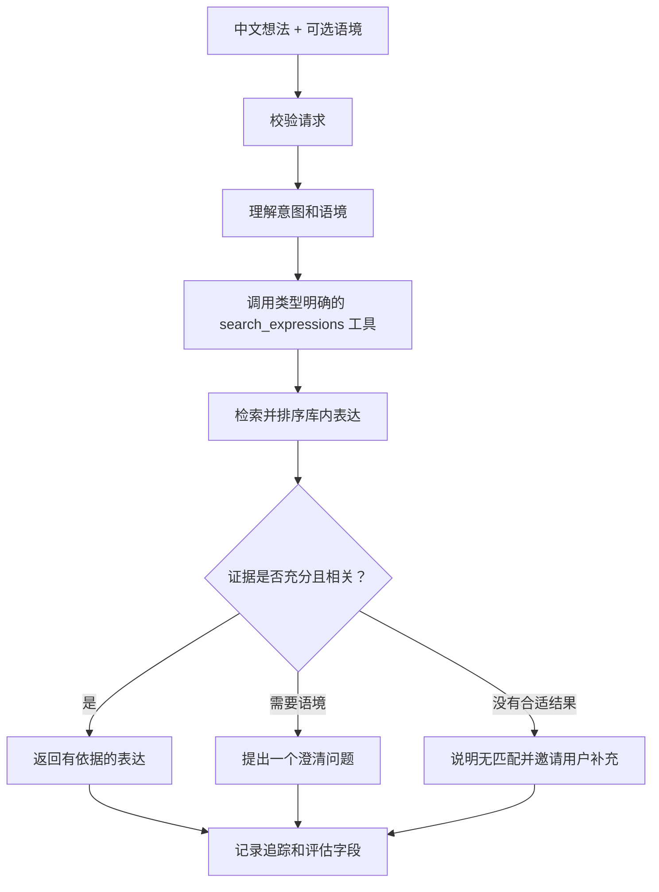

# AI English Speaking Phrase Agent — Design

> **Status:** Updated draft. English version first; Chinese version follows. This design prioritizes Agent development. A user interface is an optional final stretch goal.

### Current minimal demo slice

The approved first code demo is isolated in `translation_agent_demo/`. It accepts user text and returns an English translation using an LLM, with no retrieval, external tools, or Agent framework. Its purpose is to demonstrate strict task boundaries and modular provider design. It is a prototype slice and does not replace the expression-retrieval MVP defined below.

## 1. Project goal

Build a Python Agent/API that helps learners around IELTS 7 recall natural spoken English expressions. A learner submits an idea in Chinese, the Agent interprets the intended meaning and context, searches a curated expression library through a typed tool, checks whether the results are relevant, and returns grounded English expressions or asks a clarifying question.

The portfolio should make the Agent behavior reviewable: tool inputs and outputs, retrieval evidence, workflow decisions, failure handling, and evaluation results should be visible and reproducible.

## 2. Target user and core scenario

- **User:** an English learner with approximately IELTS 7 proficiency who sometimes cannot recall an appropriate spoken expression quickly.
- **Core request:** “I know what I mean in Chinese, but what is a natural way to say it in English in this situation?”
- **Input:** a Chinese idea and optional situation/topic, such as everyday conversation or IELTS speaking.
- **Output:** the best matching stored English expression, its Chinese meaning and usage context; optionally up to two useful alternatives. When context or evidence is insufficient, the Agent asks a short question or reports that no close match was found.

## 3. MVP boundary

### P0 — required

- Python API for phrase search
- A bounded Agent workflow that interprets the query, calls a typed expression-search tool, checks evidence, and returns a structured result
- A curated, attributable expression dataset with metadata
- A search evaluation set with expected relevant results and no-match cases
- A comparison between a simple retrieval baseline and the Agent workflow
- Defined behavior for ambiguity, low-confidence matches, malformed input, and search-service failures
- Clear setup and architecture documentation

### P1 — if time allows after P0

- Persistent learner records or a `save_expression` tool/API
- Authentication and per-user data isolation
- Agent tracing for model calls, tool calls, retrieved records, latency, and token/cost usage
- Deployment of the API for a reviewer

### P2 — optional after the three-week core is complete

- Minimal browser interface for trying the API
- Full responsive web app or native mobile application
- Speech input, pronunciation scoring, broad tutoring chat, multi-agent orchestration, or spaced repetition

The project does not need a Next.js front end to demonstrate Agent development. Use an API client, command-line demo, or API documentation as the initial interface. Add a user interface only if the P0 work is complete and time remains.

## 4. Agent workflow

```mermaid
flowchart TD
  A[Chinese idea + optional context] --> B[Validate request]
  B --> C[Interpret intent and context]
  C --> D[Call typed search_expressions tool]
  D --> E[Retrieve and rank stored expressions]
  E --> F{Evidence relevant and sufficient?}
  F -->|Yes| G[Return grounded expression(s)]
  F -->|Need context| H[Ask one clarifying question]
  F -->|No useful match| I[Return no-match and invite refinement]
  G --> J[Record trace and evaluation fields]
  H --> J
  I --> J
```

Keep the model's autonomy bounded. The Agent may interpret intent, choose search filters, and decide whether to answer or clarify. It must not invent a database result, change user data without an explicit tool call, or retry indefinitely. A deterministic workflow should enforce schemas, permissions, step limits, and failure behavior.

## 5. Search tool and expression data

### `search_expressions`

The tool accepts a normalized intent, optional situation/topic, and bounded result count. It returns stored expression IDs, English text, Chinese meaning, usage notes, metadata, and relevance scores. It has a narrow read-only responsibility.

### Expression record

- `id`
- `english_text`
- `chinese_meaning`
- `usage_note`
- `example_text` (optional)
- `topic`, `situation`, and `register`
- `difficulty` or learner level
- `source` and reuse/license information
- searchable text and optional embedding
- timestamps and dataset version

Start with a small reviewed dataset; a proposed planning target is 100–300 expressions. The actual size and source depend on the course rules and available materials. Do not import content without checking reuse rights.

### Retrieval approach

1. Validate and normalize the Chinese query and optional context.
2. Retrieve candidates using lexical search and multilingual semantic search where available.
3. Apply relevant metadata filters and rank candidates.
4. Apply a confidence threshold selected by reviewing evaluation results.
5. Return only stored records. If retrieval is weak, clarify or report no match.

Begin with the simplest measurable baseline. Add query rewriting, reranking, or a vector database only if the evaluation set shows a meaningful need.

## 6. Proposed technical shape

| Area | Proposed starting point | Notes |
|---|---|---|
| Language/API | Python + FastAPI | Typed HTTP API and convenient integration with Agent and retrieval libraries |
| Agent | One bounded workflow; framework choice remains open | Use the course-required framework if there is one; otherwise compare a small LangGraph workflow with a simple custom workflow before choosing |
| Data | Start with the simplest database permitted by the course; PostgreSQL/pgvector is a deployment-ready option | Keep the retrieval interface independent of the storage choice |
| Model | Select an available model/provider after checking course access, cost, and language quality | Keep model calls behind a small adapter |
| Demo | OpenAPI/Swagger UI, a small CLI, or a minimal API client | A full front end is optional and last priority |
| Evaluation | A versioned query set plus a repeatable evaluation script or documented procedure | Compare the same queries and dataset across retrieval variants |

These are proposals, not decisions about vendors. Prefer tools required or already supported by the course.

## 7. API outline

- `POST /api/search` — accept a Chinese idea, optional context, and bounded result count; return structured results, a clarification request, or a no-match response.
- Optional later: `POST /api/saved-expressions` and `GET /api/saved-expressions` — persist and retrieve a learner's saved expressions.
- Optional later: authentication endpoints or integration with a managed identity provider.

The search response should distinguish `matched`, `needs_clarification`, and `no_match` outcomes. Do not use a client-supplied user ID as proof of identity.

## 8. Evaluation and acceptance

Build a fixed set of Chinese queries covering paraphrases, ambiguous meaning, context-sensitive expressions, several topic areas, and cases with no suitable stored result. A proposed starting size is 30–50 queries, adjusted to the time and data available.

Measure:

- Recall@k and Precision@k for retrieved expressions
- Whether the Agent preserves the user's intended meaning
- Whether retrieved expressions preserve intent and fit the requested situation and register
- Whether it asks for clarification or abstains on ambiguous/no-match cases
- Tool selection/argument validity, step count, latency, and model/tool failure behavior

Compare the Agent with a simple retrieval baseline on the same dataset. Review weak cases manually and record the prompt, model, dataset, and search version. Do not treat an LLM judge as ground truth.

The three-week core is complete when the API can perform the intended flow, results are grounded in stored records, no-match and failure paths are defined, and the evaluation comparison is reproducible.

## 9. Reliability and safety

- Validate request size, required fields, result limits, and tool arguments.
- Bound Agent steps, retries, latency, and model/tool usage per request.
- Retry only transient failures; do not endlessly retry invalid tool arguments.
- Return a useful error or fallback when the model or search service is unavailable.
- Treat user input and imported learning materials as untrusted data.
- Keep credentials outside source control and avoid logging secrets or unnecessary learner content.
- If persistence is added, enforce ownership on every read/write and define deletion behavior.

## 10. Interview readiness and relationship to `idea.md`

The original idea document describes a broader English coach. This MVP deliberately narrows the product to Chinese-to-English expression retrieval so the Agent, its search tool, and its evaluation can be built and explained well within the course project.

| Interview area from `idea.md` | Evidence this project should produce | Boundary to explain honestly |
|---|---|---|
| Product and architecture (Q1–7) | Target user, request-to-response flow, typed tool boundary, bounded Agent decisions, and reason for using one workflow | Voice input and mid-session activity switching are future work; the API should keep input handling separable from learning logic |
| Feedback and model behavior (Q8–14) | Preserve intended meaning, return only retrieved expressions, ask when ambiguous, and use a structured response | The MVP finds expressions; it does not claim to diagnose grammar mistakes or grade writing |
| RAG and learning materials (Q15–23) | Source/rights notes, expression metadata, lexical vs semantic baseline, retrieval metrics, threshold selection, and evidence grounding | A phrase library uses records rather than long-document chunks; reranking and query rewriting need evidence before adoption |
| Tools and reliability (Q24–32) | Typed `search_expressions` schema, bounded steps/retries, malformed-input handling, no-match fallback, and traces that help replay a failure | Write-tool idempotency matters only if persistence/save tools are added |
| Memory and personalization (Q33–39) | A clear boundary between per-request context and future learner memory; a documented path for save/history and user controls | Long-term profile, cross-session personalization, authentication, and deletion are not P0 unless the course requires them |
| Evaluation (Q40–46) | Fixed labeled queries, baseline comparison, Recall@k/Precision@k, human review, versioned regression cases, and latency/cost records | Report actual measurements and limitations; do not claim quality improvements without evidence |
| Backend, scale, and security (Q47–54) | API validation, identity/data isolation design if persistence is enabled, secret handling, timeouts, bounded work, and graceful degradation | High-concurrency load testing and production operations are outside the three-week core; explain what would be added and why |
| Ownership and trade-offs (Q55–60) | Keep a short decision/failure log and prepare a walkthrough connecting a design choice, the failure it prevents, and measured evidence | Only describe implementation and results that were actually completed by the project owner |

This project is interview-ready when each in-scope claim can be supported by a design artifact, a trace, or an evaluation result, and deferred features are described as deliberate scope decisions rather than completed capabilities.

## 11. Project Owner Judgment Questions

1. Should the first release focus on daily conversation, IELTS speaking, or both?
2. Should each response show one best expression or also include up to two alternatives?
3. Should each query support optional situation/topic context?
4. Is phrase saving/history part of the required product behavior, or a later extension?
5. Which expression-library fields are essential to help the learner choose a phrase?

---

# AI 英语口语表达 Agent — 设计文档

> **状态：**更新后的草案。英文版在前，中文版在后。本设计优先展示 Agent 开发；用户界面是最后的可选扩展。

### 当前最小 Demo 切片

已确认的首个代码 Demo 独立放在 `translation_agent_demo/` 中。它接收用户文本，只使用 LLM 返回英文翻译，不接检索、外部工具或 Agent 框架。这个 Demo 用于展示严格的任务边界和可替换的模型供应商设计。它是一个原型切片，不会替代下文定义的表达检索 MVP。

## 1. 项目目标

构建一个 Python Agent/API，帮助雅思水平约为 7 分的学习者快速想起自然的英语口语表达。学习者用中文描述想法后，Agent 理解意图和语境，通过有明确类型定义的工具搜索整理好的表达库，判断结果是否相关，然后返回有依据的英语表达，或提出澄清问题。

作品集需要让评审者看清 Agent 的行为：工具输入与输出、检索证据、工作流决策、故障处理和评估结果都应可查看、可重现。

## 2. 目标用户与核心场景

- **用户：**英语水平约为雅思 7 分、有时无法快速想起合适口语表达的学习者。
- **核心需求：**“我知道自己想用中文表达什么，但在这个情境下，用英语怎么说才自然？”
- **输入：**中文想法，可选场景/话题，例如日常交流或雅思口语。
- **输出：**最匹配的库内英语表达、中文含义和使用语境；也可以给出最多两个有用的替代说法。语境或证据不足时，Agent 应简短追问，或者说明没有找到足够接近的表达。

## 3. MVP 范围边界

### P0 — 必须完成

- 用于表达搜索的 Python API
- 有明确边界的 Agent 工作流：理解查询、调用类型明确的表达搜索工具、检查证据并返回结构化结果
- 经过整理且来源可追溯、带有元数据的表达数据集
- 包含预期相关结果和无匹配案例的搜索评估集
- 对比简单检索基线和 Agent 工作流
- 为歧义、低置信度匹配、无效输入和搜索服务故障定义处理方式
- 清晰的配置和架构文档

### P1 — P0 完成后有时间再做

- 持久化学习记录，或 `save_expression` 工具/API
- 身份验证和逐用户数据隔离
- Agent 调用追踪：模型调用、工具调用、检索记录、延迟及令牌/成本使用情况
- 部署 API，方便评审者体验

### P2 — 三周核心目标完成后的可选项

- 用于试用 API 的简易浏览器界面
- 完整的响应式网页应用或原生移动应用
- 语音输入、发音评分、泛化辅导聊天、多智能体编排或间隔重复系统

展示 Agent 开发不要求使用 Next.js 前端。初期可通过 API 客户端、命令行演示或 API 文档来试用。只有完成 P0 且仍有时间时，才添加用户界面。

## 4. Agent 工作流



限制模型的自主范围。Agent 可以理解意图、选择搜索筛选条件，并决定回答还是澄清；不得编造数据库结果、未经明确工具调用就修改用户数据，也不得无限重试。工作流应通过确定性逻辑执行结构校验、权限、步骤上限和故障处理。

## 5. 搜索工具与表达数据

### `search_expressions`

工具接收规范化后的意图、可选场景/话题和有上限的结果数量。它返回库内表达 ID、英文文本、中文含义、用法说明、元数据和相关度分数。该工具只负责只读搜索。

### 表达记录

- `id`
- `english_text`：英文表达
- `chinese_meaning`：中文含义
- `usage_note`：用法说明
- `example_text`：例句，可选
- `topic`、`situation` 和 `register`：话题、场景和语域
- `difficulty` 或学习者水平
- `source` 和重用/许可信息
- 可搜索文本及可选向量嵌入
- 时间戳和数据集版本

从小型人工审核数据集开始；建议先按 100–300 条表达做计划。实际规模和来源取决于课程要求及可用材料。导入内容前要检查重用权利。

### 检索方案

1. 校验并规范化中文查询和可选语境。
2. 在条件允许时，结合词法搜索和多语言语义搜索检索候选项。
3. 应用相关元数据筛选并为候选结果排序。
4. 根据评估结果选择置信度阈值。
5. 只返回库内记录。检索结果较弱时，应澄清或说明无匹配。

先从最简单且可衡量的基线开始。只有评估集显示确有明显需求时，才增加查询改写、重排或向量数据库。

## 6. 建议的技术形态

| 领域 | 初步建议 | 说明 |
|---|---|---|
| 语言/API | Python + FastAPI | 提供类型明确的 HTTP API，便于集成 Agent 和检索库 |
| Agent | 一个边界明确的工作流；框架待定 | 如果课程指定框架，优先使用；否则先比较小型 LangGraph 工作流和简单自定义工作流 |
| 数据 | 先用课程允许的最简单数据库；PostgreSQL/pgvector 可作为可部署方案 | 检索接口不依赖特定存储方案 |
| 模型 | 确认课程访问权限、成本和中文效果后再选模型/API | 将模型调用封装在小型适配层后 |
| 演示方式 | OpenAPI/Swagger UI、小型命令行程序或简易 API 客户端 | 完整前端是可选项，优先级最低 |
| 评估 | 有版本记录的查询集，以及可重复运行的评估脚本或流程 | 使用同一组查询和数据集比较不同检索方案 |

这些都是建议，不代表已经选定供应商。优先使用课程要求或已经提供的工具。

## 7. API 草案

- `POST /api/search`：接收中文想法、可选语境和有上限的结果数量；返回结构化结果、澄清请求或无匹配状态。
- 后续可选：`POST /api/saved-expressions` 和 `GET /api/saved-expressions`，用于持久化并读取学习者保存的表达。
- 后续可选：身份验证接口或托管身份服务集成。

搜索响应应区分 `matched`、`needs_clarification` 和 `no_match` 三种结果。不能把客户端提供的用户 ID 当作身份凭证。

## 8. 评估与验收

建立固定的中文查询集，覆盖不同说法、含义模糊、依赖语境的表达、多个话题，以及表达库中没有合适结果的情况。初步建议为 30–50 条查询，再根据时间和数据调整。

至少衡量：

- 检索表达的 Recall@k 和 Precision@k
- Agent 是否保留用户本来的意思
- 检索表达是否保留原意，并符合用户要求的场景和语域
- 在歧义或无匹配情况下，Agent 是否会澄清或明确拒答
- 工具选择与参数是否合法、步骤数、延迟，以及模型/工具故障时的表现

在相同数据集上对比 Agent 和简单检索基线。人工复核效果较差的案例，并记录提示词、模型、数据集和搜索版本。不要把 LLM 评审分数当成绝对真值。

三周核心目标的完成标准是：API 能完成预期流程；返回内容有库内记录作为依据；无匹配和故障路径有明确处理；评估对比可以重复进行。

## 9. 可靠性与安全

- 校验请求大小、必填字段、结果数量限制和工具参数。
- 限制每次请求的 Agent 步骤、重试次数、延迟和模型/工具使用量。
- 只对暂时性故障重试；无效工具参数不得无限重试。
- 模型或搜索服务不可用时，返回有用的错误说明或降级结果。
- 将用户输入和导入的学习材料视为不可信数据。
- 不把凭证提交到源码管理，并避免记录密钥和不必要的学习者内容。
- 如果添加持久化存储，对每次读写执行所有权校验，并明确数据删除方式。

## 10. 面试准备及与 `idea.md` 的对应关系

原始 idea 文档描述的是更完整的英语教练。本 MVP 有意缩小为“中文想法检索英语表达”，以便在课程项目时间内把 Agent、搜索工具和评估做扎实，并能清楚讲解。

| `idea.md` 中的面试主题 | 本项目应产出的证据 | 需要诚实说明的范围边界 |
|---|---|---|
| 产品与架构（Q1–7） | 目标用户、请求到响应的流程、类型明确的工具边界、受限的 Agent 决策，以及采用单一工作流的原因 | 语音输入和会话中途切换活动属于后续工作；API 应让输入处理与学习逻辑保持可分离 |
| 反馈与模型行为（Q8–14） | 保留原意、只返回检索表达、遇到歧义时追问、使用结构化响应 | MVP 负责查找表达，不宣称能诊断语法错误或给写作评分 |
| RAG 与学习材料（Q15–23） | 来源/许可记录、表达元数据、词法与语义基线对比、检索指标、阈值选择和证据依据 | 表达库使用记录，而不是长文档分块；只有评估证明必要时才加入重排和查询改写 |
| 工具与可靠性（Q24–32） | `search_expressions` 类型定义、有限步骤/重试、错误参数处理、无匹配降级，以及便于重现故障的追踪信息 | 只有添加保存等写入工具后，幂等写入才成为必要事项 |
| 记忆与个性化（Q33–39） | 明确区分单次请求语境与未来学习者记忆；记录保存/历史功能和用户控制的后续方案 | 长期学习者档案、跨会话个性化、身份验证和数据删除不属于 P0，除非课程要求 |
| 评估（Q40–46） | 固定标注查询集、基线对比、Recall@k/Precision@k、人工复核、带版本的回归案例，以及延迟/成本记录 | 只报告实际测量和限制；没有证据就不声称质量提升 |
| 后端、规模与安全（Q47–54） | API 校验；启用持久化时的身份/数据隔离设计；密钥处理、超时、工作量限制和降级行为 | 高并发压力测试和生产运维不属于三周核心；要说明扩展时会增加什么以及原因 |
| 项目归属与权衡（Q55–60） | 简短记录设计决策和失败案例，并准备演示，说明某个设计选择预防了什么问题及其测量证据 | 只描述项目负责人实际完成的实现和结果 |

当项目范围内的每项主张都有设计材料、追踪记录或评估结果支撑，并且后续功能被明确描述为范围选择而非已实现能力时，本项目就具备面试展示基础。

## 11. 项目负责人判断题

1. 第一版优先支持日常交流、雅思口语，还是两者都支持？
2. 每次只显示一个最佳表达，还是再提供最多两个替代说法？
3. 是否允许用户为每次查询补充场景/话题语境？
4. 保存表达/搜索历史是必需行为，还是后续扩展？
5. 哪些表达库字段对用户判断是否使用该表达最重要？
